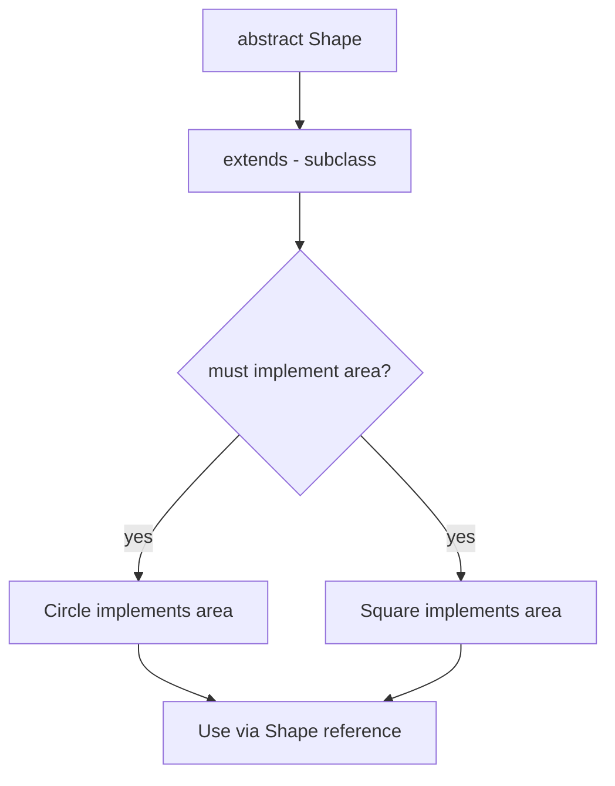

# Abstraction

## 1. Introduction

**Abstraction** hides implementation details and exposes only the essential interface. In Java it's achieved with **abstract classes** (partial abstraction) and **interfaces** (full abstraction). Users know *what* a thing does, not *how*.

---

## 2. Why This Topic Is Important

- Abstraction is **pillar #4** — it tames complexity in large systems.
- Interviewers ask: abstract class vs interface, and when to use each.
- Frameworks expose abstract APIs (e.g., Spring's templates) to developers.
- It's how libraries hide their internals while offering clean methods.

---

## 3. Real-World Analogy

Think of **driving a car**. You use the steering wheel, pedals, and gear lever (abstract interface). You don't need to know how the engine, gearbox, or ECU work (implementation). If the engine is replaced by an electric motor, you still drive the same way. Abstraction hides the "how" so the "what" stays stable.

---

## 4. Theory

### Abstract Class
- Declared with `abstract`.
- **Can** have abstract methods (no body) and concrete methods.
- **Cannot** be instantiated — must be extended.
- Can have constructors, fields, static methods.

```java
abstract class Shape {
    abstract double area();         // no body

    void describe() {               // concrete
        System.out.println("This is a shape.");
    }
}
```

### Rules for Abstract Methods
| Rule | Detail |
|------|--------|
| No body | Ends with `;` |
| Must be overridden | By the first concrete subclass |
| Can't be `private`/`final`/`static` | They must be overridable |

### Abstract Class vs Interface (pre-Java-8 era)
| Aspect | Abstract Class | Interface |
|--------|---------------|-----------|
| Instantiation | ❌ | ❌ |
| Abstract methods | Yes | Yes |
| Concrete methods | Yes | Yes (default/static, Java 8+) |
| Fields | Any | public static final constants |
| Constructors | Yes | No |
| Multiple inheritance | No | Yes |

---

## 5. Syntax

```java
abstract class ClassName {
    abstract returnType methodName(params);
}
```

---

## 6. Flow Explanation



---

## 7. Memory Representation

Abstract classes are compiled like normal classes (except abstract methods). Objects of concrete subclasses carry all parent fields.

---

## 8. Simple Example

```java
abstract class Animal {
    abstract void sound();

    void sleep() {
        System.out.println("Sleeping...");
    }
}

class Dog extends Animal {
    @Override
    void sound() { System.out.println("Woof"); }
}

public class AbstractDemo {
    public static void main(String[] args) {
        Animal a = new Dog();
        a.sound();
        a.sleep();
    }
}
```

---

## 9. Intermediate Example — Template Method Pattern

```java
abstract class Game {
    abstract void initialize();
    abstract void play();
    abstract void finish();

    // template method — fixed skeleton
    final void run() {
        initialize();
        play();
        finish();
    }
}

class Chess extends Game {
    @Override void initialize() { System.out.println("Chess: board set up"); }
    @Override void play()        { System.out.println("Chess: playing..."); }
    @Override void finish()      { System.out.println("Chess: checkmate"); }
}

public class TemplateDemo {
    public static void main(String[] args) {
        Game g = new Chess();
        g.run();
    }
}
```

---

## 10. Advanced Example — Abstract with Fields & State

```java
abstract class Account {
    protected double balance;

    Account(double balance) { this.balance = balance; }

    abstract double interestRate();

    void showBalance() {
        System.out.println("Balance: " + balance);
    }
}

class Savings extends Account {
    Savings(double b) { super(b); }
    @Override double interestRate() { return 4.0; }
}

class FixedDeposit extends Account {
    FixedDeposit(double b) { super(b); }
    @Override double interestRate() { return 7.5; }
}

public class BankAbstract {
    public static void main(String[] args) {
        Account s = new Savings(10000);
        Account fd = new FixedDeposit(10000);
        System.out.println("Savings interest: " + s.interestRate() + "%");
        System.out.println("FD interest     : " + fd.interestRate() + "%");
    }
}
```

---

## 11. Output

For the **Intermediate Example**:

```
Chess: board set up
Chess: playing...
Chess: checkmate
```

For the **Advanced Example**:

```
Savings interest: 4.0%
FD interest     : 7.5%
```

---

## 12. Common Mistakes

| Mistake | Correction |
|---------|------------|
| Instantiating an abstract class | `new Shape()` → compile error |
| Forgetting to implement abstract methods | Subclass stays abstract or fails to compile |
| Making abstract methods `private`/`final`/`static` | Not allowed |
| Using abstraction for everything | Sometimes a concrete class is enough |
| Confusing abstraction with interface-only | Abstract classes provide partial abstraction + shared code |

---

## 13. Best Practices

- Use abstract classes when classes **share code and state**.
- Use interfaces when you only define **contracts**.
- Design the abstract method set as the "what"; let subclasses define the "how".
- Keep the abstract class focused — don't overload it with concerns.
- Name abstract classes generically (`Shape`, `Account`, `Vehicle`).

---

## 14. Interview Questions

**Q1. What is abstraction?**
*Hiding implementation details and exposing only essential behavior, via abstract classes and interfaces.*

**Q2. Can you instantiate an abstract class?**
*No — you can instantiate a concrete subclass.*

**Q3. Abstract class vs interface (modern Java)?**
*Both can have default/concrete methods (Java 8+). A class can extend only one abstract class but implement many interfaces.*

**Q4. Can an abstract class have a constructor?**
*Yes — it runs when a subclass is instantiated via `super()`.*

**Q5. What happens if a subclass doesn't implement all abstract methods?**
*It must itself be declared abstract.*

---

## 15. Practice Exercises

1. Make `Shape` abstract with `area()`; implement in Circle and Square.
2. Build a `Game` template method and run it.
3. Create an abstract `Vehicle` with shared state and abstract `maxSpeed()`.
4. Explain (in a comment) when you'd choose abstraction vs concrete classes.

---

## 16. Coding Challenges

1. **Easy:** Abstract `Animal` with abstract `sound()` and concrete `eat()`.
2. **Medium:** An abstract `Payment` with a `process()` template.
3. **Hard:** A `Report` generator: abstract `generate()`, concrete `HtmlReport` and `CsvReport`.

---

## 17. Summary

- Abstraction hides *how*; exposes *what*.
- Abstract classes: partial abstraction, shared code/state, no instantiation.
- Abstract methods must be implemented by concrete subclasses.
- Use abstract classes for shared code; interfaces for contracts.
- Template methods show abstraction's real power.

➡️ Continue to: [Interfaces](Interfaces.md)