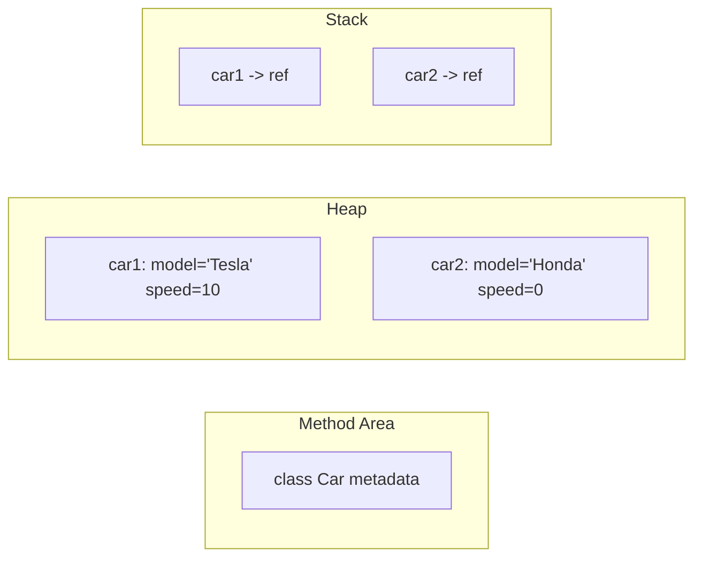

# Classes and Objects

## 1. Introduction

A **class** is a blueprint that defines *state* (fields) and *behavior* (methods). An **object** is a concrete instance created from that blueprint. This is the fundamental idea of object-oriented programming.

---

## 2. Why This Topic Is Important

- Java is *object-oriented* — everything you build is classes and objects.
- Interviewers ask about classes vs objects and object lifecycle.
- Modeling the real world in objects makes software easier to understand.
- Every framework (Spring, Hibernate) revolves around classes/objects.

---

## 3. Real-World Analogy

A class is like the **blueprint for a house** — it defines rooms (fields) and activities (methods) but you can't live in it. An **object** is an actual house built from that blueprint. You can build many houses (objects) from one blueprint (class), each with its own furniture (field values).

---

## 4. Theory

### Class Anatomy
```java
class Car {
    // Fields (state)
    String model;
    int speed;

    // Methods (behavior)
    void accelerate() {
        speed += 10;
    }
}
```

### Creating Objects
```java
Car myCar = new Car();     // new allocates + constructor runs
myCar.model = "Tesla";
myCar.accelerate();
```

### Class vs Object
| Aspect | Class | Object |
|--------|-------|--------|
| Definition | Blueprint / template | Concrete instance |
| Memory | Method area (once) | Heap (per instance) |
| Fields | Declared only | Actual values |
| Created by | `class` keyword | `new` keyword |

### The `new` Process
1. Allocate heap memory for the object.
2. Run constructors to initialize fields.
3. Return a reference (address) stored in a variable.

---

## 5. Syntax

```java
class ClassName {
    // fields
    // constructors
    // methods
}

ClassName obj = new ClassName();
obj.method();
```

---

## 6. Flow Explanation

```mermaid
flowchart TD
    A[class Car declared] --> B[Loaded into method area]
    C[new Car] --> D[Allocate heap memory]
    D --> E[Run constructor]
    E --> F[Reference returned]
    F --> G[obj.methods() called]
```

---

## 7. Memory Representation



Fields live in each object (heap); class metadata lives once in the method area.

---

## 8. Simple Example

```java
class Student {
    String name;
    int roll;

    void show() {
        System.out.println("Name: " + name + ", Roll: " + roll);
    }
}

public class ClassObjectDemo {
    public static void main(String[] args) {
        Student s1 = new Student();
        s1.name = "Ajay";
        s1.roll = 101;
        s1.show();
    }
}
```

---

## 9. Intermediate Example — Multiple Objects

```java
class BankAccount {
    String owner;
    double balance;

    void deposit(double amt) {
        balance += amt;
    }

    void display() {
        System.out.println(owner + " -> $" + balance);
    }
}

public class BankDemo {
    public static void main(String[] args) {
        BankAccount a1 = new BankAccount();
        a1.owner = "Ajay";
        a1.deposit(500);

        BankAccount a2 = new BankAccount();
        a2.owner = "Priya";
        a2.deposit(1200);

        a1.display();
        a2.display();
    }
}
```

---

## 10. Advanced Example — Object References

```java
class Box {
    int size;
    Box(int s) { size = s; }
}

public class ReferenceDemo {
    public static void main(String[] args) {
        Box b1 = new Box(10);
        Box b2 = b1;          // both reference the SAME object

        b2.size = 99;
        System.out.println("b1.size = " + b1.size);   // 99!
        System.out.println("b1 == b2 : " + (b1 == b2));

        Box b3 = new Box(10); // a different object
        System.out.println("b1 == b3 : " + (b1 == b3));
    }
}
```

---

## 11. Output

For the **Intermediate Example**:

```
Ajay -> $500.0
Priya -> $1200.0
```

For the **Advanced Example**:

```
b1.size = 99
b1 == b2 : true
b1 == b3 : false
```

---

## 12. Common Mistakes

| Mistake | Correction |
|---------|------------|
| Calling methods on `null` | NPE — ensure the object was created |
| Forgetting `new` | `Student s = Student();` won't compile |
| Using `==` for object comparison | Compares references; use `.equals()` for content |
| Making fields public | Use `private` + getters (Encapsulation topic) |
| Thinking each object shares fields | Fields are per-object; static fields are shared |

---

## 13. Best Practices

- Name classes as **nouns** (PascalCase): `BankAccount`, `Car`.
- Keep fields `private`; expose via methods (encapsulation).
- Initialize fields in constructors, not after creation.
- One class = one responsibility.
- Prefer many small classes over a few god-classes.

---

## 14. Interview Questions

**Q1. What is the difference between a class and an object?**
*A class is a blueprint/template; an object is a concrete instance of that class in memory.*

**Q2. What happens when you use `new`?**
*Memory is allocated on the heap, constructors initialize fields, and a reference is returned.*

**Q3. Where do objects live in memory?**
*In the heap. The reference (address) lives on the stack or in other objects.*

**Q4. How many objects can one class create?**
*Unlimited (memory permitting).*

**Q5. What happens if two variables reference the same object?**
*They point to the same object — changes via either are visible through both.*

---

## 15. Practice Exercises

1. Create a `Person` class with name and age; build two objects.
2. Create a `Rectangle` class with width and height; compute area via a method.
3. Create 3 `Student` objects and print all.
4. Demonstrate two references to one object modifying each other.

---

## 16. Coding Challenges

1. **Easy:** A `Circle` class with a `radius` field and `area()` method.
2. **Medium:** A `Library` with book objects stored in an array.
3. **Hard:** A `Bank` system with multiple accounts and a transfer method between accounts.

---

## 17. Summary

- Class = blueprint; object = instance.
- Objects live in the heap; `new` builds them.
- Fields = state, methods = behavior.
- References can share the same object.
- Keep fields private; name classes as nouns.

➡️ Continue to: [Constructors](Constructors.md)