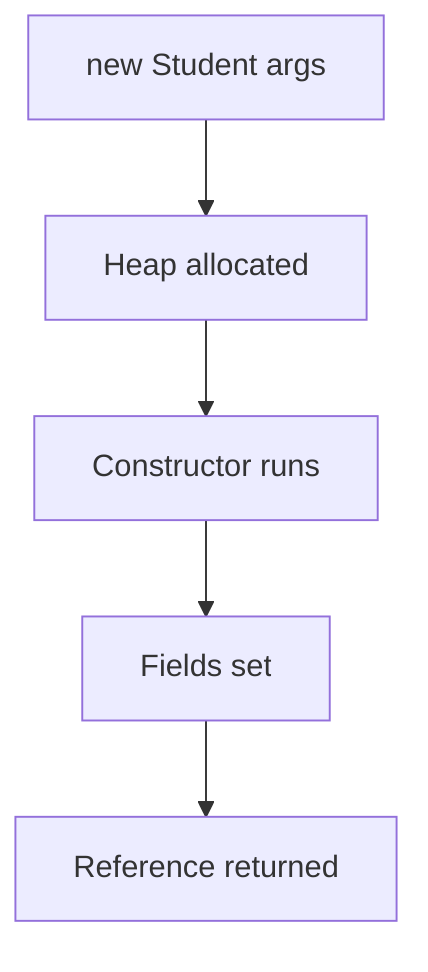

# Constructors

## 1. Introduction

A **constructor** is a special method that runs when an object is created with `new`. It **initializes** the object's fields so the object starts life in a valid state.

---

## 2. Why This Topic Is Important

- Constructors ensure objects are **born valid** — a core OOP principle.
- Interviewers test default/parameterized constructors and `this()`.
- Real classes define multiple overloaded constructors.
- Understanding constructors clarifies how Spring creates beans (Module 25).

---

## 3. Real-World Analogy

A constructor is like the **new-car setup process** at a dealership. When you buy a car, it must be delivered with a make, model, color, and working engine — you can't get a car with *nothing*. The setup (constructor) makes sure every car is fully specified before you drive away.

---

## 4. Theory

### Rules
| Rule | Detail |
|------|--------|
| Name | Same as the class name |
| No return type | Not even `void` |
| Runs automatically | On `new ClassName(...)` |
| Can be overloaded | Different parameter lists |
| Default constructor | Provided free if you define none |

### Types
```java
class Student {
    String name;
    int roll;

    // Default constructor (explicit)
    Student() {
        name = "Unknown";
        roll = 0;
    }

    // Parameterized constructor
    Student(String n, int r) {
        name = n;
        roll = r;
    }
}
```

### The Compiler's Default Constructor
If you define **no** constructor, Java adds a no-arg one that sets fields to defaults (0, null, false).

### this() Chaining
```java
Student() {
    this("Unknown", 0);     // calls the 2-arg constructor
}
```

### Copy Constructor (pattern)
```java
Student(Student other) {
    this.name = other.name;
    this.roll = other.roll;
}
```

---

## 5. Syntax

```java
ClassName(params) {
    // initialization
}
```

---

## 6. Flow Explanation



---

## 7. Memory Representation

Constructor code executes on the stack; the object it initializes lives in the heap. `this` points to the newly allocated heap object.

---

## 8. Simple Example

```java
class Student {
    String name;
    int roll;

    Student(String n, int r) {
        name = n;
        roll = r;
    }

    void show() {
        System.out.println(name + " (" + roll + ")");
    }
}

public class ConstructorDemo {
    public static void main(String[] args) {
        Student s = new Student("Ajay", 101);
        s.show();
    }
}
```

---

## 9. Intermediate Example — Overloaded Constructors

```java
class Employee {
    String name;
    double salary;

    Employee() {
        this("Unnamed", 0.0);
    }

    Employee(String name) {
        this(name, 30000.0);
    }

    Employee(String name, double salary) {
        this.name = name;
        this.salary = salary;
    }

    void show() {
        System.out.println(name + " earns " + salary);
    }
}

public class EmployeeDemo {
    public static void main(String[] args) {
        new Employee().show();
        new Employee("Ajay").show();
        new Employee("Priya", 60000).show();
    }
}
```

---

## 10. Advanced Example — Copy Constructor & Validation

```java
class Account {
    String id;
    double balance;

    Account(String id, double balance) {
        if (balance < 0) {
            throw new IllegalArgumentException("Balance cannot be negative");
        }
        this.id = id;
        this.balance = balance;
    }

    Account(Account other) {          // copy constructor
        this(other.id, other.balance);
    }

    void show() {
        System.out.println(id + ": $" + balance);
    }
}

public class CopyDemo {
    public static void main(String[] args) {
        Account a = new Account("ACC1", 5000);
        Account copy = new Account(a);   // independent copy
        copy.balance = 100;
        a.show();
        copy.show();
    }
}
```

---

## 11. Output

For the **Intermediate Example**:

```
Unnamed earns 0.0
Ajay earns 30000.0
Priya earns 60000.0
```

For the **Advanced Example**:

```
ACC1: $5000.0
ACC1: $100.0
```

---

## 12. Common Mistakes

| Mistake | Correction |
|---------|------------|
| Adding a return type to a constructor | `void Student()` is a method, not a constructor |
| Forgetting a default constructor when overloading | You must add it explicitly if you define others |
| `this()` not as the first statement | Must be the **first** line of a constructor |
| Mutating shared objects in a copy | Copy constructor may need deep copies (Module 15) |
| Overriding constructors | Constructors are NOT inherited/overridable |

---

## 13. Best Practices

- **Validate inputs** in constructors (fail fast).
- Use `this(...)` chaining to avoid duplication.
- Prefer parameterized constructors over post-creation setters.
- Provide a copy constructor when objects are mutable.
- Keep constructors small — delegate heavy work to methods.

---

## 14. Interview Questions

**Q1. What is a constructor?**
*A special method that initializes an object's fields when it's created with `new`.*

**Q2. What happens if you don't define any constructor?**
*The compiler provides a default no-arg constructor that sets fields to their defaults.*

**Q3. Can constructors be overloaded?**
*Yes — like methods, based on parameter lists.*

**Q4. What is `this()`?**
*A call to another constructor of the same class; must be the first statement.*

**Q5. Can a constructor call a method?**
*Yes, but be careful — calling overridable methods in a constructor can cause issues (called before subclass init).*

---

## 15. Practice Exercises

1. Create a `Book` class with a default and parameterized constructor.
2. Chain three overloaded constructors with `this()`.
3. Add a copy constructor to a `Point` class.
4. Validate a negative radius in a `Circle` constructor.

---

## 16. Coding Challenges

1. **Easy:** `Rectangle` with width/height constructors and an area method.
2. **Medium:** `BankAccount` with constructors ensuring non-negative balance.
3. **Hard:** `Employee` with copy constructor; create a team list and verify copies are independent.

---

## 17. Summary

- Constructors initialize objects; same name as class, no return type.
- Default, parameterized, overloaded, copy — all supported.
- `this()` chains constructors; must be first statement.
- Validate in constructors (fail fast).
- Constructors aren't inherited or overridden.

➡️ Continue to: [Encapsulation](Encapsulation.md)