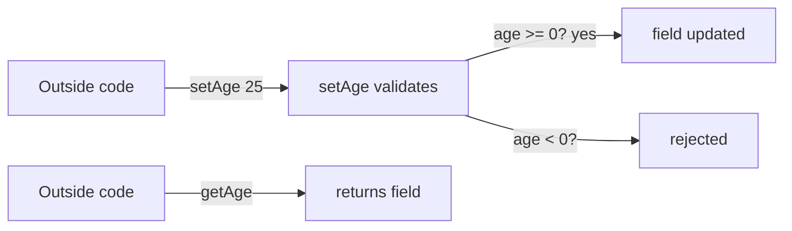

# Encapsulation

## 1. Introduction

**Encapsulation** bundles data (fields) and the methods that operate on it into one unit, and **hides** the data from outside access using `private`. Outside code interacts through controlled **getters** and **setters** — protecting the object's integrity.

---

## 2. Why This Topic Is Important

- Encapsulation is **pillar #1** of OOP and a guaranteed interview topic.
- It prevents invalid data (e.g., negative age, overspending balance).
- It lets you change internals without breaking callers.
- Real frameworks (Spring, JPA) rely on private fields + accessors.

---

## 3. Real-World Analogy

Think of a **bank vault**. The money (fields) is `private` — nobody touches it directly. To interact, you use the teller window (getters/setters): deposit, withdraw, check balance. The teller validates every transaction (rules), so you can't accidentally overdraw or steal from the vault.

---

## 4. Theory

### Without Encapsulation (bad)
```java
class Account {
    double balance;     // public — anyone can set it to -999999
}
```

### With Encapsulation (good)
```java
class Account {
    private double balance;

    public double getBalance() { return balance; }

    public void deposit(double amt) {
        if (amt > 0) balance += amt;      // rule enforced
    }

    public void withdraw(double amt) {
        if (amt > 0 && amt <= balance) balance -= amt;
    }
}
```

### Benefits
| Benefit | Meaning |
|---------|---------|
| Data hiding | `private` fields invisible outside |
| Validation | Setters/methods enforce rules |
| Flexibility | Change internals freely |
| Maintainability | Controlled API surface |

### Access Modifiers Preview
| Modifier | Same class | Same package | Subclass | Anywhere |
|----------|-----------|--------------|----------|----------|
| `private` | ✅ | ❌ | ❌ | ❌ |
| default | ✅ | ✅ | ❌ | ❌ |
| `protected` | ✅ | ✅ | ✅ | ❌ |
| `public` | ✅ | ✅ | ✅ | ✅ |

---

## 5. Syntax

```java
class Person {
    private String name;      // hidden
    private int age;

    public String getName() { return name; }
    public void setName(String name) { this.name = name; }

    public int getAge() { return age; }
    public void setAge(int age) {
        if (age >= 0) this.age = age;    // validation
    }
}
```

---

## 6. Flow Explanation



---

## 7. Memory Representation

Encapsulation doesn't change memory layout — fields still live in the object (heap). It changes **access**, not storage.

---

## 8. Simple Example

```java
class Student {
    private String name;
    private int marks;

    public String getName() { return name; }
    public void setName(String n) { name = n; }

    public int getMarks() { return marks; }
    public void setMarks(int m) {
        if (m >= 0 && m <= 100) marks = m;
    }
}

public class EncapsulationDemo {
    public static void main(String[] args) {
        Student s = new Student();
        s.setName("Ajay");
        s.setMarks(85);
        System.out.println(s.getName() + ": " + s.getMarks());
    }
}
```

---

## 9. Intermediate Example — Rules Enforced

```java
class BankAccount {
    private double balance;

    public double getBalance() { return balance; }

    public void deposit(double amount) {
        if (amount <= 0) {
            System.out.println("Deposit must be positive.");
            return;
        }
        balance += amount;
    }

    public void withdraw(double amount) {
        if (amount > balance) {
            System.out.println("Insufficient funds.");
            return;
        }
        balance -= amount;
    }
}

public class BankRules {
    public static void main(String[] args) {
        BankAccount a = new BankAccount();
        a.deposit(1000);
        a.withdraw(2000);      // rejected
        a.withdraw(300);       // ok
        System.out.println("Balance: " + a.getBalance());
    }
}
```

---

## 10. Advanced Example — Read-only Field & Business Logic

```java
class Product {
    private final String id;          // set once, never changed
    private double price;

    public Product(String id, double price) {
        this.id = id;
        this.price = price;
    }

    public String getId() { return id; }         // no setter = read-only

    public double getPrice() { return price; }
    public void applyDiscount(double percent) {
        if (percent < 0 || percent > 100) {
            System.out.println("Invalid discount.");
            return;
        }
        price -= price * percent / 100;
    }
}

public class ReadOnly {
    public static void main(String[] args) {
        Product p = new Product("P100", 1000);
        p.applyDiscount(10);
        System.out.println(p.getId() + " -> " + p.getPrice());
    }
}
```

---

## 11. Output

For the **Intermediate Example**:

```
Insufficient funds.
Balance: 700.0
```

For the **Advanced Example**:

```
P100 -> 900.0
```

---

## 12. Common Mistakes

| Mistake | Correction |
|---------|------------|
| Making all fields public | Violates encapsulation — use private + accessors |
| Getters/setters with no rules | Validation lives in setters/methods |
| Returning mutable field references | Return copies or collections defensively |
| Naming mismatch in getters | `getName()` for `name`; `isActive()` for booleans |
| Only getters, no logic methods | Prefer behavior methods (`withdraw`) over raw setters |

---

## 13. Best Practices

- Mark fields **`private`** by default.
- Use getters for reads, **behavior methods** for changes.
- Validate in setters/methods (fail fast).
- Use `final` for immutable fields (no setter).
- Follow naming: `getX`, `setX`, `isX` (booleans).

---

## 14. Interview Questions

**Q1. What is encapsulation?**
*Bundling data and methods in a class while hiding the data with `private` and exposing controlled access.*

**Q2. What is the benefit?**
*Data protection, validation, and freedom to change internals without breaking callers.*

**Q3. How do you achieve encapsulation?**
*`private` fields + `public` getters/setters and behavior methods.*

**Q4. Can you make a field read-only?**
*Yes — `private final` with a getter and no setter.*

**Q5. Is encapsulation the same as data hiding?**
*Data hiding is the main mechanism; encapsulation is the broader principle (bundling + hiding).*

---

## 15. Practice Exercises

1. Encapsulate a `Person` with validated age (0–120).
2. Add rules to a `BankAccount` (no negative deposits).
3. Make a `Car` field read-only (chassis number).
4. Refactor a public-field class to full encapsulation.

---

## 16. Coding Challenges

1. **Easy:** `Rectangle` with private width/height and validated setters.
2. **Medium:** `BankAccount` with deposit/withdraw rules and a transaction log array.
3. **Hard:** `Inventory` system where stock can't go negative and items have read-only IDs.

---

## 17. Summary

- Encapsulation = **bundle + hide** data.
- `private` fields + public accessors = the standard pattern.
- Validation lives in setters/behavior methods.
- `final` fields give read-only protection.
- It's the #1 pillar of OOP.

➡️ Continue to: [Inheritance](Inheritance.md)