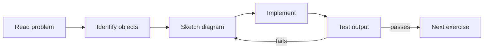

# Exercises — Object-Oriented Programming

## 1. Introduction

Practice makes perfect. Work through these exercises from easy to hard. **Write code first; check the hints only when stuck.** There are no provided solutions — the goal is to build the code yourself.

---

## 2. Why This Topic Is Important

- OOP is tested in **every** Java interview.
- Writing real classes trains design thinking.
- Repetition builds muscle memory for syntax.
- These exercises prepare you for modules 10–38.

---

## 3. Real-World Analogy

Practice is like **learning to ride a bike**. You can't become a cyclist by reading a manual — you must get on the bike, wobble, fall, and try again. Each exercise is a ride that makes the next one easier.

---

## 4. Theory — Approach

1. Read the requirements fully.
2. Identify the objects (nouns) and behaviors (verbs).
3. Draw a quick class diagram on paper.
4. Implement one class at a time.
5. Test each with a small `main`.

---

## 5. Syntax Reminder

```java
class ClassName {                  // blueprint
    private int field;             // encapsulated
    ClassName(int field) { ... }   // constructor
    void method() { ... }          // behavior
}

ClassName obj = new ClassName(5);  // object
obj.method();
```

---

## 6. Flow of a Practice Session



---

## 7. Memory Representation

None needed here — focus on **writing**, not memory.

---

## 8. Simple Exercises

**Ex 1 — Person**
Create a `Person` class with `name` and `age` (private). Provide a constructor, getters/setters, and a `display()` method. Create two persons in `main`.

**Ex 2 — Rectangle**
Create a `Rectangle` with private `width`/`height`, a constructor, and `area()` / `perimeter()` methods.

**Ex 3 — Book**
Create a `Book` with title, author, and price. Add a default and a parameterized constructor. Print a book's details.

---

## 9. Intermediate Exercises

**Ex 4 — Bank Account with Inheritance**
Parent `BankAccount` (accountNo, balance, deposit/withdraw). Children `SavingsAccount` (interestRate) and `CurrentAccount` (overdraftLimit). Override `withdraw` to enforce rules.

**Ex 5 — Shapes Polymorphism**
Interface `Shape` with `double area()`. Implement `Circle` and `Square`. Store both in a `Shape[]` and print areas polymorphically.

**Ex 6 — Employee Hierarchy**
Abstract `Employee` (name, salary, abstract `totalPay()`). Subclasses `Manager` (bonus) and `Intern` (stipend). Write a payroll loop that prints every employee's pay.

**Ex 7 — Library**
`Book` (title, author, available flag) and `Library` (array of books). Methods: `addBook`, `searchByTitle`, `borrow`, `returnBook`.

---

## 10. Advanced Exercises

**Ex 8 — Composition**
Design a `Computer` composed of `CPU`, `RAM`, and `Storage`. Inject these via constructor. Add a method `specs()` that prints each component.

**Ex 9 — SOLID Discount System**
Interface `Discount` with `apply(double)`. Implement `TenPercent`, `FiftyPercent`, and `Festive`. A `Checkout` applies any `Discount` without modification. Add a new discount without touching `Checkout`.

**Ex 10 — Zoo Simulation**
Abstract `Animal` with `sound()`; `Mammal` subclass adds `warmBlooded()`. Create `Dog`, `Cat`, `Elephant`. A `Zoo` has an `Animal[]`; `makeAllSpeak()` uses polymorphism.

**Ex 11 — Banking System (Full)**
Design with: `Account` (abstract), `SavingsAccount`, `CurrentAccount`, `Customer`, `Bank`. Handle transfers, balance checks, and validation — applying SOLID.

---

## 11. Expected Output Samples

**Ex 6 (Employee Hierarchy):**
```
Manager pay: 70000.0
Intern pay: 15000.0
Employee pay: 50000.0
```

**Ex 10 (Zoo):**
```
Woof!
Meow!
Trumpet!
All are warm-blooded.
```

---

## 12. Common Mistakes

| Mistake | Fix |
|---------|-----|
| Not testing with `main` | Every class deserves a demo runner |
| Making everything public | Encapsulate with private fields |
| Using inheritance where composition fits | Rethink the relationship |
| Overriding without `@Override` | Add the annotation |
| Writing all code in `main` | Distribute into classes |

---

## 13. Best Practices

- Compile often: `javac *.java`, run: `java ClassName`.
- Keep `main` thin — just orchestration.
- Read your own output to verify behavior.
- Refactor until each class has one job.
- Commit a new exercise group after you finish it.

---

## 14. Interview Practice Questions

**Q1.** What is the difference between an abstract class and an interface?
**Q2.** How does dynamic dispatch work with a parent reference?
**Q3.** When would you use composition over inheritance? Give an example.
**Q4.** Name the SOLID principles and explain one.
**Q5.** Why are fields private in most Java classes?

---

## 15. Self-Check

- [ ] I can model a real-world thing as a class.
- [ ] I can protect data with encapsulation.
- [ ] I can override a method and explain dynamic dispatch.
- [ ] I can choose between abstract class and interface.
- [ ] I can apply composition and dependency injection.
- [ ] I can explain all five SOLID principles.

---

## 16. Next Steps After Completion

- Move to [Module 10 — Exception Handling](../10-Exception-Handling/README.md).
- Re-read any topic file where you got stuck.
- Try a coding challenge from [Module 23 — DSA in Java](../23-DSA-in-Java/README.md) later.

---

## 17. Summary

- Write, don't just read — code every exercise.
- Start simple, then add inheritance, polymorphism, and SOLID.
- Test every class with a `main` method.
- When stuck, re-read the related topic file.
- OOP mastery unlocks every advanced Java module.

➡️ Module complete! Continue to [10 — Exception Handling](../10-Exception-Handling/README.md).