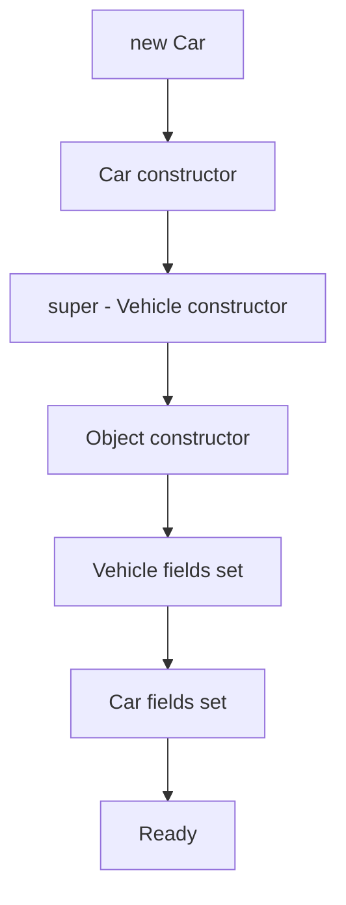

# Inheritance

## 1. Introduction

**Inheritance** lets a class (**subclass/child**) acquire the fields and methods of another class (**superclass/parent**) using the `extends` keyword. It models **IS-A** relationships ("a Dog is an Animal") and enables code reuse.

---

## 2. Why This Topic Is Important

- Inheritance is **pillar #2** — essential for polymorphism (next topic).
- It eliminates duplication by hoisting shared code into a parent.
- Interviewers test `super`, method overriding, and constructor chains.
- Spring/Hibernate frameworks rely heavily on class hierarchies.

---

## 3. Real-World Analogy

Think of **vehicles**: Car, Bike, and Truck all *are* vehicles. A Vehicle class holds common features (engine, wheels, speed). Each type adds its own specifics (Car has AC, Bike has two wheels). Inheritance lets you define the common stuff once and specialize the rest.

---

## 4. Theory

### Syntax
```java
class Vehicle {
    String brand;
    void start() { System.out.println("Engine started"); }
}

class Car extends Vehicle {
    void openSunroof() { System.out.println("Sunroof open"); }
}
```

### What the Subclass Inherits
| Member | Inherited? |
|--------|-----------|
| `public` methods/fields | ✅ |
| `protected` members | ✅ (and subclasses anywhere) |
| default members | ✅ (same package only) |
| `private` members | ❌ (use protected getters) |
| Constructors | ❌ (not inherited, but chain via `super`) |

### `super` Keyword
| Use | Meaning |
|-----|---------|
| `super.method()` | Call parent's method |
| `super.field` | Access parent's field |
| `super(args)` | Call parent's constructor (first line) |

### Constructor Chain
Every subclass constructor implicitly calls `super()` first (parent's no-arg), unless you call `super(args)` explicitly.

### The `final` Keyword on Classes
`final class` cannot be subclassed (e.g., `String`, `Math`).

### Single Inheritance
Java classes support **single inheritance** (one parent). Multiple interfaces solve the rest (Interfaces topic).

---

## 5. Syntax

```java
class Child extends Parent {
    // can override methods, add fields
}
```

---

## 6. Flow Explanation



---

## 7. Memory Representation

An object of a subclass contains **all parent fields** in a single heap block. The `super` reference is the same object viewed as its parent type.

---

## 8. Simple Example

```java
class Animal {
    void eat() { System.out.println("Eating..."); }
}

class Dog extends Animal {
    void bark() { System.out.println("Barking..."); }
}

public class InheritDemo {
    public static void main(String[] args) {
        Dog d = new Dog();
        d.eat();    // inherited from Animal
        d.bark();   // own method
    }
}
```

---

## 9. Intermediate Example — super Constructor & Method

```java
class Employee {
    String name;
    double salary;

    Employee(String name, double salary) {
        this.name = name;
        this.salary = salary;
    }

    void show() {
        System.out.println(name + ": " + salary);
    }
}

class Manager extends Employee {
    double bonus;

    Manager(String name, double salary, double bonus) {
        super(name, salary);       // parent constructor
        this.bonus = bonus;
    }

    @Override
    void show() {
        super.show();              // parent logic
        System.out.println("Bonus: " + bonus);
    }
}

public class SuperDemo {
    public static void main(String[] args) {
        Manager m = new Manager("Ajay", 80000, 20000);
        m.show();
    }
}
```

---

## 10. Advanced Example — IS-A Chains & final

```java
class Animal {
    String name;
    Animal(String name) { this.name = name; }
    void speak() { System.out.println(name + " makes a sound"); }
}

class Mammal extends Animal {
    Mammal(String name) { super(name); }
    void warmBlooded() { System.out.println(name + " is warm-blooded"); }
}

class Cat extends Mammal {
    Cat(String name) { super(name); }
    @Override
    void speak() { System.out.println(name + " meows"); }
}

public class ChainDemo {
    public static void main(String[] args) {
        Cat c = new Cat("Kitty");
        c.warmBlooded();   // from Mammal
        c.speak();         // overridden in Cat

        Animal a = c;      // IS-A: a Cat IS an Animal
        a.speak();         // dynamic dispatch -> meows
    }
}
```

---

## 11. Output

For the **Intermediate Example**:

```
Ajay: 80000.0
Bonus: 20000.0
```

For the **Advanced Example**:

```
Kitty is warm-blooded
Kitty meows
Kitty meows
```

---

## 12. Common Mistakes

| Mistake | Correction |
|---------|------------|
| Accessing `private` parent fields directly | Use protected getters or `super` accessors |
| Forgetting `super()` when parent has no default ctor | Compile error — call `super(args)` explicitly |
| Using inheritance for non-IS-A relations | Composition (HAS-A) is often better |
| Overriding without `@Override` | Annotation catches mistakes |
| Deep inheritance chains | Prefer composition; 2–3 levels max |

---

## 13. Best Practices

- Use inheritance only for **true IS-A** relationships.
- Favor **composition** (has-a) over inheritance when unsure.
- Always annotate overrides with `@Override`.
- Keep hierarchies shallow (≤ 3 levels).
- Make parent classes clear about what's overridable (`final` methods where not).

---

## 14. Interview Questions

**Q1. What is inheritance?**
*A class (subclass) inheriting fields and methods from a parent class via `extends`, modeling IS-A relationships.*

**Q2. What is the difference between `super` and `this`?**
*`this` refers to the current object; `super` refers to the parent class part of it.*

**Q3. Are constructors inherited?**
*No — but subclass constructors chain to parent constructors via `super(...)`.*

**Q4. Can a class extend multiple classes?**
*No — Java supports single class inheritance. Use interfaces for multiple types.*

**Q5. Why is `String` final?**
*To prevent subclassing, preserving immutability and security.*

---

## 15. Practice Exercises

1. Create `Vehicle` → `Car` hierarchy and call inherited methods.
2. Use `super(...)` in a subclass constructor.
3. Call `super.method()` inside an override.
4. Demonstrate that a Cat IS-A Animal by assigning to an Animal reference.

---

## 16. Coding Challenges

1. **Easy:** `Shape` parent with `area()`; `Circle` and `Square` children.
2. **Medium:** `BankAccount` parent; `SavingsAccount` and `CurrentAccount` children with extra behavior.
3. **Hard:** Build an employee hierarchy (Employee → Developer/Manager) computing total pay polymorphically.

---

## 17. Summary

- Inheritance = **IS-A** + code reuse via `extends`.
- Subclass inherits public/protected members; not private or constructors.
- `super` calls parent constructors/methods.
- Single class inheritance only.
- Prefer composition over deep inheritance.

➡️ Continue to: [Polymorphism](Polymorphism.md)