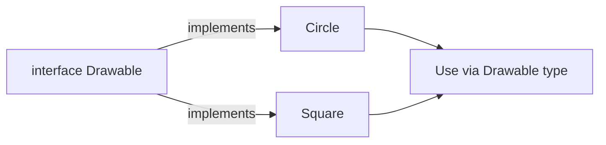

# Interfaces

## 1. Introduction

An **interface** is a fully abstract contract — it declares *what* methods a class must provide, without saying *how*. Classes `implement` interfaces, and one class can implement **many** interfaces (Java's answer to multiple inheritance).

---

## 2. Why This Topic Is Important

- Interfaces drive **loose coupling** and are the backbone of frameworks.
- Spring, JDBC (`Driver`), collections (`List`), and Java 8 lambdas all rely on interfaces.
- Interviewers ask about default/static/private interface methods and `Comparator`.
- Designing good interfaces = designing good software.

---

## 3. Real-World Analogy

An interface is like a **power outlet standard**. Any appliance with the right plug (implements the interface) works in any socket — a toaster, a kettle, a charger. The outlet defines only the *interface* (plug shape); it doesn't care what's behind it. Swap the toaster for a kettle; the socket still works.

---

## 4. Theory

### Interface Members (modern Java)
| Member | Default Modifier | Notes |
|--------|------------------|-------|
| Fields | `public static final` | Constants only |
| Abstract methods | `public abstract` | Implied, can omit keywords |
| Default methods | `default` | Concrete, Java 8+ |
| Static methods | `static` | Java 8+ |
| Private methods | `private` | Java 9+, helpers for defaults |

### Implementing
```java
interface Drawable {
    void draw();
}

class Circle implements Drawable {
    public void draw() { System.out.println("Drawing circle"); }
}
```

### Multiple Interfaces
```java
class FlyingCar implements Driveable, Flyable {
    // must implement methods of BOTH
}
```

### Interface as Type
```java
List<String> list = new ArrayList<>();    // program to the interface
Drawable d = new Circle();
```

---

## 5. Syntax

```java
interface Name {
    returnType method(params);       // abstract
    default returnType m() { ... }   // default
    static void util() { ... }       // static
}
```

---

## 6. Flow Explanation



---

## 7. Memory Representation

An object of an implementing class stores its vtable with pointers to all implemented methods, including those from interfaces.

---

## 8. Simple Example

```java
interface Drawable {
    void draw();
}

class Circle implements Drawable {
    @Override
    public void draw() { System.out.println("Drawing a circle"); }
}

class Square implements Drawable {
    @Override
    public void draw() { System.out.println("Drawing a square"); }
}

public class InterfaceDemo {
    public static void main(String[] args) {
        Drawable d = new Circle();
        d.draw();
        d = new Square();
        d.draw();
    }
}
```

---

## 9. Intermediate Example — Multiple Interfaces

```java
interface Driveable {
    void drive();
}

interface Flyable {
    void fly();
}

class FlyingCar implements Driveable, Flyable {
    @Override
    public void drive() { System.out.println("Driving on road"); }
    @Override
    public void fly()   { System.out.println("Flying in sky"); }
}

public class MultiInterface {
    public static void main(String[] args) {
        FlyingCar fc = new FlyingCar();
        fc.drive();
        fc.fly();

        Driveable d = fc;    // typed as driveable
        d.drive();
    }
}
```

---

## 10. Advanced Example — Default & Static Methods

```java
interface Vehicle {
    void start();

    default void honk() {                    // default method
        System.out.println("Beep beep!");
    }

    static int wheelsFor(String type) {      // static method
        return type.equalsIgnoreCase("bike") ? 2 : 4;
    }
}

class Car implements Vehicle {
    @Override
    public void start() { System.out.println("Car started"); }
}

public class DefaultMethods {
    public static void main(String[] args) {
        Car c = new Car();
        c.start();
        c.honk();                            // inherited default

        System.out.println("Bike wheels: " + Vehicle.wheelsFor("bike"));
        System.out.println("Car wheels : " + Vehicle.wheelsFor("car"));
    }
}
```

---

## 11. Output

For the **Intermediate Example**:

```
Driving on road
Flying in sky
Driving on road
```

For the **Advanced Example**:

```
Car started
Beep beep!
Bike wheels: 2
Car wheels : 4
```

---

## 12. Common Mistakes

| Mistake | Correction |
|---------|------------|
| Forgetting `public` on implement methods | Interface methods are public; implementation must be public |
| Instantiating an interface | `new Drawable()` → compile error |
| Making interface fields non-final | Interface fields are implicitly `public static final` |
| Diamond problem confusion | Two default methods with same name → must override in the class |
| Putting logic-heavy methods in interfaces | Keep them minimal contracts |

---

## 13. Best Practices

- Program to interfaces: `List<String>`, not `ArrayList<String>`.
- Keep interfaces **small and focused** (interface segregation).
- Use default methods for backward-compatible additions.
- Use static methods for utility methods tied to the type.
- Name interfaces with adjectives/capabilities: `Drawable`, `Comparable`, `Runnable`.

---

## 14. Interview Questions

**Q1. What is an interface?**
*A fully abstract contract listing methods a class must implement; enables multiple-inheritance-of-type.*

**Q2. Abstract class vs interface?**
*A class can extend one abstract class but implement many interfaces. Interfaces (Java 8+) can have default/static methods but no constructors/state.*

**Q3. What are default methods?**
*Concrete methods with `default` keyword (Java 8+) that implementing classes inherit unless overridden.*

**Q4. Can an interface have a constructor?**
*No.*

**Q5. What is the diamond problem?**
*If two interfaces provide the same default method, the implementing class must override it to resolve the conflict.*

---

## 15. Practice Exercises

1. Create a `Comparable`-style interface and implement it in a class.
2. Implement two interfaces in one class.
3. Add a default method and call it from an implementing class.
4. Create a static method in an interface and call it.

---

## 16. Coding Challenges

1. **Easy:** `Shape` interface with `area()`; implement Circle & Square.
2. **Medium:** `Payment` + `Refundable` interfaces; implement UPI and Card classes.
3. **Hard:** Build a media player where `Playable` interface drives Video/Audio implementations.

---

## 17. Summary

- Interfaces = abstract contracts with `implements`.
- Fields are `public static final`; methods are `public abstract` by default.
- Default, static, and private methods allowed (Java 8/9+).
- Multiple interfaces = multiple inheritance of type.
- Program to interfaces for loose coupling.

➡️ Continue to: [OOPS Design](OOPS-Design.md)