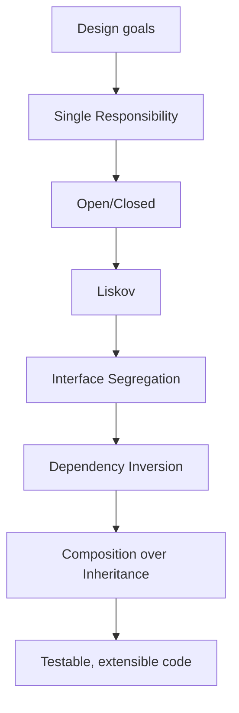

# OOP Design — SOLID & Composition

## 1. Introduction

Knowing syntax isn't enough — you must **design** with OOP. This topic covers the **SOLID principles** and **composition over inheritance**, the guidelines that separate maintainable systems from tangled ones.

---

## 2. Why This Topic Is Important

- Interviewers at 1+ year level probe SOLID and design decisions.
- Clean designs are easier to test, extend, and maintain.
- Spring frameworks reward well-designed components.
- Real-world codebases live or die by design quality.

---

## 3. Real-World Analogy

Think of **building blocks (LEGO)**. Each block (class) has one clear job. You combine blocks (composition) to build anything. You don't force one giant block to do everything (single responsibility), and you can swap a broken block for a new one without rebuilding the whole castle (open/closed).

---

## 4. Theory

### The SOLID Principles

| Letter | Principle | Idea |
|--------|-----------|------|
| S | **Single Responsibility** | One class = one reason to change |
| O | **Open/Closed** | Open for extension, closed for modification |
| L | **Liskov Substitution** | Subtypes must be replaceable by their parent |
| I | **Interface Segregation** | Many small interfaces over one fat one |
| D | **Dependency Inversion** | Depend on abstractions, not concretions |

### Composition over Inheritance (COI)
Prefer **HAS-A** over **IS-A** when:
- The relationship is not a true "is-a."
- You need behavior reuse without coupling hierarchies.
- You want to swap behavior at runtime.

```java
class Engine { void start() { System.out.println("Engine started"); } }

class ElectricEngine extends Engine {
    @Override void start() { System.out.println("Motor whirring"); }
}

class Car {
    private Engine engine;          // HAS-A, injectable
    Car(Engine e) { this.engine = e; }
    void drive() { engine.start(); }
}
```

### Dependency Inversion in Practice
```java
interface Engine { void start(); }

class Car {
    private final Engine engine;
    Car(Engine engine) { this.engine = engine; }   // injected, not created
    void drive() { engine.start(); }
}
```
The `Car` depends on the `Engine` abstraction, not on a concrete class. Swap implementations freely.

---

## 5. Syntax (patterns)

```java
class Service {
    private final Repository repo;       // injected dependency
    Service(Repository repo) { this.repo = repo; }
}
```

---

## 6. Flow Explanation



---

## 7. Memory Representation

Design principles don't affect memory; they affect **structure and coupling** between classes.

---

## 8. Simple Example — Single Responsibility

```java
class Invoice {
    double amount;
    Invoice(double amount) { this.amount = amount; }
}

class InvoicePrinter {                    // one job: print
    void print(Invoice i) {
        System.out.println("Amount: " + i.amount);
    }
}

class InvoiceStore {                      // one job: save
    void save(Invoice i) {
        System.out.println("Saving invoice " + i.amount + " to DB");
    }
}
```

---

## 9. Intermediate Example — Open/Closed + Polymorphism

```java
interface Discount {
    double apply(double price);
}

class TenPercent implements Discount {
    @Override public double apply(double p) { return p * 0.90; }
}

class BuyOneGetOne implements Discount {
    @Override public double apply(double p) { return p * 0.50; }
}

class Checkout {
    double total(double price, Discount d) {   // extend by adding new classes
        return d.apply(price);
    }
}

public class OpenClosedDemo {
    public static void main(String[] args) {
        Checkout co = new Checkout();
        System.out.println("10% off: " + co.total(1000, new TenPercent()));
        System.out.println("BOGO  : " + co.total(1000, new BuyOneGetOne()));
    }
}
```

---

## 10. Advanced Example — Composition + Dependency Injection

```java
interface Engine {
    void start();
}

class PetrolEngine implements Engine {
    @Override public void start() { System.out.println("Petrol engine roars"); }
}

class ElectricEngine implements Engine {
    @Override public void start() { System.out.println("Electric motor hums"); }
}

class Car {
    private final Engine engine;
    Car(Engine engine) { this.engine = engine; }   // composed + injected
    void drive() {
        engine.start();
        System.out.println("Car moves");
    }
}

public class CompositionDemo {
    public static void main(String[] args) {
        Car petrol = new Car(new PetrolEngine());
        petrol.drive();

        Car electric = new Car(new ElectricEngine());
        electric.drive();
    }
}
```

---

## 11. Output

For the **Intermediate Example**:

```
10% off: 900.0
BOGO  : 500.0
```

For the **Advanced Example**:

```
Petrol engine roars
Car moves
Electric motor hums
Car moves
```

---

## 12. Common Mistakes

| Mistake | Correction |
|---------|------------|
| God classes | Split by responsibility |
| Deep inheritance for code reuse | Prefer composition |
| Modifying a class to add behavior | Extend it (open/closed) instead |
| Fat interfaces | Split into role interfaces |
| Creating dependencies inside a class | Inject them (Dependency Inversion) |
| Forcing IS-A relationships | Use HAS-A where appropriate |

---

## 13. Best Practices

- One class, one clear responsibility.
- Code to abstractions (`Engine`), never concretions (`PetrolEngine`).
- Inject dependencies through constructors.
- Favor composition over inheritance.
- Keep interfaces small and role-specific.

---

## 14. Interview Questions

**Q1. What is SOLID?**
*Five design principles: Single Responsibility, Open/Closed, Liskov Substitution, Interface Segregation, Dependency Inversion.*

**Q2. Composition over inheritance — why?**
*Inheritance couples tightly; composition lets you swap behavior at runtime and avoids brittle hierarchies.*

**Q3. What is dependency inversion?**
*High-level modules depend on abstractions, not low-level details.*

**Q4. What is the Liskov Substitution Principle?**
*A subclass must be usable wherever its parent is used, without breaking behavior.*

**Q5. Give an example of violating Open/Closed?**
*Adding a new shape type by `if/else` in the area calculator — you'd modify it. Better: a `Shape` interface + polymorphic dispatch.*

---

## 15. Practice Exercises

1. Refactor a god class into single-responsibility classes.
2. Add a new discount type without modifying `Checkout`.
3. Inject an engine into a car instead of creating it inside.
4. Split a fat interface into two role interfaces.

---

## 16. Coding Challenges

1. **Easy:** Design a `Notification` system (Email/SMS) using an interface.
2. **Medium:** A `Report` generator with injectable formatters (HTML/CSV).
3. **Hard:** A library system with `Member`, `Book`, `LendingService` following SOLID; write a composition-based design doc.

---

## 17. Summary

- SOLID: 5 principles for maintainable OOP design.
- Composition > inheritance for flexibility.
- Inject dependencies; depend on abstractions.
- Small, role-specific interfaces.
- Design for extension, not modification.

➡️ Continue to: [Exercises](Exercises.md)