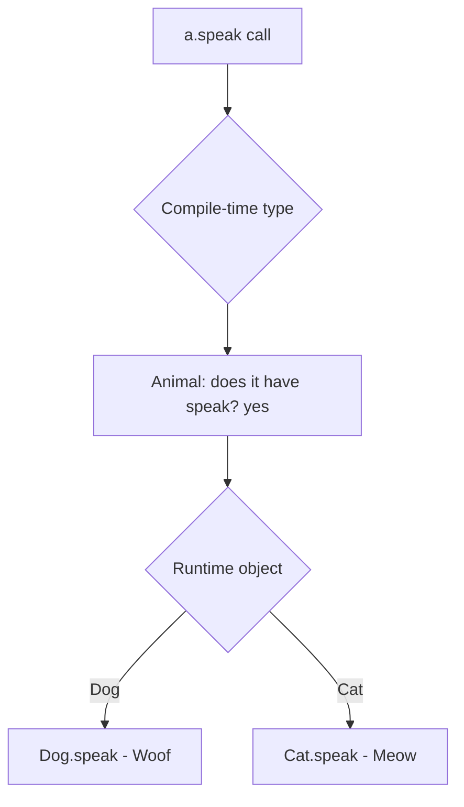

# Polymorphism

## 1. Introduction

**Polymorphism** means "many forms." In Java it means the *same method name* can behave differently depending on context: **compile-time polymorphism** (method overloading) and **runtime polymorphism** (method overriding + dynamic dispatch).

---

## 2. Why This Topic Is Important

- Polymorphism is **pillar #3** — the key to writing flexible, extensible code.
- It enables treating objects as their parent type while running child behavior.
- Interviewers probe dynamic dispatch, `@Override`, and covariant returns.
- Frameworks rely on polymorphism for dependency injection and callbacks.

---

## 3. Real-World Analogy

Think of a **"play" button** on different devices. Pressing play on a phone plays a song; on a TV it plays a video; on a radio it broadcasts. The button (method `play()`) is the same, but each device (object) responds its own way. That's runtime polymorphism.

---

## 4. Theory

### Two Kinds of Polymorphism

| Kind | Mechanism | When Resolved | Example |
|------|-----------|---------------|---------|
| **Compile-time** | Method overloading | At compile time | `add(int,int)`, `add(double,double)` |
| **Runtime** | Method overriding + dynamic dispatch | At runtime | `Animal.speak()` vs `Dog.speak()` |

### Overriding Rules
| Rule | Detail |
|------|--------|
| Same signature | Same name + parameter types |
| Same/subtype return | Covariant returns allowed |
| Cannot reduce visibility | `public` override can't be `private` |
| `@Override` annotation | Recommended (catches mistakes) |
| `static`/`final` methods can't be overridden | They can only be hidden |

### Dynamic Dispatch
When a parent reference points to a child object, the **child's** overridden method runs:

```java
Animal a = new Dog();
a.speak();     // runs Dog.speak() at runtime
```

---

## 5. Syntax

```java
class Animal { void speak() { System.out.println("sound"); } }
class Dog extends Animal {
    @Override
    void speak() { System.out.println("Woof"); }
}

Animal a = new Dog();
a.speak();
```

---

## 6. Flow Explanation



---

## 7. Memory Representation

Each object carries a reference to its class's method table (vtable). Dynamic dispatch looks up the method by the **runtime class**, not the compile-time type.

---

## 8. Simple Example

```java
class Animal {
    void speak() { System.out.println("Some sound"); }
}

class Dog extends Animal {
    @Override
    void speak() { System.out.println("Woof!"); }
}

class Cat extends Animal {
    @Override
    void speak() { System.out.println("Meow!"); }
}

public class PolyDemo {
    public static void main(String[] args) {
        Animal a = new Dog();
        a.speak();

        a = new Cat();
        a.speak();
    }
}
```

---

## 9. Intermediate Example — Polymorphic Arrays

```java
class Shape {
    double area() { return 0; }
}

class Circle extends Shape {
    double r;
    Circle(double r) { this.r = r; }
    @Override double area() { return Math.PI * r * r; }
}

class Square extends Shape {
    double side;
    Square(double s) { side = s; }
    @Override double area() { return side * side; }
}

public class ShapeDemo {
    public static void main(String[] args) {
        Shape[] shapes = {new Circle(2), new Square(3), new Circle(1)};
        for (Shape s : shapes) {
            System.out.println("Area: " + s.area());   // runs each child's area
        }
    }
}
```

---

## 10. Advanced Example — Polymorphism in a Method

```java
class Employee {
    double salary = 50000;
    double totalPay() { return salary; }
}

class Manager extends Employee {
    double bonus = 20000;
    @Override double totalPay() { return salary + bonus; }
}

class Intern extends Employee {
    @Override double totalPay() { return salary * 0.3; }
}

public class Payroll {
    static void printPay(Employee e) {          // works for ANY employee
        System.out.println(e.getClass().getSimpleName()
                + " pay: " + e.totalPay());
    }

    public static void main(String[] args) {
        printPay(new Employee());
        printPay(new Manager());
        printPay(new Intern());
    }
}
```

---

## 11. Output

For the **Intermediate Example**:

```
Area: 12.566370614359172
Area: 9.0
Area: 3.141592653589793
```

For the **Advanced Example**:

```
Employee pay: 50000.0
Manager pay: 70000.0
Intern pay: 15000.0
```

---

## 12. Common Mistakes

| Mistake | Correction |
|---------|------------|
| Not annotating `@Override` | Annotation prevents signature typos |
| Reducing visibility in an override | Compile error — cannot weaken access |
| Confusing overloading with overriding | Overload = same name diff params; override = same signature in subclass |
| Calling `super` method when you wanted child behavior | `super` bypasses dynamic dispatch deliberately |
| Expecting static methods to be polymorphic | Static methods are hidden, not overridden |

---

## 13. Best Practices

- Program to the **interface/parent type**: `Shape s = new Circle(...)`.
- Use `@Override` on every override.
- Keep overriding methods' contracts consistent (Liskov).
- Use `instanceof` sparingly — polymorphism usually removes the need.
- Design parent methods as templates for child specialization.

---

## 14. Interview Questions

**Q1. What is polymorphism?**
*"Many forms" — the same method name behaving differently via overloading (compile-time) or overriding (runtime).*

**Q2. What is dynamic method dispatch?**
*Choosing which overridden method to call at runtime based on the object's actual type.*

**Q3. Overloading vs overriding?**
*Overloading = same name, different params, compile-time. Overriding = same signature in subclass, runtime.*

**Q4. Can you override a static method?**
*No — you can hide it, but there's no dynamic dispatch for static methods.*

**Q5. What is a covariant return type?**
*A subclass override may return a subtype of the parent's return type.*

---

## 15. Practice Exercises

1. Create Animal → Dog/Cat and call speak() via Animal references.
2. Build a polymorphic Shape array and print areas.
3. Write a payroll method that works for all employee types.
4. Overload `area` and override `area` in the same project — contrast them.

---

## 16. Coding Challenges

1. **Easy:** A `Payment` class hierarchy (Card/UPI) with a polymorphic `pay()`.
2. **Medium:** A `Notification` system (Email/SMS) with a send() dispatch.
3. **Hard:** Build a zoo simulation where a `makeAllSpeak(Animal[] animals)` method uses polymorphism.

---

## 17. Summary

- Polymorphism = overloading (compile-time) + overriding (runtime).
- Dynamic dispatch calls the **actual object's** method.
- Program to parent types for flexibility.
- Use `@Override`; don't reduce visibility.
- Avoid `instanceof` when polymorphism suffices.

➡️ Continue to: [Abstraction](Abstraction.md)