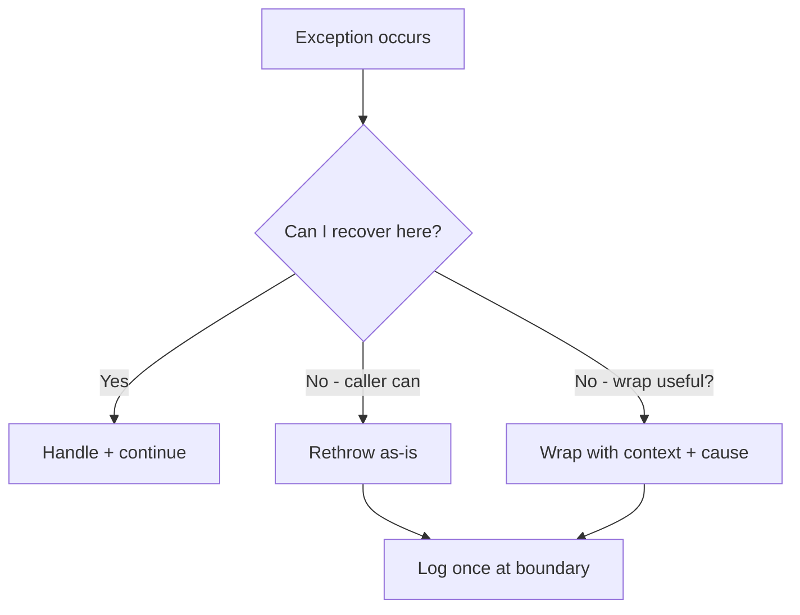

# Best Practices

## 1. Introduction

Knowing syntax isn't enough — you must **handle exceptions like a professional**. This topic collects the rules that separate clean, debuggable error handling from messy, error-hiding code.

---

## 2. Why This Topic Is Important

- Poor error handling hides bugs and leaks resources.
- Interviewers ask behavioral questions: "How do you handle errors in production?"
- Production systems need logs, rollbacks, and graceful degradation.
- These practices apply to every module ahead (JDBC, Spring, etc.).

---

## 3. Real-World Analogy

Think of a **hospital's emergency procedures**. There are clear rules: triage patients by severity (specific catches), never lose the medical history (preserve the cause), record everything (logging), and don't panic-diagnose everything as the same illness (avoid catch-all). Systematic procedures save lives — systematic exception handling saves applications.

---

## 4. Theory — The Rules

| Rule | Why |
|------|-----|
| Catch specific exceptions | Don't swallow everything with `catch (Exception e)` |
| Never swallow silently | Empty catch hides failures |
| Preserve the cause | `new MyException(msg, e)` keeps the chain |
| Fail fast | Throw early with clear messages |
| Log at the right level | INFO normal, WARN suspicious, ERROR failures |
| Don't catch to "continue ignoring" | Handle, rethrow, or log — pick one |
| Use unchecked for programming errors | Checked for recoverable business failures |

---

## 5. Syntax Patterns

```java
// Good: specific + cause preserved
try {
    risky();
} catch (IOException e) {
    throw new OrderException("save failed", e);   // wrap, keep cause
}

// Bad: swallow
try {
    risky();
} catch (Exception e) {
    // do nothing  <- bug hiding
}
```

---

## 6. Flow Decision



---

## 7. Memory Representation

No special impact — but preserving the **cause chain** is what makes stack traces useful in production.

---

## 8. Simple Example — Specific + Log

```java
public class SpecificCatch {
    public static void main(String[] args) {
        String[] nums = {"42", "NaN"};
        for (String s : nums) {
            try {
                int n = Integer.parseInt(s);
                System.out.println("Parsed " + n);
            } catch (NumberFormatException e) {
                System.err.println("Bad number: " + s + " (" + e.getMessage() + ")");
            }
        }
    }
}
```

---

## 9. Intermediate Example — Wrap with Cause

```java
class DataException extends RuntimeException {
    DataException(String msg, Throwable cause) {
        super(msg, cause);
    }
}

public class WrapCause {
    static String loadConfig() {
        try {
            // simulate an underlying failure
            throw new IllegalArgumentException("config key missing");
        } catch (IllegalArgumentException e) {
            throw new DataException("Failed to load application config", e);
        }
    }

    public static void main(String[] args) {
        try {
            loadConfig();
        } catch (DataException e) {
            System.out.println("Error: " + e.getMessage());
            System.out.println("Cause: " + e.getCause().getMessage());
        }
    }
}
```

---

## 10. Advanced Example — Handle vs Rethrow at Boundary

```java
import java.io.IOException;
import java.nio.file.Files;
import java.nio.file.Path;

public class BoundaryHandling {
    // low level: rethrows — no swallowing here
    static String read(String path) throws IOException {
        return Files.readString(Path.of(path));
    }

    public static void main(String[] args) {
        // boundary: one catch, logged once, meaningful message
        try {
            String content = read("config.txt");
            System.out.println("Config: " + content);
        } catch (IOException e) {
            System.err.println("Application could not start: "
                    + e.getMessage());
        }
    }
}
```

---

## 11. Output

For the **Intermediate Example**:

```
Error: Failed to load application config
Cause: config key missing
```

For the **Advanced Example** (missing file):

```
Application could not start: config.txt (The system cannot find the file specified)
```

---

## 12. Common Mistakes

| Mistake | Correction |
|---------|------------|
| `catch (Exception e) {}` | Never empty — log or handle |
| Catching `Throwable`/`Error` | Only handle Errors in rare top-level cases |
| Catching then throwing a new one without cause | Include the original |
| Checking exceptions to "fix" flow | Exceptions are for exceptional cases |
| Logging the same error at every layer | Log once at the boundary |

---

## 13. Best Practices

- Catch **specific** types; only catch what you can handle.
- **Never** leave an empty catch block.
- Preserve the cause when wrapping (`super(msg, cause)`).
- Throw with **clear, actionable messages**.
- Handle at the boundary; rethrow in the middle layers.
- Use a logging framework (java.util.logging, Log4j, SLF4J) — not just `System.out`.

---

## 14. Interview Questions

**Q1. What's your exception-handling strategy?**
*Fail fast with meaningful messages, catch specifically, preserve causes, and log once at the boundary.*

**Q2. When is catching a broad Exception acceptable?**
*Only at top-level boundaries for logging before graceful shutdown.*

**Q3. How do you debug swallowed exceptions?**
*Search for empty catch blocks; enable stack traces; use lint tools.*

**Q4. Checked vs unchecked for your own API?**
*Unchecked for programmer errors; checked only when callers must handle.*

**Q5. What is exception chaining/wrapping?**
*Throwing a new exception that includes the original as the cause.*

---

## 15. Practice Exercises

1. Refactor a `catch (Exception)` block into specific catches.
2. Wrap a failure with its cause and print both.
3. Add structured logging to a small file-processing app.
4. Review a code sample and list every bad-practice you find.

---

## 16. Coding Challenges

1. **Easy:** Add boundary handling to a file reader.
2. **Medium:** A `Service` layer that wraps DAO exceptions with context.
3. **Hard:** Build a small app with a global error handler that logs stack traces and shows friendly messages.

---

## 17. Summary

- Catch specific; never swallow silently.
- Preserve the cause when wrapping.
- Fail fast with clear messages.
- Log once at the boundary.
- Professional error handling = maintainable, debuggable systems.

➡️ Continue to: [Exercises](Exercises.md)