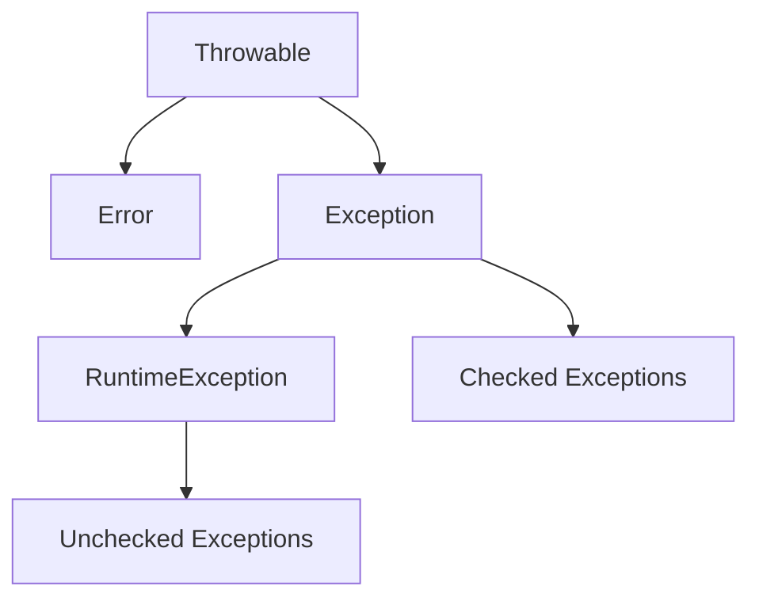
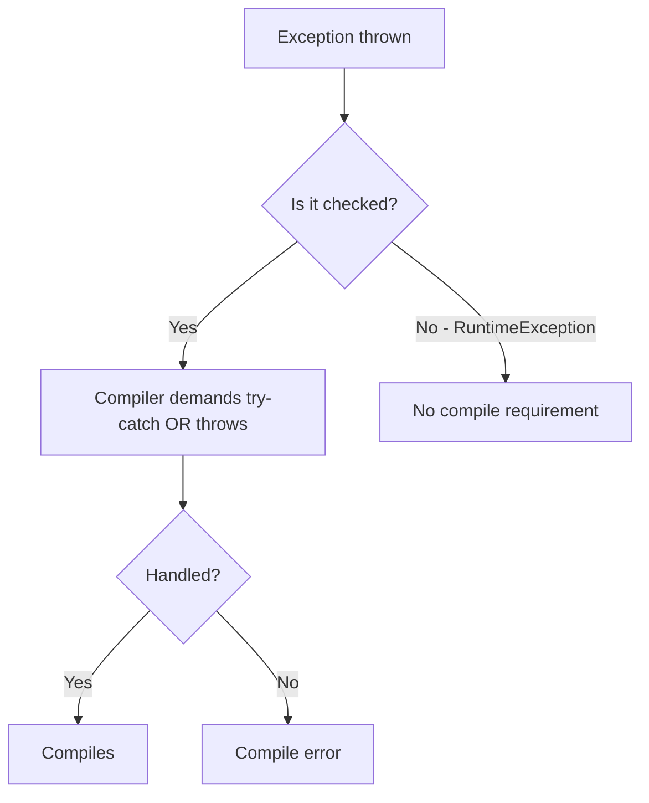

# Checked vs Unchecked Exceptions

## 1. Introduction

Java splits exceptions into two families: **checked** (the compiler forces you to handle them) and **unchecked** (runtime-only, your choice to handle). Understanding the split is critical for writing correct, idiomatic Java.

---

## 2. Why This Topic Is Important

- The compiler **refuses to compile** unhandled checked exceptions.
- Interviewers almost always ask "checked vs unchecked?"
- Framework code (`SQLException`, `IOException`) is checked.
- Knowing which to use shapes your own APIs.

---

## 3. Real-World Analogy

Think of **cooking with a fire alarm**. A checked exception is like a required safety check: the recipe (compiler) *forces* you to make sure the alarm is working before you start (you must handle it). An unchecked exception is like a burnt pan — it can happen at runtime no matter what, and you decide whether to plan for it.

---

## 4. Theory

### The Exception Hierarchy



### Checked Exceptions
- Extend `Exception` (not `RuntimeException`).
- Compiler requires: catch **or** declare with `throws`.
- Examples: `IOException`, `SQLException`, `FileNotFoundException`.

### Unchecked Exceptions
- Extend `RuntimeException`.
- No compile-time requirement to handle.
- Examples: `ArithmeticException`, `NullPointerException`, `ArrayIndexOutOfBoundsException`, `IllegalArgumentException`.

### Errors
- Extend `Error` — JVM-level problems (`OutOfMemoryError`, `StackOverflowError`).
- You generally **don't** handle these.

---

## 5. Syntax

```java
// checked — must handle or declare
try {
    Thread.sleep(1000);          // throws InterruptedException (checked)
} catch (InterruptedException e) {
    System.out.println("Interrupted");
}

// unchecked — no obligation
int x = 10 / 0;                  // ArithmeticException (unchecked)
```

---

## 6. Flow Explanation



---

## 7. Memory Representation

Same object model either way — an exception is a heap object with a stack trace. The difference is purely **compile-time enforcement**.

---

## 8. Simple Example

```java
public class CheckedDemo {
    public static void main(String[] args) throws InterruptedException {
        // Thread.sleep throws checked InterruptedException
        Thread.sleep(1000);
        System.out.println("Slept 1 second");

        // Unchecked example - no requirement to handle
        int result = 10 / 0;      // won't force you to catch at compile time
    }
}
```

---

## 9. Intermediate Example — Must Handle Checked

```java
import java.io.File;
import java.io.FileReader;
import java.io.IOException;

public class FileChecked {
    public static void main(String[] args) {
        // FileReader constructor throws FileNotFoundException (checked)
        try {
            FileReader fr = new FileReader(new File("missing.txt"));
            System.out.println("File opened");
            fr.close();
        } catch (IOException e) {
            System.out.println("Could not open file: " + e.getMessage());
        }
    }
}
```

---

## 10. Advanced Example — Declaring with throws

```java
import java.io.File;
import java.io.FileReader;
import java.io.IOException;

public class ThrowsDecl {
    // declare the checked exception instead of catching
    static String readFirstLine(String path) throws IOException {
        FileReader fr = new FileReader(new File(path));
        int first = fr.read();
        fr.close();
        return String.valueOf((char) first);
    }

    public static void main(String[] args) {
        try {
            System.out.println(readFirstLine("data.txt"));
        } catch (IOException e) {
            System.out.println("Failed: " + e.getMessage());
        }
    }
}
```

---

## 11. Output

For the **Simple Example** (after the 1s delay):

```
Slept 1 second
Exception in thread "main" java.lang.ArithmeticException: / by zero
```

For the **Intermediate Example**:

```
Could not open file: missing.txt (The system cannot find the file specified)
```

---

## 12. Common Mistakes

| Mistake | Correction |
|---------|------------|
| Catching `Exception` broadly to silence checked errors | Handle them meaningfully |
| Declaring `throws Exception` everywhere | Lazy — be specific |
| Handling `Error` types | Leave Errors to the JVM |
| Thinking unchecked exceptions are "optional to fix" | They still crash the program |
| Swallowing checked exceptions silently | Log or rethrow with context |

---

## 13. Best Practices

- Catch checked exceptions where you can recover.
- Declare `throws` for checked exceptions you can't handle.
- Throw **unchecked** exceptions for programmer errors (invalid args, nulls).
- Use checked exceptions for recoverable, external failures.
- Be specific in `throws` declarations.

---

## 14. Interview Questions

**Q1. Difference between checked and unchecked exceptions?**
*Checked are enforced at compile time (catch or declare); unchecked (RuntimeException) are not.*

**Q2. Is `SQLException` checked or unchecked?**
*Checked.*

**Q3. Is `NullPointerException` checked?**
*No — it's a RuntimeException (unchecked).*

**Q4. When would you create a checked exception?**
*When callers must handle the failure (e.g., validation of external data).*

**Q5. Can you catch unchecked exceptions?**
*Yes — you can catch any Throwable, but you're not required to.*

---

## 15. Practice Exercises

1. List 3 checked and 3 unchecked exceptions from the Java API.
2. Write code that must handle `InterruptedException`.
3. Write a method declaring `throws IOException` and calling it.
4. Convert a stack overflow (Error) discussion: why don't we catch it?

---

## 16. Coding Challenges

1. **Easy:** A method that sleeps safely (handles InterruptedException).
2. **Medium:** A file-reader with proper `throws`/catch layering.
3. **Hard:** Design a `saveToFile()` API and decide which exceptions should be checked vs unchecked, with justification.

---

## 17. Summary

- Checked: compiler forces catch-or-declare (`IOException`, `SQLException`).
- Unchecked: `RuntimeException` subclasses, no compile requirement.
- Errors: JVM-level, don't handle.
- Choose checked for recoverable external failures; unchecked for programming errors.

➡️ Continue to: [Finally Block](Finally-Block.md)