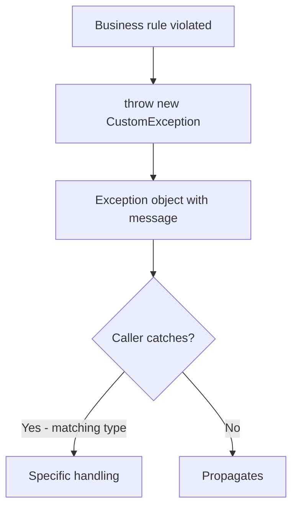

# Custom Exceptions

## 1. Introduction

**Custom exceptions** are your own exception classes, designed for the specific failure modes of your application — e.g., `InsufficientFundsException`, `InvalidEmailException`. They make error handling **semantic** and self-documenting.

---

## 2. Why This Topic Is Important

- Built-in exceptions don't express domain meaning ("insufficient funds" vs "user not found").
- Interviewers ask how to create custom exceptions and checked vs unchecked choice.
- Real APIs (Spring, banking, e-commerce) define custom exceptions.
- They enable targeted catch blocks and clean API design.

---

## 3. Real-World Analogy

Think of **airport announcements**. Instead of a generic "problem" message, the airport announces specific ones: "Flight delayed," "Gate changed," "Baggage claim at carousel 3." Each is a *specific kind* of event. Custom exceptions are like those specific messages — precise, actionable, and easy to react to.

---

## 4. Theory

### Creating a Custom Exception
```java
// unchecked (extends RuntimeException)
class InsufficientFundsException extends RuntimeException {
    public InsufficientFundsException(String message) {
        super(message);
    }
}

// checked (extends Exception)
class InsufficientFundsException extends Exception {
    public InsufficientFundsException(String message) {
        super(message);
    }
}
```

### What You Typically Add
| Member | Purpose |
|--------|---------|
| Constructors matching Exception's | Message, cause |
| Extra fields | Error codes, severity |
| Static factory methods | Convenient creation |

### Checked vs Unchecked for Custom Types
| Choice | When |
|--------|------|
| Extend `Exception` (checked) | Callers MUST handle — recoverable business failures |
| Extend `RuntimeException` (unchecked) | Programmer errors, or failures handled centrally |

---

## 5. Syntax

```java
class MyException extends RuntimeException {
    public MyException(String message) { super(message); }
    public MyException(String message, Throwable cause) { super(message, cause); }
}
```

---

## 6. Flow Explanation



---

## 7. Memory Representation

Custom exceptions are heap objects with the standard stack trace; only the class definition is yours.

---

## 8. Simple Example

```java
class AgeNotValidException extends RuntimeException {
    public AgeNotValidException(String message) {
        super(message);
    }
}

public class CustomExceptionDemo {
    static void register(int age) {
        if (age < 0) {
            throw new AgeNotValidException("Age cannot be negative");
        }
        System.out.println("Age " + age + " accepted");
    }

    public static void main(String[] args) {
        register(25);
        register(-1);      // throws custom exception
    }
}
```

---

## 9. Intermediate Example — Checked Custom Exception

```java
class InsufficientFundsException extends Exception {
    private final double shortfall;

    public InsufficientFundsException(double balance, double requested) {
        super("Requested " + requested + " but balance is " + balance);
        this.shortfall = requested - balance;
    }

    public double getShortfall() {
        return shortfall;
    }
}

class Account {
    private double balance;

    Account(double b) { balance = b; }

    void withdraw(double amt) throws InsufficientFundsException {
        if (amt > balance) {
            throw new InsufficientFundsException(balance, amt);
        }
        balance -= amt;
        System.out.println("Withdrew " + amt);
    }
}

public class AccountDemo {
    public static void main(String[] args) {
        Account a = new Account(500);
        try {
            a.withdraw(1000);
        } catch (InsufficientFundsException e) {
            System.out.println("Blocked: " + e.getMessage()
                    + " (shortfall " + e.getShortfall() + ")");
        }
    }
}
```

---

## 10. Advanced Example — Exception with Cause & Codes

```java
class OrderException extends RuntimeException {
    private final String code;

    public OrderException(String code, String message) {
        super(message);
        this.code = code;
    }

    public OrderException(String code, String message, Throwable cause) {
        super(message, cause);
        this.code = code;
    }

    public String getCode() { return code; }
}

class OrderService {
    static void placeOrder(String item, int qty) {
        if (item == null) {
            throw new OrderException("INVALID_ITEM", "Item is required");
        }
        if (qty <= 0) {
            throw new OrderException("BAD_QTY", "Quantity must be positive");
        }
        System.out.println("Order placed: " + qty + " x " + item);
    }
}

public class OrderDemo {
    public static void main(String[] args) {
        try {
            OrderService.placeOrder(null, 2);
        } catch (OrderException e) {
            System.out.println("[" + e.getCode() + "] " + e.getMessage());
        }

        try {
            OrderService.placeOrder("Laptop", -1);
        } catch (OrderException e) {
            System.out.println("[" + e.getCode() + "] " + e.getMessage());
        }
    }
}
```

---

## 11. Output

For the **Intermediate Example**:

```
Blocked: Requested 1000.0 but balance is 500.0 (shortfall 500.0)
```

For the **Advanced Example**:

```
[INVALID_ITEM] Item is required
[BAD_QTY] Quantity must be positive
```

---

## 12. Common Mistakes

| Mistake | Correction |
|---------|------------|
| Empty custom exception (no constructor) | Provide at least a message constructor |
| Extending the wrong base | Choose Exception vs RuntimeException deliberately |
| Overusing checked exceptions | Only when callers must handle |
| Not passing the cause | Preserve the original exception for debugging |
| Adding no extra value | If you add nothing, maybe use built-in types |

---

## 13. Best Practices

- Name exceptions with a clear suffix: `...Exception`.
- Extend `RuntimeException` by default; `Exception` only when required.
- Include domain fields (codes, shortfalls) that help recovery.
- Always call `super(message)` and optionally `super(message, cause)`.
- Add a message constructor even if you keep it minimal.

---

## 14. Interview Questions

**Q1. How do you create a custom exception?**
*Extend `Exception` or `RuntimeException` and add constructors that call `super`.*

**Q2. When would you use a custom exception?**
*When built-in types can't express your domain's failure meaning.*

**Q3. Checked or unchecked custom exception?**
*Checked (extends Exception) if callers must handle; unchecked (RuntimeException) otherwise.*

**Q4. Can a custom exception carry extra data?**
*Yes — add fields, a constructor to set them, and getters.*

**Q5. Why add a cause to exceptions?**
*So the underlying failure chain is preserved for debugging.*

---

## 15. Practice Exercises

1. Create `InvalidEmailException` (unchecked) and use it.
2. Create a checked `InsufficientFundsException` with a shortfall field.
3. Throw a custom exception with an error code.
4. Chain a custom exception with a cause.

---

## 16. Coding Challenges

1. **Easy:** `DivideByZeroException` thrown from a calculator.
2. **Medium:** A bank with `InsufficientFundsException` and `AccountNotFound`.
3. **Hard:** An order system with coded exceptions and a centralized error handler that prints codes + messages.

---

## 17. Summary

- Custom exceptions = domain-specific failure types.
- Extend `Exception` (checked) or `RuntimeException` (unchecked).
- Provide message/cause constructors; add useful fields.
- Use codes for programmatic handling.
- Catch them specifically for clean, semantic error handling.

➡️ Continue to: [Try-With-Resources](Try-With-Resources.md)