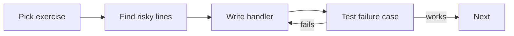

# Exercises — Exception Handling

## 1. Introduction

Time to practice. These exercises take you from catching your first error to building robust, production-style exception handling. **Write code before checking hints.**

---

## 2. Why This Topic Is Important

- Robust code *is* code that handles failure well.
- Interviews test practical error handling.
- Every future module (files, DB, web) throws exceptions.
- Practice builds the "instinct" to protect risky code.

---

## 3. Real-World Analogy

Practice is like **fire drills**. Nobody wants a fire, but when one happens, muscle memory saves lives. Running these exercises builds the same muscle memory for when production code throws.

---

## 4. Theory — Checklist

- Identify what can throw: I/O, parsing, division, indexes, nulls.
- Choose: catch here, rethrow, or declare with `throws`.
- Preserve the cause. Log meaningfully.
- Test both the happy path and the failure path.

---

## 5. Syntax Reminder

```java
try (Resource r = new Resource()) {
    risky();
} catch (SpecificException e) {
    handle();          // specific first
} catch (Exception e) {
    log(e);            // general last
}
```

---

## 6. Practice Flow



---

## 7. Memory Representation

None needed — this module is about *behavior*.

---

## 8. Simple Exercises

**Ex 1 — Safe Division**
Write a calculator that divides two numbers and never crashes on `ArithmeticException`.

**Ex 2 — Safe Parsing**
Parse five user-entered strings as integers; report which failed.

**Ex 3 — Index Guard**
Access an array at a user-supplied index; catch `ArrayIndexOutOfBoundsException`.

---

## 9. Intermediate Exercises

**Ex 4 — File with finally**
Read a file and print "Closed" (via finally) no matter what happens.

**Ex 5 — Checked in Layers**
Write `loadConfig()` (throws IOException), `startApp()` (declares it), and `main` (handles it).

**Ex 6 — Custom Business Exception**
Create `InsufficientFundsException` (checked) with a shortfall; use it in a `withdraw` method.

**Ex 7 — Try-With-Resources**
Read a text file with TWR and count its lines; auto-close is guaranteed.

---

## 10. Advanced Exercises

**Ex 8 — Validation Service**
`register(name, age)` throwing `ValidationException` with codes for each rule violation.

**Ex 9 — Cause Preservation**
Wrap an underlying DB-style failure in a `DataAccessException` and preserve the cause; print both messages.

**Ex 10 — Boundary Logger**
Build a mini app: a `repository` that rethrows, a `service` that wraps with context, and a top-level handler that logs once and exits gracefully.

**Ex 11 — Robust CSV Reader**
Read a CSV file; skip corrupt lines (log them), process valid ones, and count totals. No crash on bad data.

---

## 11. Expected Output Samples

**Ex 11 (CSV with one corrupt line):**
```
Skipped bad line: 100,abc
Total: 3 valid rows
```

**Ex 9 (Cause Preservation):**
```
Error: Failed to load data from DB
Cause: Connection refused: localhost:3306
```

---

## 12. Common Mistakes

| Mistake | Fix |
|---------|-----|
| Catching everything as `Exception` | Be specific |
| Empty catch blocks | Log or rethrow |
| Losing the cause | Wrap with `new X(msg, cause)` |
| Forgetting checked exceptions compile | Use `throws` or try-catch |
| Manual close instead of TWR | Use try-with-resources |

---

## 13. Best Practices

- Test every failure path, not just success.
- Keep user messages friendly; keep technical detail in logs.
- Fail fast with clear messages.
- Use TWR for all resources.
- Refactor until each layer handles only what it should.

---

## 14. Interview Practice Questions

**Q1.** Explain checked vs unchecked with examples.
**Q2.** What is exception chaining and why does it matter?
**Q3.** When should you create a custom exception?
**Q4.** What's the difference between throw and throws?
**Q5.** Why is try-with-resources preferred over finally for cleanup?

---

## 15. Self-Check

- [ ] I can catch specific exceptions in the right order.
- [ ] I know checked vs unchecked and can explain both.
- [ ] I can use throw/throws correctly.
- [ ] I can create and use custom exceptions.
- [ ] I use try-with-resources for files and streams.
- [ ] I never swallow exceptions silently.

---

## 16. Next Steps

- Move to [Module 11 — Packages & Access Modifiers](../11-Packages-and-Access-Modifiers/README.md).
- In Module 13 (File Handling) you'll apply everything here.
- Review [Best-Practices](Best-Practices.md) before the next module.

---

## 17. Summary

- Identify risky code; wrap it deliberately.
- Specific catches, preserved causes, boundary logging.
- Custom exceptions express domain failures.
- Try-with-resources guarantees cleanup.
- Test both happy and failure paths.

➡️ Module complete! Continue to [11 — Packages & Access Modifiers](../11-Packages-and-Access-Modifiers/README.md).