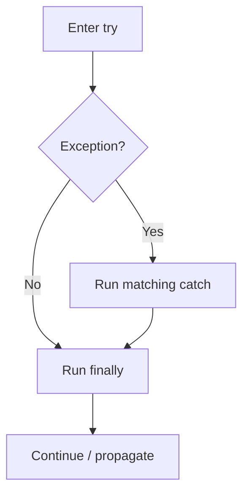

# Finally Block

## 1. Introduction

The **finally** block contains code that **always runs** — whether the try block succeeds, throws, or a catch handles it. It's the standard place for cleanup: closing files, releasing locks, disconnecting from databases.

---

## 2. Why This Topic Is Important

- Resource leaks happen when cleanup is skipped — finally prevents them.
- Interviewers test: "does finally always run?"
- It's used in production for closing streams and connections.
- Modern code prefers try-with-resources, but finally still matters.

---

## 3. Real-World Analogy

Think of **leaving a hotel room**. Whether you check out on time (try succeeds), had a complaint (exception handled), or missed checkout (crash), the staff *always* clean the room afterward (finally). The room is never left dirty for the next guest — cleanup always happens.

---

## 4. Theory

### Structure
```java
try {
    // risky code
} catch (Exception e) {
    // on failure
} finally {
    // ALWAYS runs
}
```

### When does finally run?
| Scenario | Does finally run? |
|----------|------------------|
| try completes normally | ✅ |
| Exception caught | ✅ (after catch) |
| Exception not caught | ✅ (before propagating) |
| `return` in try | ✅ (before returning) |
| `System.exit()` called | ❌ (JVM dies immediately) |
| Infinite loop in try | ❌ |

### Order of Execution
```java
try {
    return 5;         // value computed
} finally {
    // runs BEFORE the return completes
}
```

---

## 5. Syntax

```java
try {
    // statements
} finally {
    // cleanup - always runs
}
```

(Optionally with one or more catch blocks before finally.)

---

## 6. Flow Explanation



---

## 7. Memory Representation

No special memory impact — finally is just control-flow. However, cleanup (finally) matters for **heap/file-handle** resources so they don't leak.

---

## 8. Simple Example

```java
public class FinallyDemo {
    public static void main(String[] args) {
        try {
            System.out.println("Inside try");
            int x = 10 / 0;             // exception!
        } catch (ArithmeticException e) {
            System.out.println("Caught: " + e.getMessage());
        } finally {
            System.out.println("finally always runs");
        }
        System.out.println("After try-catch-finally");
    }
}
```

---

## 9. Intermediate Example — Cleanup Pattern

```java
import java.io.FileReader;
import java.io.IOException;

public class CleanupDemo {
    public static void main(String[] args) {
        FileReader fr = null;
        try {
            fr = new FileReader("data.txt");
            System.out.println("File opened, reading...");
            int ch = fr.read();
            System.out.println("First char: " + (char) ch);
        } catch (IOException e) {
            System.out.println("Error: " + e.getMessage());
        } finally {
            try {
                if (fr != null) fr.close();   // always close
                System.out.println("File closed");
            } catch (IOException e) {
                System.out.println("Close failed");
            }
        }
    }
}
```

---

## 10. Advanced Example — finally with return

```java
public class FinallyReturn {
    static int check() {
        try {
            System.out.println("In try");
            return 42;
        } finally {
            System.out.println("In finally - runs before return");
        }
    }

    public static void main(String[] args) {
        System.out.println("Result: " + check());
    }
}
```

---

## 11. Output

For the **Simple Example**:

```
Inside try
Caught: / by zero
finally always runs
After try-catch-finally
```

For the **Advanced Example**:

```
In try
In finally - runs before return
Result: 42
```

---

## 12. Common Mistakes

| Mistake | Correction |
|---------|------------|
| Doing cleanup outside finally | Leaks if an exception occurs |
| Returning from finally | Overrides the try's return value |
| Declaring variables outside needed scope | `fr` must be declared outside to close it |
| Throwing in finally | Masks the original exception |
| Using finally when try-with-resources fits | Modern code prefers auto-close |

---

## 13. Best Practices

- Put cleanup (close, disconnect, unlock) in `finally`.
- Never `return` inside `finally`.
- Don't throw exceptions from `finally` (hides original errors).
- Prefer **try-with-resources** for `AutoCloseable` types (next topic).
- Keep finally short — no heavy logic.

---

## 14. Interview Questions

**Q1. Does finally always execute?**
*Almost always — not if `System.exit()` runs or the JVM crashes.*

**Q2. What runs first: return value or finally?**
*The return expression is evaluated first; finally executes before the value is returned.*

**Q3. Can you have finally without catch?**
*Yes — try/finally is valid.*

**Q4. What if finally throws an exception?**
*It overrides/obscures the original exception.*

**Q5. finally vs try-with-resources?**
*TWR auto-closes resources more cleanly; finally is manual cleanup for anything else.*

---

## 15. Practice Exercises

1. Write try/catch/finally that always prints a closing message.
2. Add a return statement and confirm finally still runs.
3. Manually close a file in finally (pre-try-with-resources style).
4. Show what happens when `System.exit(0)` is in try.

---

## 16. Coding Challenges

1. **Easy:** A division calculator that always prints "Done" via finally.
2. **Medium:** A file read with manual close in finally that reports errors cleanly.
3. **Hard:** Reimplement the file-close using try-with-resources and compare the code.

---

## 17. Summary

- finally **always runs** for cleanup (close, release, unlock).
- Order: try → catch → finally → continue.
- Don't return/throw in finally.
- Prefer try-with-resources for AutoCloseable.
- finally = guaranteed cleanup.

➡️ Continue to: [Throw and Throws](Throw-and-Throws.md)