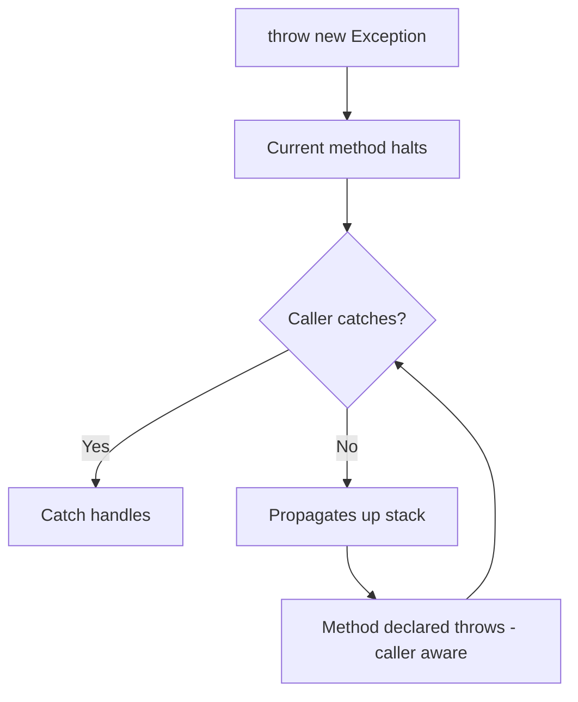

# Throw and Throws

## 1. Introduction

**`throw`** *raises* an exception (creates and throws it). **`throws`** *declares* that a method may let a checked exception escape. One is an action; the other is a signature announcement.

---

## 2. Why This Topic Is Important

- You'll validate input by throwing `IllegalArgumentException`.
- API designers use `throws` to tell callers what can fail.
- Interviewers test the throw/throws distinction constantly.
- Correct use makes error flow explicit and readable.

---

## 3. Real-World Analogy

`throw` is like a **security guard stopping someone at the door** — "You don't have a pass, get out!" (the exception is raised). `throws` is like the **building's warning sign on the entrance** — "Visitors: you may be checked at the door" (the method announces a possible failure). One acts; the other warns.

---

## 4. Theory

### throw
```java
if (age < 0) {
    throw new IllegalArgumentException("Age cannot be negative");
}
```
- Used inside a method/block.
- Followed by an exception **instance** (`new ...`).
- Immediately halts the method; control goes to a catch or propagates.

### throws
```java
void readFile(String path) throws IOException {
    // ... can throw IOException
}
```
- Used in the **method signature**.
- Lists exception **classes** (comma-separated).
- Only needed for **checked** exceptions.

### Rules
| Rule | Detail |
|------|--------|
| `throw` needs an instance | `throw new SomeException("msg")` |
| `throws` needs class names | `throws IOException, SQLException` |
| Unchecked exceptions | No `throws` required |
| `throws` for checked only | Compiler enforces |
| Multiple exceptions | Comma-separated in `throws` |

---

## 5. Syntax

```java
// throw
throw new ExceptionType("message");

// throws
returnType method(params) throws CheckedType1, CheckedType2 {
    ...
}
```

---

## 6. Flow Explanation



---

## 7. Memory Representation

`throw` creates a new exception object on the heap with the current stack trace captured.

---

## 8. Simple Example

```java
public class ThrowDemo {
    static void checkAge(int age) {
        if (age < 18) {
            throw new IllegalArgumentException("Must be 18 or older");
        }
        System.out.println("Welcome!");
    }

    public static void main(String[] args) {
        checkAge(15);      // throws
        System.out.println("This line is skipped when exception thrown");
    }
}
```

---

## 9. Intermediate Example — throws with checked exception

```java
import java.io.IOException;

public class ThrowsDemo {
    // declares the checked exception
    static void sendEmail(String to) throws IOException {
        if (to == null || to.isEmpty()) {
            throw new IOException("Invalid email address");
        }
        System.out.println("Email sent to " + to);
    }

    public static void main(String[] args) {
        try {
            sendEmail("");          // triggers IOException
        } catch (IOException e) {
            System.out.println("Failed: " + e.getMessage());
        }
        System.out.println("Continuing...");
    }
}
```

---

## 10. Advanced Example — Validation Service

```java
class ValidationException extends Exception {
    ValidationException(String msg) { super(msg); }
}

class UserService {
    // checked custom exception declared
    static void register(String name, int age) throws ValidationException {
        if (name == null || name.isBlank()) {
            throw new ValidationException("Name is required");
        }
        if (age < 0 || age > 120) {
            throw new ValidationException("Invalid age: " + age);
        }
        System.out.println("Registered " + name);
    }
}

public class ServiceDemo {
    public static void main(String[] args) {
        try {
            UserService.register("", 25);
        } catch (ValidationException e) {
            System.out.println("Validation error: " + e.getMessage());
        }

        try {
            UserService.register("Ajay", 200);
        } catch (ValidationException e) {
            System.out.println("Validation error: " + e.getMessage());
        }
    }
}
```

---

## 11. Output

For the **Intermediate Example**:

```
Failed: Invalid email address
Continuing...
```

For the **Advanced Example**:

```
Validation error: Name is required
Validation error: Invalid age: 200
```

---

## 12. Common Mistakes

| Mistake | Correction |
|---------|------------|
| `throw` without `new` | `throw SomeException` won't compile — need `new` |
| Writing `throws` on runtime-only exceptions | Legal but unnecessary |
| Forgetting `throws` for checked exceptions | Compile error |
| Declaring exceptions you never throw | Misleading API — keep honest |
| Throwing `Exception` everywhere | Be specific |

---

## 13. Best Practices

- Throw **unchecked** for programmer errors; **checked** for recoverable failures.
- Always provide a **meaningful message**.
- `throws` only what the method can actually throw.
- Favor `IllegalArgumentException` for bad parameters.
- Document thrown exceptions in method comments.

---

## 14. Interview Questions

**Q1. Difference between throw and throws?**
*`throw` raises an exception instance; `throws` declares the checked exceptions a method may propagate.*

**Q2. Do you need `throws` for RuntimeException?**
*No — unchecked exceptions don't need declaration.*

**Q3. Can a method have both throw and throws?**
*Yes — throw inside the body, throws in the signature.*

**Q4. What if a checked exception escapes a method without `throws`?**
*Compile error.*

**Q5. Can you throw an exception in a constructor?**
*Yes — and `throws` goes in the constructor signature.*

---

## 15. Practice Exercises

1. Throw `IllegalArgumentException` for invalid input.
2. Declare `throws IOException` in a method that can't fail yet.
3. Chain a checked exception through two method layers.
4. Throw a custom exception from a service method.

---

## 16. Coding Challenges

1. **Easy:** A `validateEmail` method that throws on bad input.
2. **Medium:** A `BankService` with `throws InsufficientFundsException`.
3. **Hard:** A multi-layer API (Controller → Service → DAO) where a checked business exception propagates through all layers with proper `throws`.

---

## 17. Summary

- `throw` = raise an exception (instance required).
- `throws` = declare checked exceptions in the signature.
- Unchecked exceptions need no `throws`.
- Meaningful messages make exceptions useful.
- Be specific; declare only what you throw.

➡️ Continue to: [Custom Exceptions](Custom-Exceptions.md)