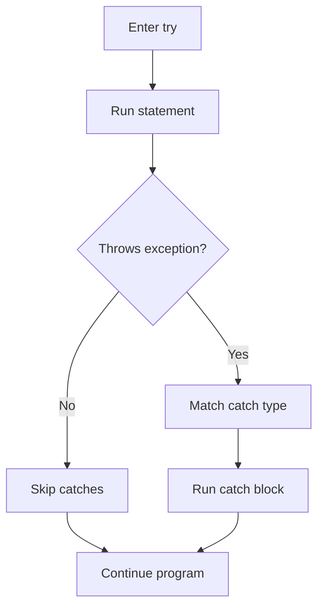

# Try-Catch

## 1. Introduction

The **try-catch** block is the primary tool for handling exceptions. Code that might fail goes inside `try`; the handlers that catch and respond to failures go inside `catch`.

---

## 2. Why This Topic Is Important

- Unhandled exceptions **crash** programs.
- try-catch converts crashes into controlled recovery.
- Every I/O, network, and parsing operation needs it.
- Interviewers test basic and advanced try-catch knowledge.

---

## 3. Real-World Analogy

Think of **landing a plane**. Pilots train for engine failure (the risky operation). When it happens, they follow a checklist (the catch block): stabilize, declare emergency, land safely. The flight doesn't crash into the ground — the "failure" is handled.

---

## 4. Theory

### The Basic Structure
```java
try {
    // risky code — may throw
} catch (SomeException e) {
    // what to do when it happens
}
```

### How It Works
1. Java executes the `try` block line by line.
2. If no exception: catch blocks are skipped, program continues.
3. If an exception occurs: execution jumps to the matching `catch`.
4. The exception object `e` holds the details (`getMessage()`, `printStackTrace()`).

### Multiple Catch Blocks
```java
try {
    int x = 10 / 0;
} catch (ArithmeticException e) {
    System.out.println("Math error: " + e.getMessage());
} catch (Exception e) {
    System.out.println("Some other error");
}
```
Order matters — **most specific first**.

---

## 5. Syntax

```java
try {
    // risky statements
} catch (ExceptionType name) {
    // recovery statements
}
```

---

## 6. Flow Explanation



---

## 7. Memory Representation

Exceptions are objects on the heap; the JVM also builds a **stack trace** (array of stack frames) telling you exactly where the failure happened.

---

## 8. Simple Example

```java
public class TryCatchDemo {
    public static void main(String[] args) {
        int[] numbers = {10, 20, 30};

        try {
            System.out.println(numbers[5]);      // out of bounds
        } catch (ArrayIndexOutOfBoundsException e) {
            System.out.println("Invalid index: " + e.getMessage());
        }

        System.out.println("Program continues!");
    }
}
```

---

## 9. Intermediate Example — Multiple Catch

```java
import java.util.Scanner;

public class MultiCatchDemo {
    public static void main(String[] args) {
        Scanner sc = new Scanner(System.in);

        try {
            System.out.print("Enter a number: ");
            int a = Integer.parseInt(sc.nextLine());
            System.out.print("Enter divisor: ");
            int b = Integer.parseInt(sc.nextLine());

            int result = a / b;
            System.out.println("Result: " + result);
        } catch (NumberFormatException e) {
            System.out.println("Not a valid number.");
        } catch (ArithmeticException e) {
            System.out.println("Cannot divide by zero.");
        } catch (Exception e) {
            System.out.println("Unexpected error: " + e.getMessage());
        }
    }
}
```

---

## 10. Advanced Example — Nested Try & Recovering

```java
public class NestedTry {
    public static void main(String[] args) {
        String[] inputs = {"100", "abc", "200"};

        for (String s : inputs) {
            try {
                int num = Integer.parseInt(s);      // outer risk
                try {
                    int half = 1000 / (num - 100);  // inner risk
                    System.out.println(s + " -> " + half);
                } catch (ArithmeticException e) {
                    System.out.println(s + " caused divide-by-zero");
                }
            } catch (NumberFormatException e) {
                System.out.println(s + " is not a number");
            }
        }
    }
}
```

---

## 11. Output

For the **Simple Example**:

```
Invalid index: Index 5 out of bounds for length 3
Program continues!
```

For the **Advanced Example**:

```
100 -> caught divide-by-zero (100-100=0)
abc -> is not a number
200 -> 10
```

---

## 12. Common Mistakes

| Mistake | Correction |
|---------|------------|
| Catching generic `Exception` first | Most specific catch must come first |
| Empty catch blocks | Swallowing errors hides bugs |
| Catching `Exception` for everything | Narrow the scope where possible |
| Not knowing the exception type | Use `e.getClass()` or check docs |
| Handling an exception too broadly | Try/catch only the risky section |

---

## 13. Best Practices

- Catch the **most specific** exception first.
- Never leave a catch block empty — log or rethrow.
- Catch only what you can actually handle.
- Keep try blocks small and focused.
- Use `e.getMessage()` in user-facing messages; log the stack trace.

---

## 14. Interview Questions

**Q1. What happens if a matching catch block isn't found?**
*The exception propagates up the call stack until handled or the program terminates.*

**Q2. Can you have multiple catch blocks?**
*Yes — catch the specific types; order most-specific first.*

**Q3. Does the rest of the try block run after an exception?**
*No — execution jumps directly to the matching catch.*

**Q4. What is in the exception object?**
*Message, type, cause, and a stack trace.*

**Q5. Can you catch an exception and still continue?**
*Yes — after the catch block runs, normal execution resumes after the try/catch.*

---

## 15. Practice Exercises

1. Handle an array out-of-bounds access gracefully.
2. Parse user input and handle `NumberFormatException`.
3. Catch `ArithmeticException` for division by zero.
4. Write a program with specific-then-general catch blocks.

---

## 16. Coding Challenges

1. **Easy:** A calculator that never crashes on bad input.
2. **Medium:** A number-guessing game with validation for invalid input.
3. **Hard:** A file score-summarizer that skips corrupt lines and reports them.

---

## 17. Summary

- try/catch wraps risky code and recovers from failures.
- Multiple catch blocks; specific types first.
- Execution skips to the catch on failure, then continues.
- Never swallow exceptions silently.
- Keep try blocks focused.

➡️ Continue to: [Checked vs Unchecked](Checked-vs-Unchecked.md)