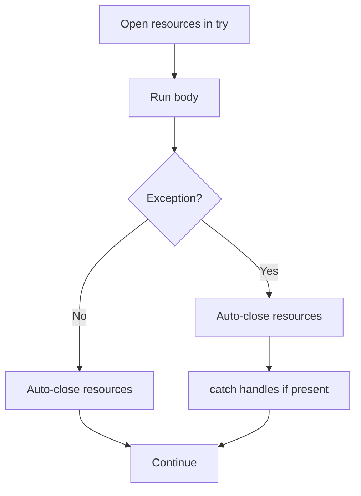

# Try-With-Resources

## 1. Introduction

**try-with-resources** (Java 7+) automatically closes resources like files, streams, and connections when the block finishes — even on exceptions. It removes the boilerplate and error-prone manual `finally` cleanup.

---

## 2. Why This Topic Is Important

- Resource leaks (open files, DB connections) crash servers over time.
- TWR is the **modern standard** for any `AutoCloseable`.
- Interviewers at 1+ years ask for it.
- Frameworks (JDBC, Spring) heavily use resource management.

---

## 3. Real-World Analogy

Think of a **hotel with automatic checkout**. Instead of you remembering to return the key card (manual close in finally), the hotel detects when you leave and cleans the room automatically (auto-close). Even if you rush out during a fire alarm (exception), the room still gets cleaned. No forgotten keys, no leaked rooms.

---

## 4. Theory

### The AutoCloseable Interface
```java
public interface AutoCloseable {
    void close() throws Exception;
}
```
`java.io.Closeable` extends it for I/O. Any class implementing it can be used in TWR.

### Syntax
```java
try (Resource r1 = new Resource();
     Resource r2 = new Resource()) {
    // use r1, r2
} catch (Exception e) {
    // handled
}
// resources auto-closed here — even on exception
```

### Key Facts
| Fact | Detail |
|------|--------|
| Auto-close order | Declared order — closed **reverse order** |
| On exception | `close()` still called |
| Suppressed exceptions | If close() throws while a primary exception exists, close's exception is *suppressed* |
| Java 9+ | Use effectively-final variables too: `try (r)` |
| Variables scope | Only inside the try block |

---

## 5. Syntax

```java
try (Type var = new Type(); ...) {
    // use
}
```

---

## 6. Flow Explanation



---

## 7. Memory Representation

Resources live in the heap; the JVM tracks them and guarantees `close()` runs. Leaks happen when old-style code forgets to close — TWR prevents that.

---

## 8. Simple Example

```java
import java.io.BufferedReader;
import java.io.StringReader;

public class TWRDemo {
    public static void main(String[] args) {
        // StringReader just for a self-contained demo
        try (BufferedReader br = new BufferedReader(
                new StringReader("Hello\nWorld"))) {
            System.out.println(br.readLine());
            System.out.println(br.readLine());
        } catch (Exception e) {
            System.out.println("Error: " + e.getMessage());
        }
        System.out.println("Resource auto-closed.");
    }
}
```

---

## 9. Intermediate Example — Real File Reading

```java
import java.nio.file.Files;
import java.nio.file.Path;

public class FileTWR {
    public static void main(String[] args) {
        // Files.newBufferedReader returns AutoCloseable
        try (var reader = Files.newBufferedReader(Path.of("data.txt"))) {
            String line;
            while ((line = reader.readLine()) != null) {
                System.out.println(line);
            }
        } catch (Exception e) {
            System.out.println("Could not read file: " + e.getMessage());
        }
    }
}
```

---

## 10. Advanced Example — Multiple Resources & Suppressed

```java
import java.io.BufferedReader;
import java.io.FileReader;

public class MultiTWR {
    public static void main(String[] args) {
        try (BufferedReader br1 = new BufferedReader(new FileReader("a.txt"));
             BufferedReader br2 = new BufferedReader(new FileReader("b.txt"))) {
            System.out.println("First line of a: " + br1.readLine());
            System.out.println("First line of b: " + br2.readLine());
        } catch (Exception e) {
            System.out.println("Error: " + e.getMessage());
            // e.getSuppressed() reveals any close() failures
            if (e.getSuppressed().length > 0) {
                System.out.println("Also suppressed: " + e.getSuppressed()[0]);
            }
        }
    }
}
```

---

## 11. Output

For the **Simple Example**:

```
Hello
World
Resource auto-closed.
```

For the **Intermediate Example** (with a file containing "Java\nRules"):

```
Java
Rules
```

---

## 12. Common Mistakes

| Mistake | Correction |
|---------|------------|
| Only closing the outer resource | TWR closes all declared resources |
| Using TWR on non-AutoCloseable | Won't compile — the type must implement it |
| Closing manually inside the body | Redundant — TWR handles it |
| Declaring resources for later use | Variables are block-scoped to the try |
| Ignoring suppressed exceptions | Check `getSuppressed()` for close failures |

---

## 13. Best Practices

- Use TWR for **every** `AutoCloseable` (files, streams, sockets, JDBC).
- Declare resources in the try header, not inside the body.
- Catch separately if you need to distinguish body vs close failures.
- Rely on the reverse-order auto-close.
- Avoid manual `finally` closing when TWR applies.

---

## 14. Interview Questions

**Q1. What is try-with-resources?**
*A construct that declares resources and closes them automatically at block end.*

**Q2. Which interface is required?**
*`AutoCloseable` (or `Closeable`).*

**Q3. In what order are resources closed?**
*Reverse of declaration order.*

**Q4. What happens if close() throws while another exception occurred?**
*The close exception is added as a suppressed exception.*

**Q5. Can TWR resources be used in finally or after?**
*No — they're scoped to the try block.*

---

## 15. Practice Exercises

1. Read a file using try-with-resources.
2. Use two resources (two readers) in one TWR block.
3. Create your own `AutoCloseable` class and use TWR.
4. Trigger a suppressed exception and inspect `getSuppressed()`.

---

## 16. Coding Challenges

1. **Easy:** Copy a file using TWR readers/writers.
2. **Medium:** A `DatabaseConnection` (AutoCloseable) that logs close; open/use/close it in TWR.
3. **Hard:** Simulate a primary exception + close exception and print both via suppressed handling.

---

## 17. Summary

- TWR auto-closes `AutoCloseable` resources (Java 7+).
- Cleaner and safer than manual finally cleanup.
- Closes in reverse declaration order.
- Suppressed exceptions preserve original failures.
- Use it for all files, streams, and connections.

➡️ Continue to: [Best Practices](Best-Practices.md)