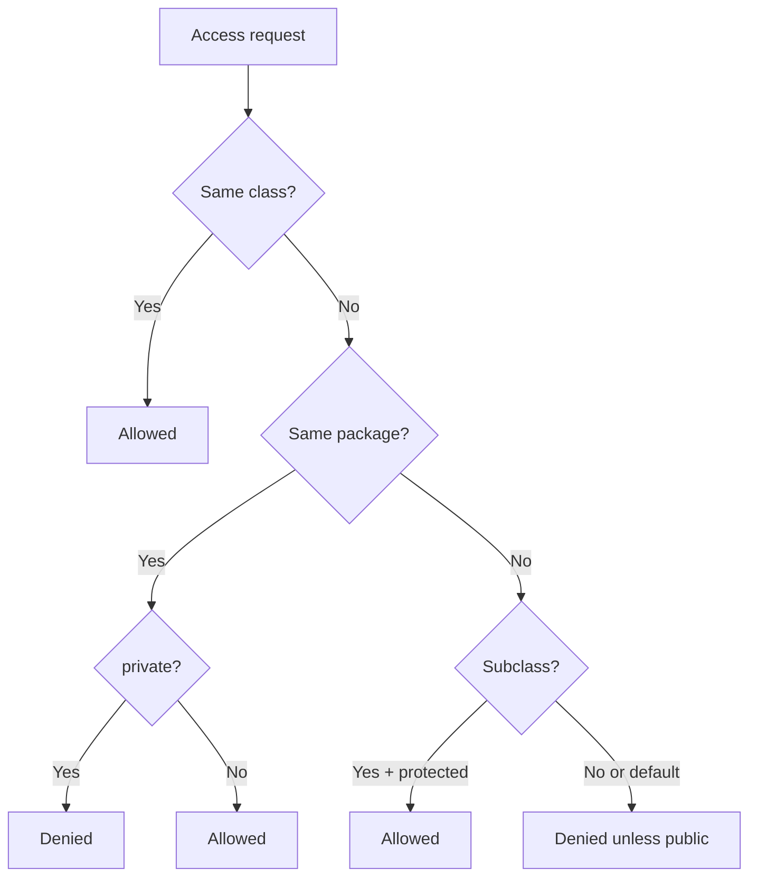

# Access Modifiers

## 1. Introduction

**Access modifiers** control the visibility of classes, methods, and fields. Java has four: `private`, *default* (no keyword), `protected`, and `public` — from most to least restrictive.

---

## 2. Why This Topic Is Important

- Correct visibility is the foundation of **encapsulation** (Module 09).
- Interviewers test the exact matrix of access modifiers.
- Security and API design depend on hiding internals.
- Frameworks rely on `public`/`protected` contracts.

---

## 3. Real-World Analogy

Think of a **company building**:
- `private` = your personal locker (only you).
- default = your department's office (your team).
- `protected` = the office plus trusted family (subclasses) visiting.
- `public` = the lobby (anyone can enter).

---

## 4. Theory

### The Access Matrix

| Modifier | Same class | Same package | Subclass (other pkg) | Anywhere |
|----------|-----------|--------------|----------------------|----------|
| `private` | ✅ | ❌ | ❌ | ❌ |
| default (none) | ✅ | ✅ | ❌ | ❌ |
| `protected` | ✅ | ✅ | ✅ | ❌ |
| `public` | ✅ | ✅ | ✅ | ✅ |

### Where Each Applies
| Modifier | Class | Method | Field | Constructor |
|----------|-------|--------|-------|-------------|
| `private` | ❌ (inner only) | ✅ | ✅ | ✅ |
| default | ✅ | ✅ | ✅ | ✅ |
| `protected` | ❌ (inner only) | ✅ | ✅ | ✅ |
| `public` | ✅ | ✅ | ✅ | ✅ |

### Top-level Class Rules
- A top-level class can be `public` or default **only**.
- `public` class → file name must match the class name.

---

## 5. Syntax

```java
class Demo {
    private int a;      // only this class
    int b;              // package-private
    protected int c;    // package + subclasses
    public int d;       // everywhere
}
```

---

## 6. Flow Explanation



---

## 7. Memory Representation

Modifiers don't change memory; they change **access checks** performed at compile time (and reflection at runtime).

---

## 8. Simple Example

```java
class Counter {
    private int count;         // hidden

    public void increment() {  // public API
        count++;
    }

    int getCount() {           // package-private read
        return count;
    }
}

public class AccessDemo {
    public static void main(String[] args) {
        Counter c = new Counter();
        c.increment();
        c.increment();
        // c.count++;  -> compile error (private)
        System.out.println("Count: " + c.getCount());
    }
}
```

---

## 9. Intermediate Example — Package vs Public

`com/example/helper/Helper.java`:
```java
package com.example.helper;

public class Helper {
    public void publicHelp() { System.out.println("public: anyone"); }
    void packageHelp()      { System.out.println("package: same pkg"); }
}
```

`com/example/helper/User.java`:
```java
package com.example.helper;

public class User {
    public static void main(String[] args) {
        Helper h = new Helper();
        h.publicHelp();      // ok
        h.packageHelp();     // ok — same package
    }
}
```

`com/example/Outside.java`:
```java
package com.example;

import com.example.helper.Helper;

public class Outside {
    public static void main(String[] args) {
        Helper h = new Helper();
        h.publicHelp();      // ok
        // h.packageHelp(); // compile error — different package
    }
}
```

---

## 10. Advanced Example — protected with Subclass

`com/example/bank/Account.java`:
```java
package com.example.bank;

public class Account {
    protected double balance;    // subclasses can access
    public void deposit(double amt) { balance += amt; }
}
```

`com/example/savings/SavingsAccount.java`:
```java
package com.example.savings;

import com.example.bank.Account;

public class SavingsAccount extends Account {
    public void addInterest(double rate) {
        balance += balance * rate / 100;    // protected -> OK in subclass
    }

    public double getBalance() {
        return balance;
    }
}
```

---

## 11. Output

For the **Simple Example**:

```
Count: 2
```

For the **Advanced Example** (after depositing 1000 and 5% interest):

```
Balance after interest: 1050.0
```

---

## 12. Common Mistakes

| Mistake | Correction |
|---------|------------|
| Making everything public | Leaks internals — encapsulate |
| Expecting protected to work from a non-subclass | Protected needs inheritance (outside package) |
| Thinking default = public | Default is package-only |
| Making fields private with no access | Provide getters/behavior methods |
| Using `protected` for inner classes carelessly | Rarely needed |

---

## 13. Best Practices

- Default to **`private`**; expose the minimum API as `public`.
- Use **package-private** for internal helpers within a package.
- Use **`protected`** for extension points in hierarchies.
- Keep fields private; use methods for access.
- Prefer `final` classes/immutables to reduce exposure.

---

## 14. Interview Questions

**Q1. List the four access modifiers in increasing visibility.**
*private, default, protected, public.*

**Q2. What's the difference between default and protected?**
*Protected also allows access from subclasses in other packages.*

**Q3. Can a top-level class be private?**
*No — only public or package-private (default).*

**Q4. How does access control relate to encapsulation?**
*Private fields + public methods implement data hiding.*

**Q5. What happens if you don't write any modifier?**
*Default (package-private) access applies.*

---

## 15. Practice Exercises

1. Create a class with all four modifier levels and test access.
2. Prove default access fails from another package.
3. Use protected from a subclass in a different package.
4. Explain (comment) why a field should be private.

---

## 16. Coding Challenges

1. **Easy:** A `BankAccount` where balance is private and methods are public.
2. **Medium:** A package-private `Utility` class used inside one package.
3. **Hard:** A framework-style library where only the public API is visible and internals are protected/package-private.

---

## 17. Summary

- private < default < protected < public.
- Encapsulation = private fields + public behavior methods.
- Default is package-scoped; protected adds cross-package subclasses.
- Fields stay private; API stays public.
- Choose visibility deliberately — it's your contract.

➡️ Continue to: [Package & Import](Package-Import.md)