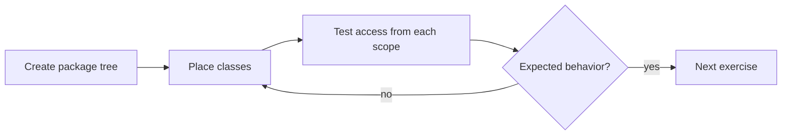

# Exercises — Packages & Access Modifiers

## 1. Introduction

Practice organizing and protecting code. You'll build multi-package projects and test every access modifier from every vantage point.

---

## 2. Why This Topic Is Important

- Real projects are package-structured with careful visibility.
- Access-control mistakes cause refactoring pain.
- These skills unlock framework modules (Spring scans packages).
- Interviews test the access modifier matrix.

---

## 3. Real-World Analogy

Like **organizing a warehouse**: boxes (classes) go in labeled aisles (packages), and only staff with the right badge (access modifier) can open certain doors. A well-organized warehouse is faster and safer — so is well-organized code.

---

## 4. Theory — Recap

- Package = namespace = folder.
- Access: private < default < protected < public.
- private: same class. default: same package. protected: + subclasses. public: all.

---

## 5. Syntax Reminder

```java
package com.example.x;          // folder com/example/x

class Helper {                  // package-private
    int secret;                 // package-private field
}
```

---

## 6. Practice Flow



---

## 7. Memory Representation

Not needed — focus on structure and visibility.

---

## 8. Simple Exercises

**Ex 1 — First Package**
Create `com.example.hello` with a `Greeter` class and run it from the base directory.

**Ex 2 — Private Field**
A `BankAccount` with `private double balance` and public deposit/withdraw. Prove direct field access fails.

**Ex 3 — Import Practice**
Use `ArrayList` via explicit import, wildcard import, and fully-qualified name in three small programs.

---

## 9. Intermediate Exercises

**Ex 4 — Two Same-Named Classes**
Put `User` in `com.example.shop` and `com.example.admin`. Use both in one program.

**Ex 5 — Package-Private**
Create a `helper` package class callable from the same package but blocked from outside.

**Ex 6 — Static Import**
Static-import `Math.PI` and `Math.sqrt`; use them without the `Math.` prefix.

**Ex 7 — Protected Access**
`Account.balance` is protected. A `SavingsAccount` in another package reads and modifies it. A non-subclass in that package cannot.

---

## 10. Advanced Exercises

**Ex 8 — Conflict Resolution**
Import both `java.util.*` and `java.awt.*`; demonstrate the `List` conflict and resolve it.

**Ex 9 — Full Project Layout**
Build this tree and compile/run:
```
com.example.shop/
├── model/  Order, Product
├── service/ OrderService (uses model)
└── ShopApp (main, imports service)
```

**Ex 10 — Library Design**
Create a package with: public API classes, a package-private internal class, and a protected extension point. Document who can access what.

---

## 11. Expected Output Samples

**Ex 7 (Protected):**
```
Deposited 1000.0
Balance after interest: 1050.0
```

**Ex 8 (Conflict):**
```
[Ajay]
AWT item
```

---

## 12. Common Mistakes

| Mistake | Fix |
|---------|-----|
| Compiling with wrong working dir | Compile from the source root |
| `import` before `package` | package first |
| Expecting protected to work from non-subclass | Needs inheritance |
| Wildcard collision | Qualify one conflicting name |
| Everything public | Design the real API surface |

---

## 13. Best Practices

- Build package trees mirroring domain modules.
- Fields private; methods public; helpers package-private.
- Use protected only for extension points.
- Verify access with small tests from each scope.
- Compile and run from the base source directory.

---

## 14. Interview Practice Questions

**Q1.** What are the four access modifiers and their scopes?
**Q2.** Why do packages use reverse-domain names?
**Q3.** Does import affect runtime performance?
**Q4.** When is package-private the right choice?
**Q5.** How do you run a class inside a package?

---

## 15. Self-Check

- [ ] I can create and compile a packaged project.
- [ ] I can use imports and static imports.
- [ ] I know when each access modifier applies.
- [ ] I can resolve name conflicts.
- [ ] I follow package/class/method naming conventions.
- [ ] I can design a multi-package project layout.

---

## 16. Next Steps

- Move to [Module 12 — Collections](../12-Collections/README.md).
- Packages/access will be assumed knowledge from here on.

---

## 17. Summary

- Packages organize; access modifiers protect.
- Build real package trees, not single-file programs.
- Test access from every scope.
- Follow conventions religiously.
- This structure is the foundation of framework modules.

➡️ Module complete! Continue to [12 — Collections](../12-Collections/README.md).