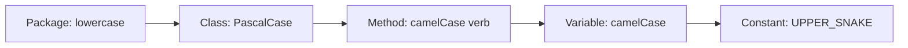

# Naming Conventions

## 1. Introduction

**Naming conventions** are the agreed-upon style rules for packages, classes, methods, and variables. Following them makes your code instantly readable by every Java developer.

---

## 2. Why This Topic Is Important

- Conventions are checked in code reviews.
- Interviewers (and employers) judge code cleanliness.
- Consistent names prevent confusion in large teams.
- Package structure affects tooling (Maven, Spring scanning).

---

## 3. Real-World Analogy

Think of **road signs**. Every country has standards: red octagon = stop, green = go. If each city used different colors, driving would be chaos. Naming conventions are the standard "signs" of code — everyone reads them the same way.

---

## 4. Theory — The Conventions

| Element | Style | Example |
|---------|-------|---------|
| Package | lowercase, reverse-domain | `com.example.bank` |
| Class | PascalCase (UpperCamelCase) | `BankAccount` |
| Interface | PascalCase, often capability | `Drawable`, `Comparable` |
| Method | camelCase (verb-first) | `getBalance`, `withdraw` |
| Variable | camelCase | `totalAmount` |
| Constant | UPPER_SNAKE_CASE | `MAX_LIMIT`, `PI` |
| Enum values | UPPER_SNAKE_CASE | `SUNDAY`, `ACTIVE` |
| File name | matches public class | `BankAccount.java` |

### Rules of Thumb
| Rule | Meaning |
|------|---------|
| Be descriptive | `numberOfStudents`, not `n` |
| Avoid abbreviations | `amount`, not `amt` (unless standard) |
| Booleans read as questions | `isActive`, `hasAccess` |
| One idea per name | Clear and unambiguous |
| Never start with a digit | `2ndItem` invalid |

---

## 5. Syntax (examples)

```java
package com.example.order;                       // lowercase package

public class OrderService {                      // PascalCase class
    private static final double TAX_RATE = 0.18; // UPPER_SNAKE constant

    private double totalAmount;                  // camelCase field

    public double calculateTotal(int itemCount) { // camelCase method
        return itemCount * totalAmount * (1 + TAX_RATE);
    }
}
```

---

## 6. Flow Explanation



---

## 7. Memory Representation

Naming has no memory impact — it's pure readability and maintainability.

---

## 8. Simple Example

```java
public class Student {
    private String studentName;
    private int rollNumber;
    private boolean isActive;         // boolean reads as question

    public void displayStudent() {
        System.out.println(studentName + " (roll " + rollNumber
                + ") active=" + isActive);
    }
}
```

---

## 9. Intermediate Example — Constants & Enums

```java
public class OrderStatus {
    public static final String PENDING = "PENDING";
    public static final String SHIPPED = "SHIPPED";
    public static final String DELIVERED = "DELIVERED";

    public static void main(String[] args) {
        String currentStatus = SHIPPED;
        System.out.println("Order is " + currentStatus);
    }
}
```

Better with an enum (Module 16 / enums basics):
```java
enum OrderStatus {
    PENDING, SHIPPED, DELIVERED
}
```

---

## 10. Advanced Example — Realistic Package Layout

```
com.example.shop/
├── model/            (Customer, Order, Product)
├── service/          (OrderService, PaymentService)
├── repository/       (OrderRepository)
└── controller/       (OrderController)

com.example.shop.service.OrderService:
```
```java
package com.example.shop.service;

import com.example.shop.model.Order;

public class OrderService {
    private final int MAX_ITEMS_PER_ORDER = 50;

    public void placeOrder(Order order) {
        // naming matches the business language
        System.out.println("Placing order " + order.getId());
    }
}
```

---

## 11. Output

For the **Simple Example**:

```
Ajay (roll 101) active=true
```

For the **Intermediate Example**:

```
Order is SHIPPED
```

---

## 12. Common Mistakes

| Mistake | Correction |
|---------|------------|
| `pascalCase` class names | Classes use PascalCase: `BankAccount` |
| `UPPER_CASE` methods | Methods are camelCase |
| Vague names (`x`, `temp`, `data`) | Use descriptive names |
| Package names with uppercase | Lowercase only |
| Abbreviations everywhere | Spell out: `total`, not `tot` |
| Constants in camelCase | UPPER_SNAKE_CASE |

---

## 13. Best Practices

- Follow Java conventions consistently.
- Name classes as nouns, methods as verbs.
- Booleans read like questions (`isValid`).
- Use descriptive names over short ones.
- Match package names to the project domain.

---

## 14. Interview Questions

**Q1. Why follow naming conventions?**
*Readability, maintainability, and team consistency — code is read far more than written.*

**Q2. How do you name a constant?**
*UPPER_SNAKE_CASE: `MAX_LIMIT`.*

**Q3. What case are classes vs methods?**
*Classes PascalCase; methods camelCase.*

**Q4. How are packages named?**
*Lowercase, reverse-domain, e.g., `com.example.app`.*

**Q5. Why name booleans as questions?**
*So `if (isActive)` reads naturally.*

---

## 15. Practice Exercises

1. Rename poorly-named variables in a sample snippet.
2. Create a package tree matching `com.example.shop`.
3. Name constants and enums correctly in a small app.
4. Convert an all-uppercase class to proper PascalCase.

---

## 16. Coding Challenges

1. **Easy:** Write a `BankAccount` fully compliant with conventions.
2. **Medium:** Build the `com.example.shop` package tree with models/services.
3. **Hard:** Refactor a messy snippet into convention-clean, well-packaged code.

---

## 17. Summary

- Packages lowercase; classes PascalCase; methods/vars camelCase.
- Constants and enum values UPPER_SNAKE_CASE.
- Descriptive, question-style booleans.
- Follow conventions — code is written once, read many times.

➡️ Continue to: [Exercises](Exercises.md)