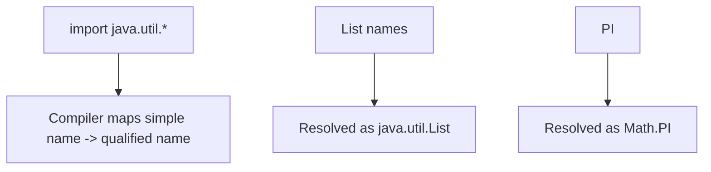

# Package & Import

## 1. Introduction

`import` brings classes from other packages into your namespace so you can refer to them by simple name. This topic covers single imports, wildcard imports, and static imports.

---

## 2. Why This Topic Is Important

- Without imports you'd write fully-qualified names everywhere.
- Wildcard vs explicit imports affect readability and collisions.
- Static imports enable clean utility calls (`Math.PI` as `PI`).
- IDE auto-imports handle this daily, but you must understand it.

---

## 3. Real-World Analogy

Imports are like **adding contacts to your phone**. You can dial a full international number (fully-qualified name) every time, or save contacts (import) and call by first name. Static import is like having your most-used numbers on speed dial.

---

## 4. Theory

### Types of Import
```java
import java.util.List;              // single class
import java.util.*;                 // wildcard — all classes in package
import static java.lang.Math.PI;    // static member
import static java.lang.Math.*;     // all static members
```

### Key Rules
| Rule | Detail |
|------|--------|
| Order | `package` first, then `import` |
| Not required | Fully-qualified names always work |
| No performance difference | Compile-time convenience |
| Name conflicts | Explicit import wins; else error |
| `java.lang` | Auto-imported (`String`, `Math`, `System`) |
| Wildcard | Imports **classes**, not sub-packages |

### Conflict Example
```java
import java.util.List;          // from util
import java.awt.List;           // also List — compile error
```
Fix: import one, fully-qualify the other.

---

## 5. Syntax

```java
package com.example.app;

import java.util.ArrayList;
import java.util.List;
import static java.lang.Math.*;

public class Demo {
    public static void main(String[] args) {
        List<String> names = new ArrayList<>();
        System.out.println(PI);      // static import — no Math. prefix
    }
}
```

---

## 6. Flow Explanation



---

## 7. Memory Representation

Imports have **no runtime effect** — they're resolved at compile time to fully-qualified names.

---

## 8. Simple Example

```java
import java.util.ArrayList;
import java.util.Date;

public class ImportDemo {
    public static void main(String[] args) {
        ArrayList<String> list = new ArrayList<>();
        list.add("java");
        System.out.println(list);
        System.out.println("Date: " + new Date());
    }
}
```

---

## 9. Intermediate Example — Wildcard + Static

```java
import java.util.*;                      // ArrayList, HashMap, Random...
import static java.lang.Math.*;          // PI, sqrt, pow...

public class WildcardDemo {
    public static void main(String[] args) {
        Random rand = new Random();      // via wildcard
        List<Integer> nums = new ArrayList<>();
        for (int i = 0; i < 5; i++) {
            nums.add(rand.nextInt(10));
        }
        System.out.println(nums);
        System.out.println("sqrt(16) = " + sqrt(16));    // Math.sqrt
        System.out.println("PI = " + PI);                // Math.PI
    }
}
```

---

## 10. Advanced Example — Resolving Name Conflicts

```java
import java.util.*;

// Notice: we DON'T import java.awt.List to avoid the clash.
public class ConflictDemo {
    public static void main(String[] args) {
        List<String> names = new ArrayList<>();       // java.util.List
        names.add("Ajay");

        // Fully-qualified to use the OTHER List
        java.awt.List awtList = new java.awt.List();
        awtList.add("AWT item");

        System.out.println(names);
        System.out.println(awtList.getItem(0));
    }
}
```

---

## 11. Output

For the **Intermediate Example**:

```
[3, 8, 1, 5, 9]
sqrt(16) = 4.0
PI = 3.141592653589793
```

For the **Advanced Example**:

```
[Ajay]
AWT item
```

---

## 12. Common Mistakes

| Mistake | Correction |
|---------|------------|
| Wildcard importing `java.util.*` and `java.awt.*` | Ambiguous `List` — pick one, qualify the other |
| Thinking wildcards import sub-packages | `java.util.*` does NOT import `java.util.concurrent.*` |
| Putting imports before `package` | Compile error — package must be first |
| Importing from `java.lang` | Unnecessary — auto-imported |
| Overusing static imports | Hurts readability; use sparingly |

---

## 13. Best Practices

- Prefer **explicit** imports (IDEs generate them) for clarity.
- Use wildcards in quick demos only.
- Use static imports only for obvious constants (`PI`, `MIN_VALUE`).
- Keep `java.lang` imports out (redundant).
- Resolve conflicts by fully qualifying the less-used type.

---

## 14. Interview Questions

**Q1. Why do we need imports?**
*To use classes from other packages by simple name instead of fully-qualified names.*

**Q2. Does import affect performance?**
*No — it's compile-time only.*

**Q3. What does `import java.util.*` import?**
*All classes in `java.util`, not its sub-packages.*

**Q4. What is a static import?**
*Importing static members so you can use them without the class name.*

**Q5. How do you resolve a name conflict?**
*Import one; fully-qualify the other.*

---

## 15. Practice Exercises

1. Import `ArrayList` explicitly and use it.
2. Use a wildcard import in a small demo.
3. Static-import `Math.PI` and `Math.sqrt`.
4. Trigger a `List` conflict and resolve it.

---

## 16. Coding Challenges

1. **Easy:** A program using three imports from different packages.
2. **Medium:** Resolve a `List` conflict between `java.util` and `java.awt`.
3. **Hard:** Build a project with a package-private helper used via import in one class and via fully-qualified name in another.

---

## 17. Summary

- import = compile-time convenience, no runtime cost.
- Explicit imports > wildcards for readability.
- Static imports for constants and utilities.
- package comes first; `java.lang` is automatic.
- Qualify conflicting names fully.

➡️ Continue to: [Naming Conventions](Naming-Conventions.md)