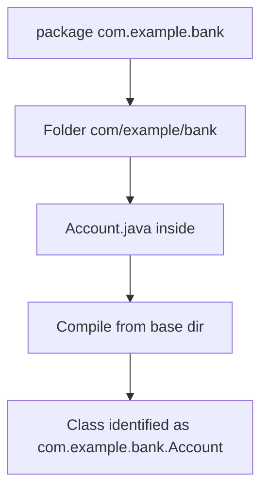

# Packages

## 1. Introduction

A **package** is a named namespace that groups related classes and interfaces. It maps to a folder structure on disk and prevents name collisions across your project.

---

## 2. Why This Topic Is Important

- Real projects have hundreds of classes — packages keep them organized.
- Two classes named `User` can coexist in different packages.
- Access control (next topic) works *per package*.
- Frameworks like Spring and Maven are built on package structure.

---

## 3. Real-World Analogy

Packages are like **folders in a company's file room**. Customer records go in the "Customers" folder, invoices in "Invoices." Two salespeople can both have a document called "Report" — but each lives in its own folder, so there's no confusion. Packages = file-room folders.

---

## 4. Theory

### Declaration
```java
package com.example.bank;   // first line (before imports)
```

### Rules
| Rule | Detail |
|------|--------|
| First statement | Only comments/whitespace before it |
| One package per file | Implicit: the current package |
| Default package | No declaration = root folder (avoid in real projects) |
| Folder match | `com.example.bank` → `com/example/bank/` |
| Naming convention | Reverse domain: `com.mycompany.project.module` |

### Why Reverse Domain?
`com.example.bank` mirrors your website domain, guaranteeing uniqueness across companies.

### Benefits
| Benefit | Explanation |
|---------|-------------|
| Organization | Related classes grouped |
| Name collision avoidance | Same class name in different packages |
| Access control | package-private members visible within a package |
| Distribution | Easier to build, test, ship |

---

## 5. Syntax

```java
package com.example.bank;

public class Account {
    // ...
}
```

Compile from the base folder:
```
javac com/example/bank/Account.java
```

---

## 6. Flow Explanation



---

## 7. Memory Representation

Packages don't affect runtime memory much — they become part of the fully-qualified class name (`com.example.bank.Account`).

---

## 8. Simple Example

`com/example/bank/Account.java`:
```java
package com.example.bank;

public class Account {
    public void info() {
        System.out.println("Account from com.example.bank");
    }
}
```

---

## 9. Intermediate Example — Two Same-Named Classes

`com/example/shop/User.java`:
```java
package com.example.shop;

public class User {
    public void who() { System.out.println("Shop User"); }
}
```

`com/example/admin/User.java`:
```java
package com.example.admin;

public class User {
    public void who() { System.out.println("Admin User"); }
}
```

`com/example/Main.java`:
```java
package com.example;

import com.example.shop.User;

public class Main {
    public static void main(String[] args) {
        User shopUser = new User();                 // imported
        com.example.admin.User adminUser = new com.example.admin.User();
        shopUser.who();
        adminUser.who();
    }
}
```

---

## 10. Advanced Example — Multi-Package Build

`com/example/pay/Payment.java`:
```java
package com.example.pay;

public class Payment {
    public void pay(double amount) {
        System.out.println("Paid " + amount);
    }
}
```

`com/example/pay/CardPayment.java`:
```java
package com.example.pay;

public class CardPayment extends Payment {
    @Override
    public void pay(double amount) {
        System.out.println("Card: charged " + amount);
    }
}
```

`com/example/App.java`:
```java
package com.example;

import com.example.pay.CardPayment;
import com.example.pay.Payment;

public class App {
    public static void main(String[] args) {
        Payment p = new CardPayment();
        p.pay(250.0);
    }
}
```

Compile from base: `javac com/example/pay/*.java com/example/App.java`
Run: `java com.example.App`

---

## 11. Output

For the **Intermediate Example**:

```
Shop User
Admin User
```

For the **Advanced Example**:

```
Card: charged 250.0
```

---

## 12. Common Mistakes

| Mistake | Correction |
|---------|------------|
| Wrong folder placement | Folder must mirror the package name |
| Running `java` with `.java` | Use `java com.example.App` (fully-qualified class) |
| Using the default package | Package everything in real projects |
| Capital letters in package names | Use lowercase (convention) |
| Missing package line | Class lands in the default package |

---

## 13. Best Practices

- Start packages with `com.yourcompany` or your domain.
- Use lowercase, no underscores.
- Group by **feature/module**, not by type (`com.app.users` vs `com.app.models`).
- Keep one top-level public class per file.
- Compile from the source root directory.

---

## 14. Interview Questions

**Q1. What is a package?**
*A namespace grouping related classes, mapped to folders, preventing name collisions.*

**Q2. Why reverse-domain naming?**
*It guarantees unique package names across the world.*

**Q3. Can two classes share a name in one project?**
*Yes — if they're in different packages.*

**Q4. What is the default package?**
*No declaration = root; used for small demos only.*

**Q5. How do you run a packaged class?**
*`java com.example.App` from the source root.*

---

## 15. Practice Exercises

1. Create a `com.example.animal` package with an `Animal` class.
2. Put two `User` classes in different packages and use both.
3. Compile and run a packaged program from the terminal.
4. Import a class from another package with a fully-qualified name fallback.

---

## 16. Coding Challenges

1. **Easy:** A two-package project (model + main).
2. **Medium:** A `com.example.bank` hierarchy split across packages with cross-package usage.
3. **Hard:** Reorganize a single-file project into a proper `com.example` package tree and compile it.

---

## 17. Summary

- Packages = namespaces = folders; declare with `package`.
- Use reverse-domain lowercase names.
- Fully-qualified names avoid collisions.
- Compile from source root; run with the qualified class name.
- Every real project is package-organized.

➡️ Continue to: [Access Modifiers](Access-Modifiers.md)