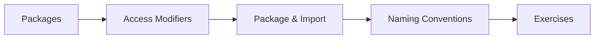

# 11 — Packages & Access Modifiers

> **Experience level: 🟡 Basic+ (6 months – 1 year)**

Packages organize your code into namespaces; access modifiers control **who can see what**. Together they structure and protect real-world Java projects.

---

## 📂 Files in This Module

| File | What You'll Learn |
|------|-------------------|
| [Packages.md](Packages.md) | Namespaces, folders, and imports |
| [Access-Modifiers.md](Access-Modifiers.md) | private, default, protected, public |
| [Package-Import.md](Package-Import.md) | Importing classes, wildcards, static imports |
| [Naming-Conventions.md](Naming-Conventions.md) | How real projects are organized |
| [Exercises.md](Exercises.md) | Practice tasks for this module |

---

## 🎯 Learning Objectives

By the end of this module, you will be able to:

1. ✅ Create and use packages (`package` + folder structure).
2. ✅ Import classes with `import` and wildcards.
3. ✅ Choose the right access modifier for every member.
4. ✅ Use `protected` correctly with subclasses.
5. ✅ Organize a multi-class project like a professional.

---

## 🧭 Module Map



---

## 📌 Quick Preview

```java
package com.example.bank;

public class Account {
    private double balance;          // hidden
    protected String owner;          // visible to subclasses
    public void deposit(double amt) { balance += amt; }
}
```

---

## Next Module

➡️ [12 — Collections](../12-Collections/README.md) — powerful data structures built into Java.