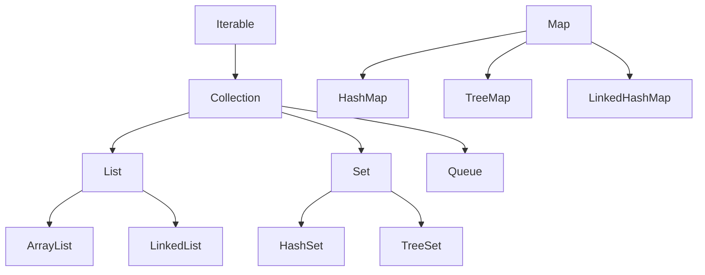
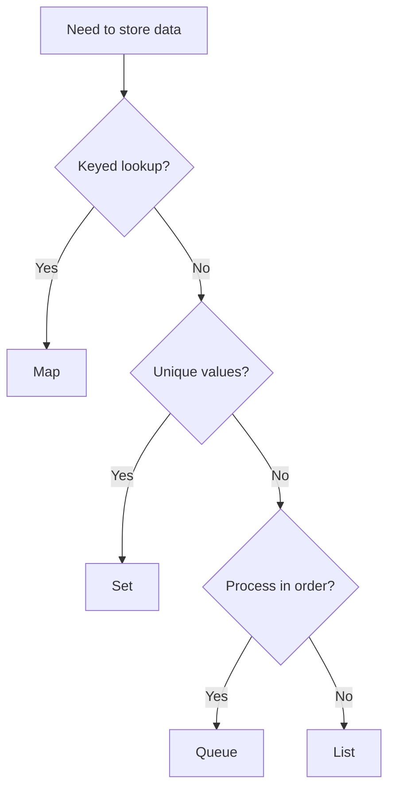

# Collection Framework

## 1. Introduction

The **Java Collections Framework** is a unified set of interfaces and classes for storing and manipulating groups of data. Interfaces (`List`, `Set`, `Map`) define contracts; implementation classes (`ArrayList`, `HashSet`, `HashMap`) provide concrete behavior.

---

## 2. Why This Topic Is Important

- Collections replace raw arrays for almost all real code.
- Choosing the right collection impacts performance massively.
- Interviews at every level test the framework hierarchy.
- Frameworks (Spring, Hibernate) return and accept collections everywhere.

---

## 3. Real-World Analogy

Think of a **workshop tool cabinet**:
- List = a shelf of files, in order, numbered slots.
- Set = a jar of unique bolts (no duplicates allowed).
- Map = a labeled drawer: name tags on the front, tools inside.
- Queue = a printer line: first come, first served.
Each storage system fits a different need — the framework gives you them all.

---

## 4. Theory

### The Hierarchy



### Core Interfaces & Key Implementations
| Interface | Order? | Duplicates? | Implementations | Best For |
|-----------|--------|-------------|-----------------|----------|
| `List` | ✅ | ✅ | `ArrayList`, `LinkedList` | Indexed access |
| `Set` | ❌/varies | ❌ | `HashSet`, `TreeSet`, `LinkedHashSet` | Uniqueness |
| `Map` | key-based | unique keys | `HashMap`, `TreeMap` | Lookup by key |
| `Queue` | FIFO/priority | ✅ | `ArrayDeque`, `PriorityQueue` | Processing order |

### Program to Interfaces
```java
List<String> names = new ArrayList<>();   // not ArrayList<String> names
Map<String, Integer> ages = new HashMap<>();
```
Swapping implementations later is trivial.

### java.util.Arrays & Collections
```java
Arrays.asList("a", "b");          // fixed-size list from array
Collections.sort(list);           // sorts a List
Collections.reverse(list);
```

---

## 5. Syntax

```java
import java.util.*;

List<String> list = new ArrayList<>();
Set<Integer> set = new HashSet<>();
Map<String, Integer> map = new HashMap<>();
Queue<String> queue = new ArrayDeque<>();
```

---

## 6. Flow Explanation



---

## 7. Memory Representation

- `ArrayList`: contiguous array (fast index, slow inserts mid).
- `LinkedList`: node chain (fast inserts, slow index).
- `HashSet`/`HashMap`: buckets with hashing (near-constant time).
- `TreeSet`/`TreeMap`: red-black tree (logarithmic time, sorted).

---

## 8. Simple Example

```java
import java.util.*;

public class FrameworkDemo {
    public static void main(String[] args) {
        List<String> list = new ArrayList<>();
        list.add("apple");
        list.add("banana");
        list.add("apple");
        System.out.println("List (duplicates ok): " + list);

        Set<String> set = new HashSet<>(list);
        System.out.println("Set (unique): " + set);
    }
}
```

---

## 9. Intermediate Example — Choosing Correctly

```java
import java.util.*;

public class ChooseDemo {
    public static void main(String[] args) {
        // Fast lookup by student id
        Map<Integer, String> students = new HashMap<>();
        students.put(101, "Ajay");
        students.put(102, "Priya");
        students.put(101, "Ajay updated");   // replaces value
        System.out.println("Id 101 -> " + students.get(101));
        System.out.println("Size: " + students.size());

        // Unique tags
        Set<String> tags = new HashSet<>();
        tags.add("java");
        tags.add("java");
        tags.add("spring");
        System.out.println("Tags: " + tags);
    }
}
```

---

## 10. Advanced Example — Mixed Collection Usage

```java
import java.util.*;

public class CollectionsDemo {
    public static void main(String[] args) {
        // Build a queue of tasks
        Queue<String> tasks = new ArrayDeque<>();
        tasks.offer("build");
        tasks.offer("test");
        tasks.offer("deploy");

        while (!tasks.isEmpty()) {
            System.out.println("Processing: " + tasks.poll());
        }

        // Sort a list via Collections
        List<Integer> numbers = new ArrayList<>(Arrays.asList(5, 2, 9, 1));
        Collections.sort(numbers);
        System.out.println("Sorted: " + numbers);

        // Convert list -> array and back
        String[] arr = {"a", "b", "c"};
        List<String> back = new ArrayList<>(Arrays.asList(arr));
        System.out.println("Array to list: " + back);
    }
}
```

---

## 11. Output

For the **Intermediate Example**:

```
Id 101 -> Ajay updated
Size: 2
Tags: [java, spring]
```

For the **Advanced Example**:

```
Processing: build
Processing: test
Processing: deploy
Sorted: [1, 2, 5, 9]
Array to list: [a, b, c]
```

---

## 12. Common Mistakes

| Mistake | Correction |
|---------|------------|
| Using arrays when collections fit | Prefer `List`/`Set`/`Map` |
| Modifying a list while iterating | Use `Iterator.remove()` or a new list |
| Raw types (`List` without `<...>`) | Always use generics (Module 15) |
| `HashMap` where order matters | Use `LinkedHashMap` or `TreeMap` |
| Using `==` on elements | Use `.equals()` |

---

## 13. Best Practices

- Program to interfaces: `List`, `Map`, `Set`, not concrete classes.
- Choose by operation: random access → ArrayList; uniqueness → Set; lookup → Map.
- Use diamond `<>` (`new ArrayList<>()`).
- Prefer `Arrays.asList` and `List.of` for fixed lists (Java 9+).
- Be aware of ordering guarantees before relying on them.

---

## 14. Interview Questions

**Q1. What is the Collection Framework?**
*A unified architecture of interfaces/classes for storing and manipulating groups of objects.*

**Q2. List vs Set?**
*List allows duplicates and preserves order/index; Set disallows duplicates.*

**Q3. When ArrayList vs LinkedList?**
*ArrayList for random access; LinkedList for frequent insert/delete at ends.*

**Q4. HashMap vs TreeMap?**
*HashMap: O(1) avg, no order. TreeMap: sorted by key, O(log n).*

**Q5. Why program to interfaces?**
*Flexibility to swap implementations and cleaner APIs.*

---

## 15. Practice Exercises

1. Store and iterate a list of your favorite books.
2. Remove duplicates from a list using a set.
3. Count word frequencies with a Map.
4. Process tasks FIFO with a Queue.

---

## 16. Coding Challenges

1. **Easy:** A grocery cart (List) with total price.
2. **Medium:** A contact book (Map name→phone) with search.
3. **Hard:** A task scheduler using a Queue + priority, showing order guarantees.

---

## 17. Summary

- Framework = interfaces + implementations for storing data.
- List: ordered+duplicates. Set: unique. Map: keyed. Queue: processing order.
- Program to interfaces; choose by operation.
- Generics keep collections type-safe.
- Collections are everywhere in real code.

➡️ Continue to: [List](List.md)