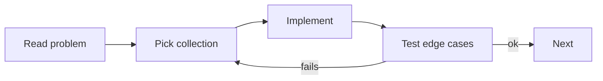

# Exercises — Collections

## 1. Introduction

Time to practice the framework. You'll build real applications with Lists, Sets, Maps, and Queues — picking the right structure for each job.

---

## 2. Why This Topic Is Important

- Collections are the workhorses of Java development.
- Correct structure choice = correct, fast code.
- Interviews test collection behavior extensively.
- Every framework returns and consumes collections.

---

## 3. Real-World Analogy

Practice is like **learning a workshop** — once you know which drawer holds which tool (which collection fits which task), building anything becomes fast and natural.

---

## 4. Theory — Decision Guide

- Need order + duplicates? → **List**
- Need uniqueness? → **Set**
- Need keyed lookup? → **Map**
- Need processing order? → **Queue**
- Need sorting? → Comparable/Comparator

---

## 5. Syntax Reminder

```java
List<T> list = new ArrayList<>();
Set<T> set = new HashSet<>();
Map<K, V> map = new HashMap<>();
Queue<T> q = new ArrayDeque<>();
```

---

## 6. Practice Flow



---

## 7. Memory Representation

Skip — focus on choosing and using structures.

---

## 8. Simple Exercises

**Ex 1 — Grocery List (List)**
Add items, print count, check contains, remove one, print all.

**Ex 2 — Unique Tags (Set)**
Add tags (with duplicates) to a HashSet; show final set size.

**Ex 3 — Phone Book (Map)**
Store name→number; look up, update, remove.

---

## 9. Intermediate Exercises

**Ex 4 — Word Counter (Map)**
Count each word's frequency in a sentence (case-insensitive).

**Ex 5 — Task Queue (Queue)**
FIFO task processor printing "Processing: <task>" for each.

**Ex 6 — Leaderboard (Comparator)**
Sort players by score desc, then by name; print ranks.

**Ex 7 — De-dupe + Sort (Set → List)**
Collect unique words, then produce a sorted list.

---

## 10. Advanced Exercises

**Ex 8 — Grouping Students (Map of Lists)**
Group students by grade using `computeIfAbsent`.

**Ex 9 — Priority Triage (PriorityQueue)**
Emergency queue: highest severity handled first; ties by arrival.

**Ex 10 — Shopping Cart System**
Cart (List of items with quantities in a Map). Add/remove, compute total, checkout empties cart.

**Ex 11 — Friend Recommendations (Set algebra)**
Users have friend Sets. Find mutual friends (intersection), and suggestions (difference).

---

## 11. Expected Output Samples

**Ex 6 (Leaderboard):**
```
1. Ajay - 950
2. Ravi - 950
3. Priya - 900
```

**Ex 9 (Triage):**
```
Handling: outage(10)
Handling: crash(8)
Handling: question(3)
```

---

## 12. Common Mistakes

| Mistake | Fix |
|---------|-----|
| Wrong structure (Map for ordered list) | Re-read the decision guide |
| Forgetting duplicates/order guarantees | Check the docs |
| Removing while iterating | Iterator/removeIf |
| Expecting HashMap order | LinkedHashMap/TreeMap |
| Mutating map keys | Immutable keys only |

---

## 13. Best Practices

- Program to interfaces.
- Test empty/duplicate/edge cases.
- Use safe methods (getOrDefault, computeIfAbsent).
- Print outputs to verify behavior.
- Refactor repeated logic into methods.

---

## 14. Interview Practice Questions

**Q1.** List vs Set vs Map — when each?
**Q2.** HashMap vs TreeMap ordering and complexity?
**Q3.** How does ArrayList grow internally?
**Q4.** Comparable vs Comparator, and when to use each?
**Q5.** How to remove duplicates from a List efficiently?

---

## 15. Self-Check

- [ ] I can pick the right collection for a task.
- [ ] I can iterate Lists, Sets, Maps, and Queues.
- [ ] I can use computeIfAbsent and merge safely.
- [ ] I can sort with Comparable and Comparator.
- [ ] I can do Set algebra (union/intersection/difference).
- [ ] I avoid common pitfalls (concurrent modification, order assumptions).

---

## 16. Next Steps

- Move to [Module 13 — File Handling](../13-File-Handling/README.md).
- Streams (Module 16) will supercharge these collections.

---

## 17. Summary

- Choose structure by need: List/Set/Map/Queue.
- Program to interfaces; mind ordering guarantees.
- Comparable for natural order; Comparator for custom.
- Use safe modern methods.
- Test edge cases — collections fail silently if misused.

➡️ Module complete! Continue to [13 — File Handling](../13-File-Handling/README.md).