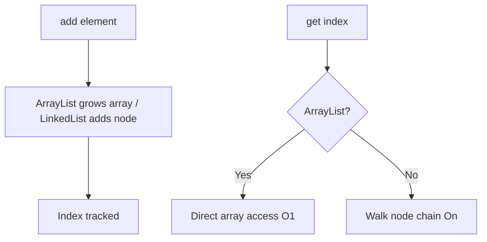

# List

## 1. Introduction

A **`List`** is an **ordered** collection that **allows duplicates** and supports **index-based access**. `ArrayList` (array-backed) and `LinkedList` (node-backed) are the two main implementations.

---

## 2. Why This Topic Is Important

- Lists are the most-used collection in Java.
- You'll store users, products, search results — all in Lists.
- Interviews test ArrayList vs LinkedList trade-offs.
- Every REST/DAO layer returns lists.

---

## 3. Real-World Analogy

A List is like a **numbered queue at a deli counter**. You get a ticket when you join (index), people can join at the end or cut in line (insert), and anyone can be called by number (index access). Tickets can repeat — two people can hold ticket #5 copies only if duplicates were allowed.

---

## 4. Theory

### Key Operations
| Method | Behavior |
|--------|----------|
| `add(E)` | Append at end |
| `add(i, E)` | Insert at index |
| `get(i)` | Element at index |
| `set(i, E)` | Replace at index |
| `remove(i)` / `remove(E)` | Remove by index or value |
| `size()` | Count |
| `contains(E)` | Existence check |
| `indexOf(E)` | First index (or -1) |
| `subList(a,b)` | View of a range |

### ArrayList vs LinkedList
| Aspect | ArrayList | LinkedList |
|--------|-----------|------------|
| Storage | Contiguous array | Node chain |
| Random access `get(i)` | O(1) | O(n) |
| Insert/remove at end | O(1) amortized | O(1) |
| Insert/remove at middle | O(n) shift | O(n) search |
| Memory | Less overhead | More (node links) |
| Best for | Read-heavy, random access | Insert/delete-heavy at ends |

---

## 5. Syntax

```java
import java.util.*;

List<String> list = new ArrayList<>();
list.add("a");
list.add(0, "first");      // insert at front
String x = list.get(1);
```

---

## 6. Flow Explanation



---

## 7. Memory Representation

- **ArrayList**: a single backing `Object[]`; grows ~50% when full.
- **LinkedList**: each node holds value + prev + next pointers.

---

## 8. Simple Example

```java
import java.util.*;

public class ListDemo {
    public static void main(String[] args) {
        List<String> fruits = new ArrayList<>();
        fruits.add("Apple");
        fruits.add("Banana");
        fruits.add("Cherry");

        System.out.println("Size: " + fruits.size());
        System.out.println("Index 1: " + fruits.get(1));
        System.out.println("Has Apple? " + fruits.contains("Apple"));

        fruits.set(0, "Apricot");
        System.out.println("After set: " + fruits);

        fruits.remove(2);
        System.out.println("After remove: " + fruits);
    }
}
```

---

## 9. Intermediate Example — Iterating

```java
import java.util.*;

public class IterateDemo {
    public static void main(String[] args) {
        List<Integer> scores = new ArrayList<>(Arrays.asList(45, 67, 89, 55));

        // for-each
        System.out.print("for-each: ");
        for (int s : scores) System.out.print(s + " ");
        System.out.println();

        // indexed
        System.out.print("indexed: ");
        for (int i = 0; i < scores.size(); i++) {
            System.out.print(scores.get(i) + " ");
        }
        System.out.println();

        // forEach + lambda (Java 8)
        System.out.print("lambda: ");
        scores.forEach(s -> System.out.print(s + " "));
        System.out.println();
    }
}
```

---

## 10. Advanced Example — Removing During Iteration

```java
import java.util.*;

public class SafeRemove {
    public static void main(String[] args) {
        List<Integer> numbers = new ArrayList<>(Arrays.asList(1, 2, 3, 4, 5, 6));

        // SAFE: use Iterator.remove()
        Iterator<Integer> it = numbers.iterator();
        while (it.hasNext()) {
            if (it.next() % 2 == 0) {
                it.remove();
            }
        }
        System.out.println("Even removed: " + numbers);

        // SAFE: removeIf (Java 8+)
        numbers.removeIf(n -> n < 3);
        System.out.println("Less than 3 removed: " + numbers);

        // List.of creates an immutable list (Java 9+)
        List<String> fixed = List.of("a", "b", "c");
        System.out.println("Immutable: " + fixed);
    }
}
```

---

## 11. Output

For the **Simple Example**:

```
Size: 3
Index 1: Banana
Has Apple? true
After set: [Apricot, Banana, Cherry]
After remove: [Apricot, Banana]
```

For the **Advanced Example**:

```
Even removed: [1, 3, 5]
Less than 3 removed: [3, 5]
Immutable: [a, b, c]
```

---

## 12. Common Mistakes

| Mistake | Correction |
|---------|------------|
| Removing while for-each looping | Use `Iterator.remove()` or `removeIf` |
| Using `==` on elements | Use `.equals()` |
| Index out of bounds | Check `size()` before `get(i)` |
| Unnecessary LinkedList | Default to ArrayList |
| Ignoring nulls | Decide if nulls are allowed |

---

## 13. Best Practices

- Default to **`ArrayList`**.
- Use **`List.of(...)`** for fixed, immutable lists (Java 9+).
- Use `removeIf` for conditional removal.
- Program to `List` interface.
- For heavy end-insertion/removal, consider `ArrayDeque`.

---

## 14. Interview Questions

**Q1. ArrayList vs LinkedList?**
*ArrayList: array-backed, fast get, slower mid-insert. LinkedList: node chain, fast end ops, slower get.*

**Q2. How does ArrayList grow?**
*~50% capacity increase, copying to a new array.*

**Q3. How do you safely remove while iterating?**
*Iterator.remove() or Collection.removeIf().*

**Q4. Why is List.of immutable?**
*Java 9 factory for fixed-size, unmodifiable lists.*

**Q5. Can a List contain duplicates?**
*Yes — duplicates allowed, order preserved.*

---

## 15. Practice Exercises

1. Store 5 cities in a list and print them three ways.
2. Insert at index 0 and remove from index 2.
3. Remove all even numbers safely.
4. Convert an array to a List and back.

---

## 16. Coding Challenges

1. **Easy:** A to-do list manager (add, remove, list).
2. **Medium:** Student score list — find max, average, and positions.
3. **Hard:** A contact list with search by first letter, safe deletion, and immutability in the public API.

---

## 17. Summary

- List = ordered, duplicates allowed, index access.
- ArrayList for most cases; LinkedList only for end-heavy patterns.
- Safe removal: Iterator or removeIf.
- Program to `List`; prefer `List.of` for fixed data.

➡️ Continue to: [Set](Set.md)