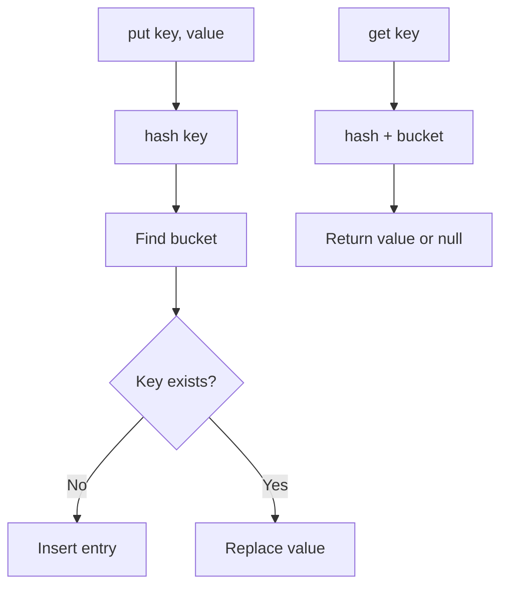

# Map

## 1. Introduction

A **`Map`** stores **key-value pairs**. Keys are unique; values can repeat. `HashMap` (fast, unordered), `LinkedHashMap` (insertion order), and `TreeMap` (sorted keys) are the core implementations.

---

## 2. Why This Topic Is Important

- Lookup-by-key is one of the most common operations in software.
- Maps back configuration, caching, counting, and grouping.
- Interviewers test HashMap internals and map iteration.
- Databases and JSON objects map naturally to Map.

---

## 3. Real-World Analogy

A Map is like a **dictionary** or **phone book**. You look up a word (key) to get its definition (value). Keys are unique — "Java" appears once. A HashMap is like an unordered dictionary; a TreeMap is a dictionary in alphabetical order.

---

## 4. Theory

### Key Operations
| Method | Behavior |
|--------|----------|
| `put(K, V)` | Insert or replace; returns old value |
| `get(K)` | Value or null |
| `getOrDefault(K, def)` | Value or default (Java 8) |
| `containsKey(K)` | Key exists? |
| `containsValue(V)` | Value exists? |
| `remove(K)` | Remove by key |
| `keySet()` | Set of keys |
| `values()` | Collection of values |
| `entrySet()` | Set of key-value entries |
| `merge`/`computeIfAbsent` | Advanced updates (Java 8) |

### Implementations
| Implementation | Ordering | Complexity | Best For |
|----------------|----------|------------|----------|
| `HashMap` | None | O(1) avg | Fastest lookups |
| `LinkedHashMap` | Insertion order | O(1) avg | Ordered iteration |
| `TreeMap` | Sorted by key | O(log n) | Sorted keys |

### HashMap Bucket Internals
Keys hash to buckets; collisions chain (or tree-ify). Performance depends on a good `hashCode`.

---

## 5. Syntax

```java
import java.util.*;

Map<String, Integer> map = new HashMap<>();
map.put("age", 25);
int age = map.getOrDefault("age", 0);
```

---

## 6. Flow Explanation



---

## 7. Memory Representation

HashMap = array of buckets → nodes (key, value, hash, next). TreeMap = red-black tree of entries.

---

## 8. Simple Example

```java
import java.util.*;

public class MapDemo {
    public static void main(String[] args) {
        Map<String, String> capitals = new HashMap<>();
        capitals.put("India", "New Delhi");
        capitals.put("USA", "Washington DC");
        capitals.put("Japan", "Tokyo");

        System.out.println("Capital of India: " + capitals.get("India"));
        System.out.println("Has France? " + capitals.containsKey("France"));
        System.out.println("Has New Delhi as value? " + capitals.containsValue("New Delhi"));

        capitals.put("India", "Delhi");     // replaces value
        System.out.println("Updated: " + capitals.get("India"));
        System.out.println("Size: " + capitals.size());
    }
}
```

---

## 9. Intermediate Example — Iteration & Word Count

```java
import java.util.*;

public class WordCount {
    public static void main(String[] args) {
        String[] words = {"java", "spring", "java", "boot", "spring", "java"};

        Map<String, Integer> counts = new HashMap<>();
        for (String w : words) {
            counts.put(w, counts.getOrDefault(w, 0) + 1);
        }

        // iterate entries
        for (Map.Entry<String, Integer> e : counts.entrySet()) {
            System.out.println(e.getKey() + " -> " + e.getValue());
        }
    }
}
```

---

## 10. Advanced Example — computeIfAbsent & Grouping

```java
import java.util.*;

public class AdvancedMap {
    public static void main(String[] args) {
        List<String> names = Arrays.asList("ajay", "priya", "amit", "pooja");

        // group names by first letter
        Map<Character, List<String>> byLetter = new HashMap<>();
        for (String n : names) {
            char first = Character.toUpperCase(n.charAt(0));
            byLetter.computeIfAbsent(first, k -> new ArrayList<>()).add(n);
        }
        System.out.println("Grouped: " + byLetter);

        // counting with merge
        Map<String, Integer> scores = new HashMap<>();
        scores.merge("ajay", 10, Integer::sum);
        scores.merge("ajay", 5, Integer::sum);
        System.out.println("ajay total: " + scores.get("ajay"));
    }
}
```

---

## 11. Output

For the **Intermediate Example**:

```
java -> 3
spring -> 2
boot -> 1
```

For the **Advanced Example**:

```
Grouped: {A=[ajay, amit], P=[priya, pooja]}
ajay total: 15
```

---

## 12. Common Mistakes

| Mistake | Correction |
|---------|------------|
| Assuming HashMap order | Use LinkedHashMap/TreeMap |
| `get()` returning null | Use `getOrDefault` or `containsKey` |
| Using mutable keys | Changes hash — corrupts the map |
| Ignoring null keys/values | HashMap allows; TreeMap doesn't (null keys) |
| Iterating with `keySet` + `get` | Inefficient — iterate `entrySet()` |

---

## 13. Best Practices

- Default to **HashMap**; switch only when ordering matters.
- Use `getOrDefault`, `computeIfAbsent`, `merge` to avoid null checks.
- Iterate `entrySet()` for both key and value.
- Use immutable keys (`String`, `Integer`, custom immutable).
- Prefer `Map.of` (Java 9+) for small constant maps.

---

## 14. Interview Questions

**Q1. How does HashMap work internally?**
*Array of buckets; keys hashed to buckets; collisions chained; Java 8+ tree-ifies large chains.*

**Q2. HashMap vs TreeMap?**
*HashMap O(1), no order. TreeMap O(log n), sorted keys.*

**Q3. Can a Map have null keys/values?**
*HashMap yes (one null key, many null values); TreeMap no null keys.*

**Q4. Why are immutable keys preferred?**
*A changed hashCode after insertion breaks lookup.*

**Q5. What is computeIfAbsent?**
*Computes and stores a value only if the key is absent.*

---

## 15. Practice Exercises

1. Build a phone book and look up numbers.
2. Count letter frequency in a string.
3. Group students by grade using computeIfAbsent.
4. Compare iteration order of HashMap vs TreeMap.

---

## 16. Coding Challenges

1. **Easy:** A word counter that ignores case.
2. **Medium:** A config store (key→value) with defaults.
3. **Hard:** A caching layer: LRU-like behavior using LinkedHashMap with accessOrder.

---

## 17. Summary

- Map = unique keys → values; look up fast.
- HashMap: fastest. LinkedHashMap: insertion order. TreeMap: sorted keys.
- Use getOrDefault/computeIfAbsent/merge to stay null-safe.
- Iterate entrySet for key+value.
- Immutable keys keep maps correct.

➡️ Continue to: [Queue](Queue.md)