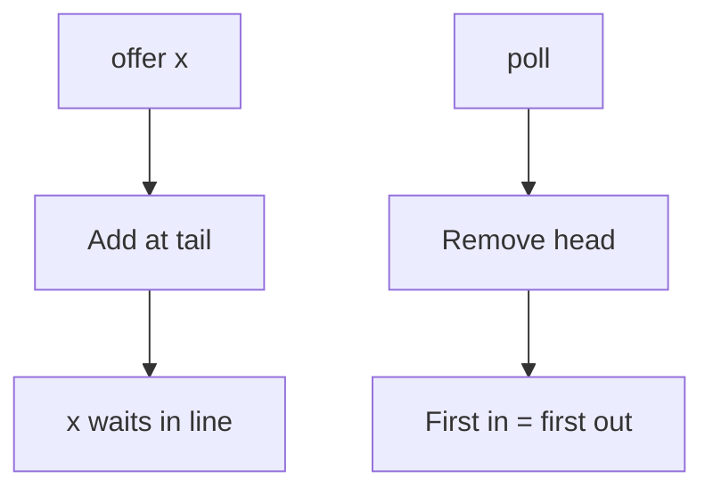

# Queue

## 1. Introduction

A **`Queue`** processes elements in a defined order — typically **FIFO (first-in, first-out)**. `ArrayDeque` (general queue/deque) and `PriorityQueue` (by priority) are the main implementations.

---

## 2. Why This Topic Is Important

- Task queues, message queues, print jobs — all FIFO.
- Priority queues power scheduling, Dijkstra's, and load balancing.
- Interviewers test queue operations and PriorityQueue behavior.
- Frameworks (task executors, message brokers) use queues internally.

---

## 3. Real-World Analogy

A Queue is the **line at a ticket counter**. The first person to arrive is served first (FIFO). A **PriorityQueue** is a *VIP* line — most passengers still wait in order, but those with priority skip ahead regardless of arrival time.

---

## 4. Theory

### Core Methods (with throw vs return flavors)
| Operation | Throws | Returns special value |
|-----------|--------|----------------------|
| Insert | `add(E)` | `offer(E)` → boolean |
| Remove | `remove()` | `poll()` → null if empty |
| Peek | `element()` | `peek()` → null if empty |

### Implementations
| Implementation | Order | Underlying | Best For |
|----------------|-------|------------|----------|
| `ArrayDeque` | FIFO (queue) / LIFO (deque) | Circular array | General queue/deque |
| `LinkedList` | FIFO | Node chain | Queue + list combo |
| `PriorityQueue` | By priority | Heap | Highest/lowest priority first |

### PriorityQueue Ordering
- Natural order by default (`Integer` → ascending).
- Custom via `Comparator` (or Comparable).
- Not fully sorted — `poll()` returns min/max one at a time.

### Deque (double-ended)
`ArrayDeque` also supports both ends: `addFirst`, `addLast`, `pollFirst`, `pollLast` — works as queue or stack.

---

## 5. Syntax

```java
import java.util.*;

Queue<String> queue = new ArrayDeque<>();
queue.offer("a");
queue.offer("b");
String next = queue.poll();      // "a"
```

---

## 6. Flow Explanation



---

## 7. Memory Representation

- ArrayDeque: circular array (efficient, no node overhead).
- PriorityQueue: binary heap in an array.
- LinkedList-as-queue: node chain.

---

## 8. Simple Example

```java
import java.util.*;

public class QueueDemo {
    public static void main(String[] args) {
        Queue<String> jobs = new ArrayDeque<>();
        jobs.offer("compile");
        jobs.offer("test");
        jobs.offer("package");

        System.out.println("Head (peek): " + jobs.peek());

        while (!jobs.isEmpty()) {
            System.out.println("Processing: " + jobs.poll());
        }
        System.out.println("Empty now: " + jobs.isEmpty());
    }
}
```

---

## 9. Intermediate Example — Priority Queue

```java
import java.util.*;

public class PriorityDemo {
    public static void main(String[] args) {
        PriorityQueue<Integer> pq = new PriorityQueue<>();
        pq.offer(30);
        pq.offer(10);
        pq.offer(20);
        pq.offer(40);

        System.out.print("Polling (natural ascending): ");
        while (!pq.isEmpty()) {
            System.out.print(pq.poll() + " ");
        }
        System.out.println();

        // Max-priority with Comparator
        PriorityQueue<Integer> maxPq =
                new PriorityQueue<>(Comparator.reverseOrder());
        maxPq.offer(30);
        maxPq.offer(10);
        maxPq.offer(20);
        System.out.print("Polling (descending)        : ");
        while (!maxPq.isEmpty()) {
            System.out.print(maxPq.poll() + " ");
        }
    }
}
```

---

## 10. Advanced Example — Deque as Stack & Priority Tasks

```java
import java.util.*;

class Task {
    String name;
    int priority;
    Task(String name, int priority) {
        this.name = name;
        this.priority = priority;
    }
    public String toString() { return name + "(" + priority + ")"; }
}

public class TaskQueue {
    public static void main(String[] args) {
        // PriorityQueue with custom Comparator (higher first)
        PriorityQueue<Task> tasks = new PriorityQueue<>(
                (a, b) -> b.priority - a.priority);
        tasks.offer(new Task("send email", 1));
        tasks.offer(new Task("fix outage", 10));
        tasks.offer(new Task("write docs", 5));

        while (!tasks.isEmpty()) {
            System.out.println("Handling: " + tasks.poll());
        }

        // Deque used as a stack (LIFO)
        ArrayDeque<String> stack = new ArrayDeque<>();
        stack.push("a");
        stack.push("b");
        stack.push("c");
        System.out.println("Stack pop: " + stack.pop());  // "c"
        System.out.println("Stack pop: " + stack.pop());  // "b"
    }
}
```

---

## 11. Output

For the **Intermediate Example**:

```
Polling (natural ascending): 10 20 30 40
Polling (descending)        : 40 30 20 10
```

For the **Advanced Example**:

```
Handling: fix outage(10)
Handling: write docs(5)
Handling: send email(1)
Stack pop: c
Stack pop: b
```

---

## 12. Common Mistakes

| Mistake | Correction |
|---------|------------|
| Using `add`/`remove` on possibly-empty queues | They throw; use offer/poll for graceful handling |
| Expecting PriorityQueue to be fully sorted | It's a heap — only poll order is guaranteed |
| Using LinkedList as default queue | ArrayDeque is more efficient |
| Confusing FIFO vs priority | Pick the right semantics deliberately |
| Forgetting to check `isEmpty()` | poll() returns null on empty |

---

## 13. Best Practices

- Use **offer/poll/peek** (return values) over throwing variants.
- **ArrayDeque** for general queue/deque/stack needs.
- **PriorityQueue** for "highest priority first" semantics.
- Provide a `Comparator` for custom priorities.
- Test `isEmpty()` before polling in loops.

---

## 14. Interview Questions

**Q1. FIFO vs LIFO?**
*FIFO = queue (first in, first out). LIFO = stack (last in, first out).*

**Q2. PriorityQueue ordering?**
*A binary heap — poll() returns the min (or custom-priority) element each time.*

**Q3. add/remove vs offer/poll?**
*Throwing vs special-value flavors for empty/full conditions.*

**Q4. When to use ArrayDeque?**
*General queue or stack; efficient, no nulls allowed.*

**Q5. How is a queue used in real apps?**
*Task scheduling, message processing, breadth-first search (Module 23).*

---

## 15. Practice Exercises

1. Simulate a print queue (FIFO).
2. Process integers in ascending priority.
3. Use ArrayDeque as a stack (push/pop).
4. Build a priority task queue with a Comparator.

---

## 16. Coding Challenges

1. **Easy:** A ticket counter simulation (FIFO).
2. **Medium:** An emergency room triage queue (highest severity first).
3. **Hard:** Implement a simple BFS using a queue and report visit order.

---

## 17. Summary

- Queue = FIFO processing; PriorityQueue = by priority.
- offer/poll/peek are the safe methods.
- ArrayDeque covers queue, deque, and stack.
- PriorityQueue polls min/max by comparator.
- Queues power scheduling and search algorithms.

➡️ Continue to: [Sorting & Comparable](Sorting-Comparable.md)