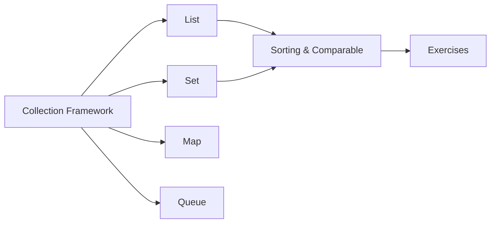

# 12 — Collections

> **Experience level: 🟡 Basic+ (6 months – 1 year)**

Collections are Java's built-in data structures — `List`, `Set`, `Map`, `Queue`, and friends. They store and organize data efficiently and are used in **every** real-world Java application.

---

## 📂 Files in This Module

| File | What You'll Learn |
|------|-------------------|
| [Collection-Framework.md](Collection-Framework.md) | The hierarchy that ties it together |
| [List.md](List.md) | Ordered, indexable data: ArrayList & LinkedList |
| [Set.md](Set.md) | Unique elements: HashSet, LinkedHashSet, TreeSet |
| [Map.md](Map.md) | Key-value pairs: HashMap, TreeMap |
| [Queue.md](Queue.md) | FIFO processing: ArrayDeque, PriorityQueue |
| [Sorting-Comparable.md](Sorting-Comparable.md) | Sorting with Comparable & Comparator |
| [Exercises.md](Exercises.md) | Practice tasks for this module |

---

## 🎯 Learning Objectives

By the end of this module, you will be able to:

1. ✅ Navigate the Collection Framework hierarchy.
2. ✅ Choose the right `List`, `Set`, or `Map` for the job.
3. ✅ Use queues for FIFO and priority processing.
4. ✅ Sort collections with Comparable and Comparator.
5. ✅ Convert between arrays and collections.

---

## 🧭 Module Map



---

## 📌 Quick Preview

```java
import java.util.*;

public class Preview {
    public static void main(String[] args) {
        List<String> names = new ArrayList<>();
        names.add("Ajay");
        names.add("Priya");

        Map<String, Integer> ages = new HashMap<>();
        ages.put("Ajay", 25);

        names.forEach(System.out::println);
        System.out.println(ages.get("Ajay"));
    }
}
```

---

## Next Module

➡️ [13 — File Handling](../13-File-Handling/README.md) — read and write files with Java.