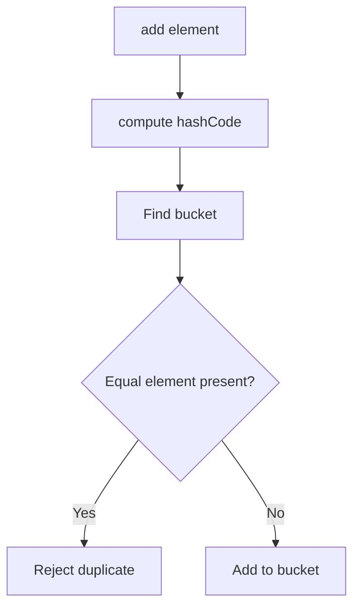

# Set

## 1. Introduction

A **`Set`** is a collection that **cannot contain duplicates**. `HashSet` (fast, unordered), `LinkedHashSet` (insertion order), and `TreeSet` (sorted) are the main implementations.

---

## 2. Why This Topic Is Important

- Uniqueness is a constant requirement: tags, IDs, visited pages.
- Set operations (union, intersection) solve real problems.
- Interviewers test HashSet vs TreeSet and equals/hashCode.
- Hibernate/Spring use sets for unique relationships.

---

## 3. Real-World Analogy

A Set is like a **guest list at a party** — you write every name once; nobody can appear twice. If the list is a HashSet, names are in no particular order (scattered). A TreeSet is a sorted A-to-Z list. Either way: no duplicates allowed.

---

## 4. Theory

### Implementations
| Implementation | Ordering | Underlying | Best For |
|----------------|----------|------------|----------|
| `HashSet` | None (hash order) | HashMap | Fast lookups, uniqueness |
| `LinkedHashSet` | Insertion order | LinkedHashMap | Unique + insertion order |
| `TreeSet` | Natural/sorted order | TreeMap | Sorted unique values |

### Key Operations (all O(1) for HashSet)
| Method | Behavior |
|--------|----------|
| `add(E)` | Add; returns false if duplicate |
| `remove(E)` | Remove value |
| `contains(E)` | Membership check |
| `size()` | Count |
| `addAll(other)` | Union |
| `retainAll(other)` | Intersection |
| `removeAll(other)` | Difference |

### The equals/hashCode Contract
For `HashSet`/`LinkedHashSet` to detect duplicates correctly, elements must override `equals()` **and** `hashCode()` consistently.

---

## 5. Syntax

```java
import java.util.*;

Set<String> set = new HashSet<>();
set.add("x");
set.add("x");          // ignored - already present
```

---

## 6. Flow Explanation



---

## 7. Memory Representation

- HashSet: array of buckets; each bucket holds entries (hash-backed).
- TreeSet: red-black tree nodes.

---

## 8. Simple Example

```java
import java.util.*;

public class SetDemo {
    public static void main(String[] args) {
        Set<String> tags = new HashSet<>();
        System.out.println("Added java: " + tags.add("java"));
        System.out.println("Added java: " + tags.add("java"));  // false
        tags.add("spring");
        tags.add("hibernate");

        System.out.println("Tags: " + tags);
        System.out.println("Contains spring? " + tags.contains("spring"));
        System.out.println("Size: " + tags.size());
    }
}
```

---

## 9. Intermediate Example — Ordering Differences

```java
import java.util.*;

public class SetOrderDemo {
    public static void main(String[] args) {
        List<Integer> input = Arrays.asList(50, 10, 30, 20);

        Set<Integer> hash = new HashSet<>(input);
        System.out.println("HashSet (unordered)  : " + hash);

        Set<Integer> linked = new LinkedHashSet<>(input);
        System.out.println("LinkedHashSet (insert): " + linked);

        Set<Integer> tree = new TreeSet<>(input);
        System.out.println("TreeSet (sorted)     : " + tree);
    }
}
```

---

## 10. Advanced Example — Set Algebra

```java
import java.util.*;

public class SetAlgebra {
    public static void main(String[] args) {
        Set<String> a = new HashSet<>(Arrays.asList("java", "sql", "html"));
        Set<String> b = new HashSet<>(Arrays.asList("java", "python", "css"));

        Set<String> union = new HashSet<>(a);
        union.addAll(b);
        System.out.println("Union       : " + union);

        Set<String> intersection = new HashSet<>(a);
        intersection.retainAll(b);
        System.out.println("Intersection: " + intersection);

        Set<String> difference = new HashSet<>(a);
        difference.removeAll(b);
        System.out.println("A - B       : " + difference);
    }
}
```

---

## 11. Output

For the **Simple Example**:

```
Added java: true
Added java: false
Tags: [java, spring, hibernate]
Contains spring? true
Size: 3
```

For the **Advanced Example**:

```
Union       : [java, sql, html, python, css]
Intersection: [java]
A - B       : [sql, html]
```

---

## 12. Common Mistakes

| Mistake | Correction |
|---------|------------|
| Forgetting equals/hashCode | Duplicates won't be detected |
| Relying on HashSet order | No guarantees — use LinkedHashSet/TreeSet |
| Modifying elements in a Set | Changes hash — breaks the set |
| Using TreeSet with non-comparable elements | Provide a Comparator |
| Expecting duplicates | Sets reject them by design |

---

## 13. Best Practices

- Use `Set` when uniqueness matters.
- Override `equals` + `hashCode` for custom types.
- Choose LinkedHashSet for stable insertion order.
- Use TreeSet (or TreeMap) for sorted iteration.
- Use `Set.copyOf` (Java 10+) for immutable sets.

---

## 14. Interview Questions

**Q1. When would you use a Set?**
*When you need to guarantee no duplicates.*

**Q2. HashSet vs TreeSet?**
*HashSet O(1), unordered; TreeSet O(log n), sorted.*

**Q3. Why do we override hashCode with equals?**
*To locate buckets consistently — objects that are equal must share a hash.*

**Q4. How do you find duplicates in a list?**
*Add all to a HashSet; duplicates are those where add() returns false.*

**Q5. Can a Set be sorted?**
*Yes — TreeSet, or by collecting to a sorted structure.*

---

## 15. Practice Exercises

1. Remove duplicates from a list using a Set.
2. Compare ordering of HashSet vs LinkedHashSet vs TreeSet.
3. Find common tags between two lists using Set algebra.
4. Implement a custom class with equals/hashCode and add to a Set.

---

## 16. Coding Challenges

1. **Easy:** Find unique words in a sentence.
2. **Medium:** A voting app — count unique and duplicate ballots.
3. **Hard:** A recommendation system: users who share interests (intersection) and exclusive interests (difference).

---

## 17. Summary

- Set = no duplicates.
- HashSet: fast/unordered. LinkedHashSet: insertion order. TreeSet: sorted.
- Override equals + hashCode for correctness.
- Set algebra (union/intersection/difference) is powerful.
- Choose the ordering you actually need.

➡️ Continue to: [Map](Map.md)