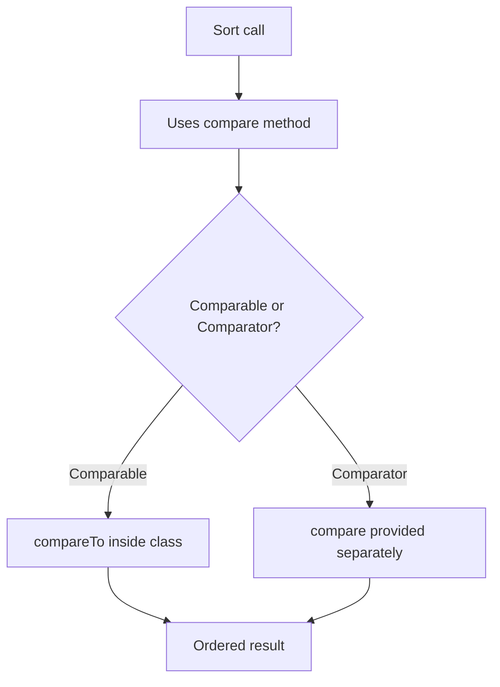

# Sorting & Comparable

## 1. Introduction

Sorting collections requires a way to compare elements. Java provides **`Comparable`** (natural order, in the class) and **`Comparator`** (custom order, outside the class). This topic covers both.

---

## 2. Why This Topic Is Important

- Sorting is everywhere: top scores, recent items, alphabetical lists.
- Interviews test Comparable vs Comparator constantly.
- `TreeSet`/`TreeMap`/`PriorityQueue` depend on these.
- Java 8 streams use them heavily (`sorted()`).

---

## 3. Real-World Analogy

**Comparable** is like a built-in trait: every student knows their own roll number, so they can naturally line up by roll number. **Comparator** is like a hall monitor with a clipboard: they can order the same students by height, by grade, or by age — any rule *from outside*.

---

## 4. Theory

### Comparable (natural order)
```java
class Student implements Comparable<Student> {
    int roll;
    @Override
    public int compareTo(Student o) {
        return this.roll - o.roll;    // ascending by roll
    }
}
```
| Return | Meaning |
|--------|---------|
| negative | this < other |
| 0 | equal |
| positive | this > other |

### Comparator (custom order)
```java
Comparator<Student> byName = (a, b) -> a.name.compareTo(b.name);
```
Java 8 chaining:
```java
Comparator<Student> byAgeThenName =
        Comparator.comparingInt(Student::getAge)
                  .thenComparing(Student::getName);
```

### Choosing
| Aspect | Comparable | Comparator |
|--------|-----------|------------|
| Where | Inside the class | Separate |
| Signature | `compareTo(T)` | `compare(T, T)` |
| Single natural order | ✅ | Multiple orders |
| Changes class? | Yes (implements) | No |
| Used by | `TreeSet`, `Collections.sort` | Any custom sort |

---

## 5. Syntax

```java
// Comparable
class X implements Comparable<X> {
    public int compareTo(X o) { ... }
}

// Comparator (lambda)
Collections.sort(list, (a, b) -> Integer.compare(a.age, b.age));
```

---

## 6. Flow Explanation



---

## 7. Memory Representation

Sorting algorithms swap references/values based on comparisons — no special memory layout beyond the collection itself.

---

## 8. Simple Example — Comparable

```java
import java.util.*;

class Student implements Comparable<Student> {
    String name;
    int roll;

    Student(String name, int roll) {
        this.name = name;
        this.roll = roll;
    }

    @Override
    public int compareTo(Student o) {
        return this.roll - o.roll;      // ascending by roll
    }

    @Override
    public String toString() { return name + "(" + roll + ")"; }
}

public class ComparableDemo {
    public static void main(String[] args) {
        List<Student> students = new ArrayList<>(Arrays.asList(
                new Student("Priya", 102),
                new Student("Ajay", 101),
                new Student("Ravi", 103)));

        Collections.sort(students);
        System.out.println("Sorted by roll: " + students);
    }
}
```

---

## 9. Intermediate Example — Comparator Multiple Ways

```java
import java.util.*;

class Employee {
    String name;
    int age;
    double salary;

    Employee(String name, int age, double salary) {
        this.name = name;
        this.age = age;
        this.salary = salary;
    }

    @Override
    public String toString() { return name + "(" + age + ")"; }
}

public class ComparatorDemo {
    public static void main(String[] args) {
        List<Employee> emps = new ArrayList<>(Arrays.asList(
                new Employee("Priya", 30, 80000),
                new Employee("Ajay", 25, 90000),
                new Employee("Ravi", 30, 70000)));

        emps.sort(Comparator.comparingInt(Employee::getAge));
        System.out.println("By age: " + emps);

        emps.sort(Comparator.comparingDouble(Employee::getSalary)
                .reversed());
        System.out.println("By salary desc: " + emps);

        emps.sort(Comparator.comparingInt(Employee::getAge)
                .thenComparing(Employee::getName));
        System.out.println("By age then name: " + emps);
    }
}
```

---

## 10. Advanced Example — Nulls & Reverse

```java
import java.util.*;

public class AdvancedSort {
    public static void main(String[] args) {
        List<String> names = new ArrayList<>(Arrays.asList("Banana", "Apple",
                null, "Cherry"));

        names.sort(Comparator.nullsFirst(String::compareTo));
        System.out.println("Nulls first: " + names);

        names.sort(Comparator.nullsLast(String::compareTo)
                .reversed());
        System.out.println("Reversed, nulls last: " + names);

        List<Integer> nums = new ArrayList<>(Arrays.asList(5, 2, 9, 1));
        nums.sort(Comparator.reverseOrder());
        System.out.println("Descending: " + nums);
    }
}
```

---

## 11. Output

For the **Intermediate Example**:

```
By age: [Ajay(25), Priya(30), Ravi(30)]
By salary desc: [Ajay(25), Priya(30), Ravi(30)]
By age then name: [Ajay(25), Priya(30), Ravi(30)]
```

For the **Advanced Example**:

```
Nulls first: [Apple, Banana, Cherry, null]
Reversed, nulls last: [Cherry, Banana, Apple, null]
Descending: [9, 5, 2, 1]
```

---

## 12. Common Mistakes

| Mistake | Correction |
|---------|------------|
| Subtracting for compare (`a-b`) | Integer overflow risk — use `Integer.compare` |
| Ignoring tie-breaking | Chain with `thenComparing` |
| Changing equals/compareTo inconsistently | Breaks TreeSet/TreeMap |
| Returning wrong sign convention | this-first vs other-first |
| Using Comparable when multiple orders needed | Use Comparator |

---

## 13. Best Practices

- Implement `Comparable` only for the **one natural order**.
- Use **Comparators** for everything else (age, name, salary).
- Chain with `thenComparing` for ties.
- Use `Comparator.comparingInt/Double` to avoid boxing.
- Handle nulls explicitly (`nullsFirst`/`nullsLast`).

---

## 14. Interview Questions

**Q1. Comparable vs Comparator?**
*Comparable = natural order inside class (compareTo). Comparator = external custom order (compare).*

**Q2. What should compareTo return?**
*negative / zero / positive for less / equal / greater.*

**Q3. Can you sort in descending order?**
*Yes — Comparator.reverseOrder() or reversed().*

**Q4. Why avoid `a - b` in comparisons?**
*Integer overflow produces wrong results; use Integer.compare.*

**Q5. How do you sort by multiple criteria?**
*thenComparing chains.*

---

## 15. Practice Exercises

1. Make a `Product` comparable by price.
2. Sort products by name using a Comparator.
3. Sort employees by salary descending.
4. Sort with nullsFirst and nullsLast.

---

## 16. Coding Challenges

1. **Easy:** Sort a list of strings naturally and reversed.
2. **Medium:** Sort employees by age then salary with chained comparators.
3. **Hard:** A ranking system — players sorted by score, then by name on ties; print the leaderboard.

---

## 17. Summary

- Comparable: natural order (compareTo) inside the class.
- Comparator: external custom order; multiple rules.
- Chain `thenComparing`; use comparingInt/Double.
- `Integer.compare` over subtraction.
- TreeSet/TreeMap/PriorityQueue/streams all use these.

➡️ Continue to: [Exercises](Exercises.md)