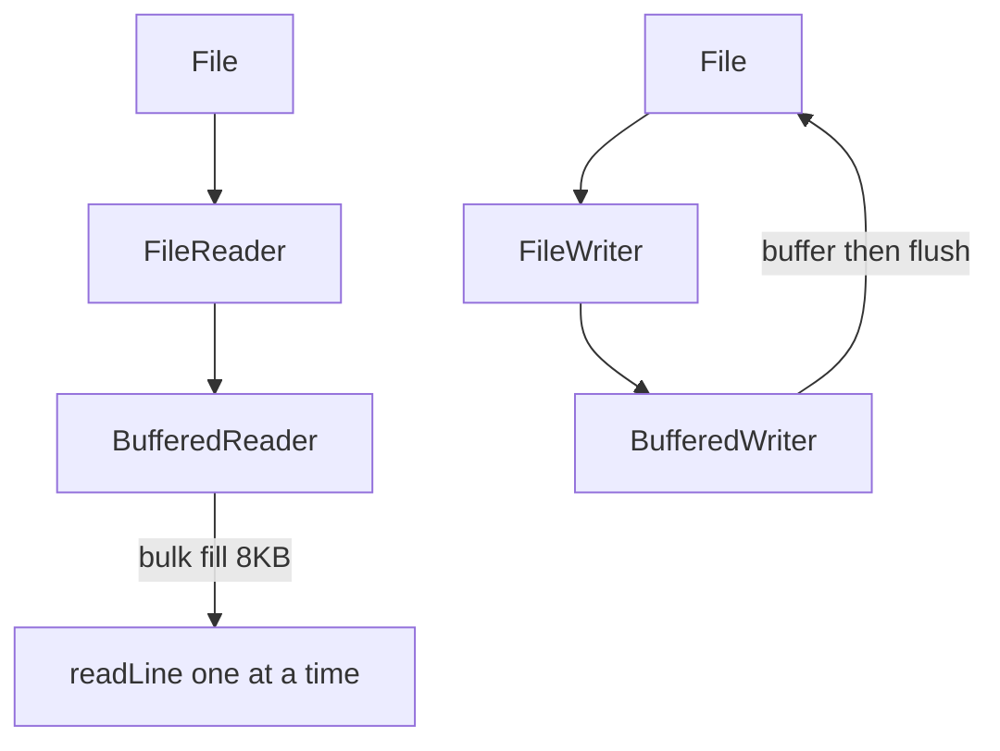

# BufferedReader & BufferedWriter

## 1. Introduction

**`BufferedReader`** and **`BufferedWriter`** wrap other readers/writers to add **buffering** — reading and writing in bulk — plus convenient methods like `readLine()` and `newLine()`.

---

## 2. Why This Topic Is Important

- Per-character I/O is brutally slow; buffering fixes it.
- `readLine()` makes text processing trivial.
- Interviewers ask why buffered streams are faster.
- Real code almost always uses buffered I/O.

---

## 3. Real-World Analogy

Without buffering, reading a file is like **walking to the library for each word**. With buffering, you **bring home a whole book** (the buffer) and read many words at once. Same words, far fewer trips.

---

## 4. Theory

### BufferedReader
```java
BufferedReader br = new BufferedReader(new FileReader("file.txt"));
String line = br.readLine();    // null at EOF
br.lines().forEach(...);        // Java 8 stream of lines
```
- Default buffer size: 8192 chars.
- `readLine()` strips the newline.

### BufferedWriter
```java
BufferedWriter bw = new BufferedWriter(new FileWriter("file.txt"));
bw.write("line");
bw.newLine();        // platform line separator
bw.flush();          // force write
```

### Why It's Faster
| Without buffer | With buffer |
|---------------|-------------|
| 1 system call per char | 1 system call per ~8KB |
| Huge overhead | Minimal overhead |

---

## 5. Syntax

```java
try (BufferedReader br = new BufferedReader(new FileReader("in.txt"))) {
    String line;
    while ((line = br.readLine()) != null) { ... }
}
```

---

## 6. Flow Explanation



---

## 7. Memory Representation

Buffered streams hold a char array (default 8192) that fills/empties in bulk; the underlying stream handles the actual file I/O.

---

## 8. Simple Example

```java
import java.io.BufferedReader;
import java.io.FileReader;
import java.io.FileWriter;
import java.io.BufferedWriter;

public class BufferedDemo {
    public static void main(String[] args) throws Exception {
        try (BufferedWriter bw = new BufferedWriter(new FileWriter("lines.txt"))) {
            bw.write("First line");
            bw.newLine();
            bw.write("Second line");
            bw.newLine();
            bw.write("Third line");
        }

        try (BufferedReader br = new BufferedReader(new FileReader("lines.txt"))) {
            String line;
            while ((line = br.readLine()) != null) {
                System.out.println("Read: " + line);
            }
        }
    }
}
```

---

## 9. Intermediate Example — Processing Line by Line

```java
import java.io.BufferedReader;
import java.io.FileReader;

public class LineStats {
    public static void main(String[] args) throws Exception {
        int lines = 0, words = 0;

        try (BufferedReader br = new BufferedReader(new FileReader("lines.txt"))) {
            String line;
            while ((line = br.readLine()) != null) {
                lines++;
                words += line.split("\\s+").length;
            }
        }
        System.out.println("Lines: " + lines + ", Words: " + words);
    }
}
```

---

## 10. Advanced Example — Stream of Lines + Try-With-Resources

```java
import java.io.BufferedReader;
import java.io.FileReader;

public class StreamLines {
    public static void main(String[] args) throws Exception {
        try (BufferedReader br = new BufferedReader(new FileReader("lines.txt"))) {
            System.out.println("First word of each line:");
            br.lines()
              .filter(l -> !l.isBlank())
              .map(l -> l.split("\\s+")[0])
              .forEach(System.out::println);
        }
    }
}
```

---

## 11. Output

For the **Simple Example**:

```
Read: First line
Read: Second line
Read: Third line
```

For the **Intermediate Example**:

```
Lines: 3, Words: 6
```

---

## 12. Common Mistakes

| Mistake | Correction |
|---------|------------|
| Not closing the wrapper | Closing BufferedReader closes the underlying reader |
| Forgetting `readLine()` returns null at EOF | Loop while `line != null` |
| Mixing readLine and read() | They share position — confusing |
| Not using `newLine()` | Platform-specific `\n` breaks Windows files |
| Wrapping without buffering need | It's almost always worth it |

---

## 13. Best Practices

- Always buffer file text I/O.
- Use `readLine()` + `while` loop for line processing.
- Use `br.lines()` (Java 8) for stream pipelines.
- `newLine()` instead of `"\n"`.
- Close wrappers (they close the chain).

---

## 14. Interview Questions

**Q1. Why is buffered I/O faster?**
*Fewer system calls — data is read/written in bulk (default 8KB).*

**Q2. What does readLine() return at EOF?**
*null.*

**Q3. Do you need to close the underlying stream too?**
*No — closing the buffered wrapper closes the chain.*

**Q4. What is the default buffer size?**
*8192 characters.*

**Q5. newLine() vs "\n"?**
*newLine() uses the platform line separator; "\n" is hard-coded.*

---

## 15. Practice Exercises

1. Write 3 lines with BufferedWriter and read them back.
2. Count words and characters in a file.
3. Print the longest line in a file.
4. Use `br.lines()` to print lines containing "Java".

---

## 16. Coding Challenges

1. **Easy:** A reverse-line printer.
2. **Medium:** A CSV summarizer reading line by line.
3. **Hard:** A log analyzer: count error levels (INFO/WARN/ERROR) using buffered reading.

---

## 17. Summary

- Buffered I/O = bulk reads/writes + `readLine()`.
- Close the wrapper; it closes the chain.
- `newLine()` for portable line endings.
- Use `br.lines()` for stream pipelines.
- Buffer all text file I/O.

➡️ Continue to: [File, Path & NIO](File-Path-NIO.md)