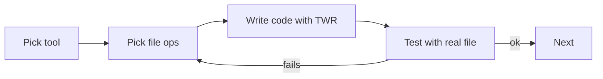

# Exercises — File Handling

## 1. Introduction

Practice reading, writing, and managing files. You'll build tools you'd actually use: loggers, backup scripts, data importers, and save-game systems.

---

## 2. Why This Topic Is Important

- File I/O powers configs, data, logs, and exports.
- Interviews test practical file manipulation.
- All the try-with-resources and exception skills come together here.
- Frameworks (Spring) load configs and process uploads.

---

## 3. Real-World Analogy

Practice is like **learning the post office**: writing letters (writing files), reading them (reading files), forwarding (move), duplicating (copy), and shredding (delete). Master the tools and any file task is easy.

---

## 4. Theory — Toolbox Recap

- Byte streams: InputStream/OutputStream (binary).
- Char streams: Reader/Writer (text).
- Buffered: BufferedReader/Writer (fast, readLine).
- NIO: Path + Files (modern, simple).
- Serialization: objects ↔ bytes.

---

## 5. Syntax Reminder

```java
try (BufferedWriter bw = new BufferedWriter(new FileWriter("out.txt"))) {
    bw.write("data");
    bw.newLine();
}
```

---

## 6. Practice Flow



---

## 7. Memory Representation

Skip — this module is about doing, not memory.

---

## 8. Simple Exercises

**Ex 1 — Hello File**
Write "Hello, Files!" and read it back with FileWriter/FileReader.

**Ex 2 — NIO Fast Path**
Repeat Ex 1 with `Files.writeString`/`readString`.

**Ex 3 — Line Writer**
Write 5 numbered lines with BufferedWriter + newLine.

---

## 9. Intermediate Exercises

**Ex 4 — Line Counter**
Count lines, words, and characters in a text file.

**Ex 5 — Appending Logger**
A logger that appends timestamped events to `log.txt`.

**Ex 6 — Copy & Backup**
Copy a file to `backup-<timestamp>.txt` using Files.copy.

**Ex 7 — CSV Importer**
Read a CSV of `name,score`, parse it, and print names with scores > 50.

---

## 10. Advanced Exercises

**Ex 8 — Config Loader**
Parse `key=value` lines into a Map and look up values.

**Ex 9 — File Manager**
A menu-driven tool: create dir, create file, copy, move, delete (all with safe options).

**Ex 10 — Save Game**
Serialize a `Player` (name, level, score) and its inventory list to a file; load and continue the game.

**Ex 11 — Log Analyzer**
Read a log file, count INFO/WARN/ERROR lines, and print a summary. Skip blank lines.

---

## 11. Expected Output Samples

**Ex 4 (Line Counter):**
```
Lines: 3, Words: 6, Chars: 24
```

**Ex 11 (Log Analyzer):**
```
INFO: 12
WARN: 3
ERROR: 1
```

---

## 12. Common Mistakes

| Mistake | Fix |
|---------|-----|
| Forgetting to close | Try-with-resources |
| Overwriting instead of appending | FileWriter(path, true) |
| Not specifying charset | UTF-8 explicitly |
| Loading huge files with readString | Buffer or stream |
| Ignoring IOException | Handle or declare |

---

## 13. Best Practices

- Buffer all text I/O.
- Close everything with try-with-resources.
- Use NIO Path + Files for modern code.
- Test with real files on disk.
- Handle missing files gracefully.

---

## 14. Interview Practice Questions

**Q1.** Byte vs character streams?
**Q2.** Why buffered I/O?
**Q3.** How do you append to a file?
**Q4.** What is serialization and what does transient do?
**Q5.** readString vs readAllLines — when each?

---

## 15. Self-Check

- [ ] I can write and read text files multiple ways.
- [ ] I use BufferedReader/Writer for performance.
- [ ] I can create/copy/move/delete files and dirs.
- [ ] I use try-with-resources everywhere.
- [ ] I can serialize and deserialize objects.
- [ ] I handle missing files and I/O errors gracefully.

---

## 16. Next Steps

- Move to [Module 14 — Multithreading](../14-Multithreading/README.md).
- Later, combine file reading with collections and streams (Modules 12, 16).

---

## 17. Summary

- Text → buffered char I/O; binary → byte streams.
- NIO Files makes most ops one line.
- Append with the true flag.
- Serialize objects for state persistence.
- Handle exceptions and close resources always.

➡️ Module complete! Continue to [14 — Multithreading](../14-Multithreading/README.md).