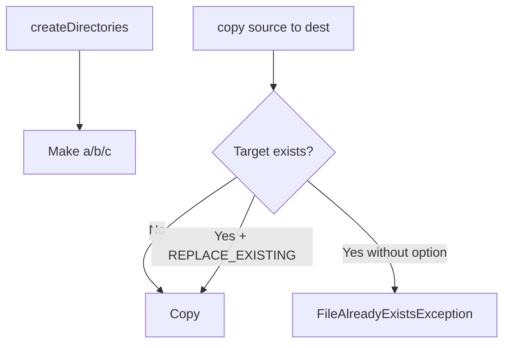

# File Operations

## 1. Introduction

Beyond reading and writing content, you need to **manage** files and directories: create, copy, move, delete, rename, and check properties. `Files` and `Path` cover all of it.

---

## 2. Why This Topic Is Important

- Real apps create exports, move uploads, archive logs, clean temp files.
- Interviewers test copy/move/delete semantics.
- File operations fail in predictable ways — handle them.
- Frameworks manage files for uploads and artifacts.

---

## 3. Real-World Analogy

Think of a **filing clerk**. They don't just read documents — they create folders, copy files, move papers between cabinets, rename labels, and shred unneeded ones. `Files` is your automated filing clerk.

---

## 4. Theory

### Core Operations
| Operation | Method | Notes |
|-----------|--------|-------|
| Create file | `Files.createFile(p)` | Fails if exists |
| Create dir | `Files.createDirectory(p)` | Parent must exist |
| Create dirs | `Files.createDirectories(p)` | Creates parents too |
| Copy | `Files.copy(src, dst, options)` | `REPLACE_EXISTING` |
| Move/rename | `Files.move(src, dst, options)` | Atomic if same fs |
| Delete | `Files.delete(p)` | Throws if missing |
| Delete if exists | `Files.deleteIfExists(p)` | Silent |
| Check | `exists`, `isDirectory`, `isRegularFile` | Booleans |
| Size | `Files.size(p)` | Bytes |
| Temp | `Files.createTempFile/Directory` | Auto cleanup dir |

### Common Options (CopyOption)
| Option | Effect |
|--------|--------|
| `REPLACE_EXISTING` | Overwrite target |
| `COPY_ATTRIBUTES` | Copy timestamps |
| `ATOMIC_MOVE` | Move atomically |

---

## 5. Syntax

```java
Files.createDirectories(Path.of("a/b/c"));
Files.copy(Path.of("a.txt"), Path.of("b.txt"), StandardCopyOption.REPLACE_EXISTING);
```

---

## 6. Flow Explanation



---

## 7. Memory Representation

Operations are handled by the OS via the JVM's file system calls; NIO streams copy in chunks without loading whole files.

---

## 8. Simple Example

```java
import java.nio.file.*;

public class CreateDemo {
    public static void main(String[] args) throws Exception {
        Path dir = Path.of("temp-project");
        Files.createDirectories(dir.resolve("src/main"));   // nested dirs

        Path file = dir.resolve("src/main/App.java");
        Files.createFile(file);
        System.out.println("Created: " + file);
        System.out.println("Exists? " + Files.exists(file));
        System.out.println("Is directory? " + Files.isDirectory(dir));
    }
}
```

---

## 9. Intermediate Example — Copy & Move

```java
import java.nio.file.*;

public class CopyMoveDemo {
    public static void main(String[] args) throws Exception {
        Path src = Path.of("original.txt");
        Files.writeString(src, "Important data");

        Path backup = Path.of("backup.txt");
        Files.copy(src, backup, StandardCopyOption.REPLACE_EXISTING);
        System.out.println("Copied to backup.");

        Path archived = Path.of("archive/");
        Files.createDirectories(archived);
        Files.move(backup, archived.resolve("backup.txt"));
        System.out.println("Moved into archive.");

        System.out.println("Backup still at root? " + Files.exists(backup));
        System.out.println("In archive? " + Files.exists(archived.resolve("backup.txt")));
    }
}
```

---

## 10. Advanced Example — Safe Delete & Temp Files

```java
import java.nio.file.*;

public class CleanupDemo {
    public static void main(String[] args) throws Exception {
        Path tempFile = Files.createTempFile("myapp", ".tmp");
        System.out.println("Temp file: " + tempFile);

        Path gone = Path.of("gone.txt");
        // deleteIfExists never throws for a missing file
        boolean deleted = Files.deleteIfExists(gone);
        System.out.println("Delete missing? " + deleted);

        Path toDelete = Path.of("delete-me.txt");
        Files.writeString(toDelete, "junk");
        System.out.println("Delete existing? "
                + Files.deleteIfExists(toDelete));

        // clean up temp file
        Files.deleteIfExists(tempFile);
        System.out.println("Temp cleaned up.");
    }
}
```

---

## 11. Output

For the **Intermediate Example**:

```
Copied to backup.
Moved into archive.
Backup still at root? false
In archive? true
```

For the **Advanced Example**:

```
Temp file: C:\...\myapp1234567890.tmp
Delete missing? false
Delete existing? true
Temp cleaned up.
```

---

## 12. Common Mistakes

| Mistake | Correction |
|---------|------------|
| `createFile` when file exists | Throws — check or use deleteIfExists/writeString |
| `createDirectory` without parent | Use `createDirectories` |
| Copy over an existing file | Add `REPLACE_EXISTING` |
| `delete` on missing file | Use `deleteIfExists` |
| Forgetting options | Import `StandardCopyOption` |

---

## 13. Best Practices

- Use `createDirectories` for nested paths.
- Pass `REPLACE_EXISTING` deliberately.
- Use `deleteIfExists` for idempotent cleanup.
- Use temp files for scratch work.
- Handle `IOException` (checked) properly.

---

## 14. Interview Questions

**Q1. createDirectory vs createDirectories?**
*createDirectories also creates missing parents.*

**Q2. How to overwrite during copy?**
*StandardCopyOption.REPLACE_EXISTING.*

**Q3. delete vs deleteIfExists?**
*delete throws on missing; deleteIfExists returns false.*

**Q4. What is ATOMIC_MOVE?**
*Moves the file in one atomic operation, never leaving a partial state.*

**Q5. How to create temp files?**
*Files.createTempFile(prefix, suffix).*

---

## 15. Practice Exercises

1. Create a nested directory structure.
2. Copy a file and overwrite an existing target.
3. Move a file into a new folder.
4. Delete files safely with deleteIfExists.

---

## 16. Coding Challenges

1. **Easy:** A backup script (copy file with timestamp name).
2. **Medium:** A log archiver: move `.log` files to an archive folder.
3. **Hard:** A temp-file manager that creates, uses, and auto-cleans temporary working files.

---

## 17. Summary

- Files: create, copy, move, delete, check.
- createDirectories for nested; REPLACE_EXISTING to overwrite.
- deleteIfExists for safe cleanup.
- Temp files for scratch work.
- Always handle IOException.

➡️ Continue to: [Serialization](Serialization.md)