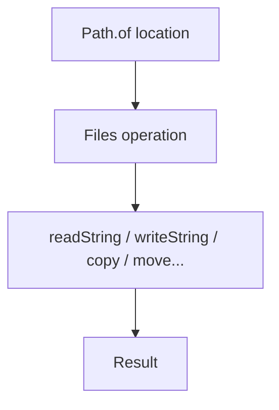

# File, Path & NIO

## 1. Introduction

The **`java.nio.file`** package (NIO.2, Java 7+) is the modern way to work with files: `Path` represents a location, and the static `Files` class provides almost every file operation with clean, one-line methods.

---

## 2. Why This Topic Is Important

- NIO replaces the older `java.io.File` for most work.
- `Files.readString/writeString` are the simplest file APIs ever.
- Interviewers at 1+ years expect NIO knowledge.
- Spring Boot and all modern tooling use NIO under the hood.

---

## 3. Real-World Analogy

Think of **GPS coordinates vs walking**. The old `File` API is like walking street by street (error-prone, verbose). `Path` is the coordinates (a clean location), and `Files` is a **teleport service** — you just say the destination and the operation, and it's done.

---

## 4. Theory

### Path
```java
Path p = Path.of("data.txt");                 // Java 11+
Path dir = Path.of("C:", "projects", "app");  // multi-part
```
Represents a location — doesn't touch disk.

### Files (static utility)
| Method | Purpose |
|--------|---------|
| `readString(Path)` | Whole file → String (Java 11) |
| `writeString(Path, String)` | String → file (Java 11) |
| `readAllLines(Path)` | All lines → List |
| `newBufferedReader/Writer` | Buffered char I/O |
| `copy`, `move`, `delete` | Operations |
| `exists`, `isDirectory`, `size` | Checks |
| `list`, `walk` | Directory listing |

### Path vs File
| Aspect | Path/NIO | File (old) |
|--------|----------|-----------|
| API | Clean, static methods | Verbose |
| Symlinks | Handled well | Poorly |
| Encoding | Charset-aware | Platform default |
| Watch service | Built-in | None |

---

## 5. Syntax

```java
import java.nio.file.*;

Path p = Path.of("hello.txt");
Files.writeString(p, "content");       // create/write
String content = Files.readString(p);  // read back
```

---

## 6. Flow Explanation



---

## 7. Memory Representation

Path is a lightweight location object. `readString` loads the whole file into a String in memory (fine for small files).

---

## 8. Simple Example

```java
import java.nio.file.*;

public class NIODemo {
    public static void main(String[] args) throws Exception {
        Path p = Path.of("hello.txt");

        Files.writeString(p, "Hello, NIO!");
        System.out.println("Read back: " + Files.readString(p));

        System.out.println("Exists: " + Files.exists(p));
        System.out.println("Size: " + Files.size(p) + " bytes");
    }
}
```

---

## 9. Intermediate Example — All Lines & Charset

```java
import java.nio.charset.StandardCharsets;
import java.nio.file.*;

public class LinesDemo {
    public static void main(String[] args) throws Exception {
        Path p = Path.of("lines.txt");

        Files.writeString(p, "one\ntwo\nthree", StandardCharsets.UTF_8);

        // read all lines
        for (String line : Files.readAllLines(p)) {
            System.out.println("Line: " + line);
        }
    }
}
```

---

## 10. Advanced Example — Directory Listing & Filters

```java
import java.nio.file.*;

public class DirectoryDemo {
    public static void main(String[] args) throws Exception {
        Path dir = Path.of(".");

        System.out.println("Files in current directory:");
        try (var stream = Files.list(dir)) {
            stream.filter(Files::isRegularFile)
                  .map(Path::getFileName)
                  .forEach(System.out::println);
        }

        // print files ending in .java
        System.out.println("Java files:");
        try (var stream = Files.list(dir)) {
            stream.filter(p -> p.toString().endsWith(".java"))
                  .forEach(System.out::println);
        }
    }
}
```

---

## 11. Output

For the **Simple Example**:

```
Read back: Hello, NIO!
Exists: true
Size: 10 bytes
```

For the **Advanced Example** (sample):

```
Files in current directory:
hello.txt
Main.java
data.csv
Java files:
Main.java
```

---

## 12. Common Mistakes

| Mistake | Correction |
|---------|------------|
| Using old `File` API everywhere | Prefer `Path` + `Files` |
| `readString` on huge files | Stream or buffer large files |
| Not closing `Files.list` streams | Try-with-resources — they're AutoCloseable |
| Ignoring charset | Specify UTF-8 explicitly |
| Expecting Path creation to validate | `Path.of` doesn't touch disk |

---

## 13. Best Practices

- Use `Path.of` + `Files` for most file work.
- `readString/writeString` for small files.
- Specify `StandardCharsets.UTF_8`.
- Close directory streams with try-with-resources.
- Use `Files.move/copy` instead of manual streams.

---

## 14. Interview Questions

**Q1. What is Path?**
*A location in the filesystem — doesn't touch disk until used.*

**Q2. Why NIO over java.io.File?**
*Cleaner API, symlink handling, charset control, watch services.*

**Q3. What's the simplest way to read a whole file?**
*`Files.readString(path)` (Java 11).*

**Q4. What does Files.writeString do if the file exists?**
*Overwrites it.*

**Q5. Are Files.list streams AutoCloseable?**
*Yes — close them to release the directory handle.*

---

## 15. Practice Exercises

1. Write and read a file with Files.
2. Print all lines of a file as a List.
3. List `.txt` files in the current directory.
4. Read a file specifying UTF-8.

---

## 16. Coding Challenges

1. **Easy:** A settings file reader/writer using Files.
2. **Medium:** A directory lister with size for each file.
3. **Hard:** A file finder that walks a tree and reports files over a size threshold.

---

## 17. Summary

- Path = location; Files = operations.
- readString/writeString: simplest file I/O ever.
- Use UTF-8 explicitly.
- Close directory streams.
- Prefer NIO for all modern Java file work.

➡️ Continue to: [File Operations](File-Operations.md)