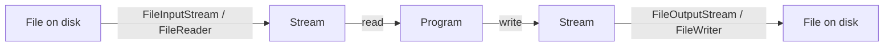

# File Streams Basics

## 1. Introduction

Java I/O is built on **streams** — sequences of data flowing into or out of your program. **Byte streams** (raw bytes) and **character streams** (text) cover all file operations.

---

## 2. Why This Topic Is Important

- Streams are the foundation of all file and network I/O.
- Choosing byte vs character streams affects correctness.
- Interviewers test the stream hierarchy and `AutoCloseable`.
- Data flows (files, sockets, pipes) all use streams.

---

## 3. Real-World Analogy

A stream is like a **water pipe**. Water (data) flows through it from a source (file) to a destination (program). A byte stream carries raw drops (bytes); a character stream carries readable words (text). Both flow continuously, drop by drop.

---

## 4. Theory

### Two Stream Families
| Family | Base Class | Unit | Best For |
|--------|-----------|------|----------|
| Byte streams | `InputStream` / `OutputStream` | bytes | Images, audio, any binary |
| Character streams | `Reader` / `Writer` | chars | Text files, JSON, logs |

### Common Implementations
| Class | Reads/Writes | Notes |
|-------|--------------|-------|
| `FileInputStream` | bytes from file | binary data |
| `FileOutputStream` | bytes to file | binary data |
| `FileReader` | chars from file | text (default charset) |
| `FileWriter` | chars to file | text |
| `BufferedReader/Writer` | buffered chars | efficient (next topic) |

### Always Close
Streams implement `AutoCloseable` — use **try-with-resources**.

---

## 5. Syntax

```java
try (OutputStream out = new FileOutputStream("data.bin")) {
    out.write(42);          // write a byte
} catch (IOException e) { ... }
```

---

## 6. Flow Explanation



---

## 7. Memory Representation

Streams buffer data in memory; the OS manages disk access. Each stream holds an internal buffer or connection to the file descriptor.

---

## 8. Simple Example — Byte Stream

```java
import java.io.FileInputStream;
import java.io.FileOutputStream;

public class ByteStreamDemo {
    public static void main(String[] args) throws Exception {
        try (FileOutputStream out = new FileOutputStream("data.bin")) {
            out.write(65);           // 'A'
            out.write(66);           // 'B'
        }

        try (FileInputStream in = new FileInputStream("data.bin")) {
            int b;
            while ((b = in.read()) != -1) {
                System.out.println("Byte: " + b + " (" + (char) b + ")");
            }
        }
    }
}
```

---

## 9. Intermediate Example — Copying a File

```java
import java.io.FileInputStream;
import java.io.FileOutputStream;

public class CopyDemo {
    public static void main(String[] args) throws Exception {
        try (FileInputStream in = new FileInputStream("source.txt");
             FileOutputStream out = new FileOutputStream("copy.txt")) {
            byte[] buffer = new byte[1024];
            int bytesRead;
            while ((bytesRead = in.read(buffer)) != -1) {
                out.write(buffer, 0, bytesRead);
            }
            System.out.println("File copied.");
        }
    }
}
```

---

## 10. Advanced Example — Char Stream with Explicit Charset

```java
import java.io.FileReader;
import java.io.FileWriter;

public class CharStreamDemo {
    public static void main(String[] args) throws Exception {
        try (FileWriter writer = new FileWriter("notes.txt")) {
            writer.write("Hello, streams!");
            writer.write(System.lineSeparator());
            writer.write("Second line.");
        }

        try (FileReader reader = new FileReader("notes.txt")) {
            int ch;
            StringBuilder sb = new StringBuilder();
            while ((ch = reader.read()) != -1) {
                sb.append((char) ch);
            }
            System.out.println(sb);
        }
    }
}
```

---

## 11. Output

For the **Simple Example**:

```
Byte: 65 (A)
Byte: 66 (B)
```

For the **Advanced Example**:

```
Hello, streams!
Second line.
```

---

## 12. Common Mistakes

| Mistake | Correction |
|---------|------------|
| Forgetting to close streams | Use try-with-resources |
| Using byte streams for text | Character streams respect encoding |
| `read()` into a byte vs int | Use int to detect -1 (EOF) |
| Ignoring `IOException` | Handle or declare with throws |
| Assuming `\n` works everywhere | Use `System.lineSeparator()` |

---

## 13. Best Practices

- Prefer character streams for text, byte streams for binary.
- Always use try-with-resources.
- Buffer with `Buffered*` for performance.
- Specify charset (`Files.newBufferedReader(path, UTF_8)`).
- Read in chunks, not one byte at a time.

---

## 14. Interview Questions

**Q1. Byte streams vs character streams?**
*Byte: InputStream/OutputStream for binary. Character: Reader/Writer for text with encoding.*

**Q2. Why use buffered streams?**
*Fewer system calls — reads/writes in bulk, much faster.*

**Q3. What does read() return at end of file?**
*-1.*

**Q4. Why must streams be closed?**
*To release OS file handles and flush buffers.*

**Q5. InputStream vs Reader?**
*Byte-oriented vs char-oriented.*

---

## 15. Practice Exercises

1. Write bytes 1–10 to a file and read them back.
2. Copy a file with a byte buffer.
3. Write and read a multi-line text file.
4. Detect the EOF (-1) in a read loop.

---

## 16. Coding Challenges

1. **Easy:** A program that writes today's date to a file.
2. **Medium:** A file copier with progress (bytes copied).
3. **Hard:** An image copy utility using byte streams in chunks.

---

## 17. Summary

- Streams carry data: byte (InputStream/OutputStream) vs char (Reader/Writer).
- Use try-with-resources to close streams.
- Read in chunks; detect EOF with -1.
- Text → character streams; binary → byte streams.
- Buffering improves performance dramatically.

➡️ Continue to: [FileReader & FileWriter](FileReader-Writer.md)