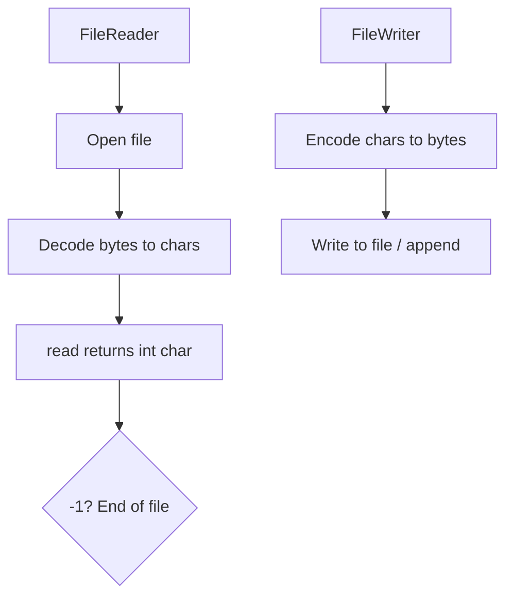

# FileReader & FileWriter

## 1. Introduction

**`FileReader`** reads character data from a file; **`FileWriter`** writes character data to a file. They're the simple, direct way to handle text files in Java.

---

## 2. Why This Topic Is Important

- Text files (configs, logs, exports) are the most common I/O.
- FileReader/Writer are the baseline before buffering/NIO.
- Interviewers ask about their charset behavior and limitations.
- They're stepping stones to every other text I/O API.

---

## 3. Real-World Analogy

FileReader is like **reading a book aloud letter by letter**; FileWriter is like **writing a letter by hand**. Simple and direct, but slow for long documents — which is why you add buffers (next topic).

---

## 4. Theory

### FileReader
```java
FileReader reader = new FileReader("file.txt");
int ch = reader.read();        // reads one char (as int), -1 at EOF
```
- Reads **characters** (decodes bytes per default charset).
- Constructor throws `FileNotFoundException` (checked).

### FileWriter
```java
FileWriter writer = new FileWriter("file.txt");        // overwrite
FileWriter appender = new FileWriter("file.txt", true); // append
writer.write("text");
writer.write(new char[]{'a','b'});
writer.write(String, offset, count);
```
- Overwrites by default; pass `true` to append.
- `flush()` pushes buffered chars; `close()` flushes + closes.

### Charset Caveat
`FileReader/FileWriter` use the **platform default charset**. For explicit control, use `InputStreamReader`/`OutputStreamWriter` or `Files.newBufferedReader` with a charset.

---

## 5. Syntax

```java
try (FileReader r = new FileReader("in.txt")) { ... }
try (FileWriter w = new FileWriter("out.txt", true)) { ... }
```

---

## 6. Flow Explanation



---

## 7. Memory Representation

Readers/writers hold an internal buffer and the file descriptor; chars are decoded one at a time without buffering in these raw classes.

---

## 8. Simple Example

```java
import java.io.FileWriter;
import java.io.FileReader;

public class RWBasic {
    public static void main(String[] args) throws Exception {
        try (FileWriter writer = new FileWriter("greet.txt")) {
            writer.write("Hello, Java I/O!");
        }

        try (FileReader reader = new FileReader("greet.txt")) {
            int ch;
            while ((ch = reader.read()) != -1) {
                System.out.print((char) ch);
            }
            System.out.println();
        }
    }
}
```

---

## 9. Intermediate Example — Append Mode

```java
import java.io.FileWriter;

public class AppendDemo {
    public static void main(String[] args) throws Exception {
        try (FileWriter writer = new FileWriter("log.txt", true)) {
            writer.write("Event: " + System.currentTimeMillis()
                    + System.lineSeparator());
        }
        System.out.println("Appended. Now the file contains:");
        System.out.println(java.nio.file.Files.readString(
                java.nio.file.Path.of("log.txt")));
    }
}
```

---

## 10. Advanced Example — Copying Text with char[]

```java
import java.io.FileReader;
import java.io.FileWriter;

public class CharCopy {
    public static void main(String[] args) throws Exception {
        char[] buffer = new char[1024];

        try (FileReader reader = new FileReader("source.txt");
             FileWriter writer = new FileWriter("target.txt")) {
            int len;
            while ((len = reader.read(buffer)) != -1) {
                writer.write(buffer, 0, len);
            }
        }
        System.out.println("Text copied using char buffer.");
    }
}
```

---

## 11. Output

For the **Simple Example**:

```
Hello, Java I/O!
```

For the **Intermediate Example** (on first run):

```
Appended. Now the file contains:
Event: 1789000000000
```

---

## 12. Common Mistakes

| Mistake | Correction |
|---------|------------|
| Overwriting instead of appending | Pass `true` to FileWriter |
| Not flushing/clearing buffers | close() handles it; flush() when streaming |
| Platform-default charset surprises | Specify UTF-8 explicitly |
| Casting read() without EOF check | Check -1 before casting |
| Forgetting to close | Try-with-resources |

---

## 13. Best Practices

- Wrap with `BufferedReader/Writer` for performance.
- Specify charset for portability.
- Use append mode for logs.
- Read into char arrays in chunks.
- Use try-with-resources.

---

## 14. Interview Questions

**Q1. FileReader vs FileWriter?**
*Reader reads chars; Writer writes chars; both text-oriented with default charset.*

**Q2. How do you append to a file?**
*`new FileWriter(path, true)`.*

**Q3. What charset does FileReader use?**
*The platform default — specify one explicitly for portability.*

**Q4. What does read() return at EOF?**
*-1.*

**Q5. Why buffer these streams?**
*Per-char calls are slow; buffers read/write in bulk.*

---

## 15. Practice Exercises

1. Write "Hello" and read it back.
2. Append three log lines to a file.
3. Copy a text file with a char array.
4. Handle FileNotFoundException gracefully.

---

## 16. Coding Challenges

1. **Easy:** A diary app that appends dated entries.
2. **Medium:** A simple text file editor (read all, modify, write).
3. **Hard:** A config file loader that parses `key=value` lines.

---

## 17. Summary

- FileReader: char text reading; FileWriter: char text writing.
- Append with the `true` flag; overwrite by default.
- Specify charset for portability.
- Buffer for performance; use try-with-resources.

➡️ Continue to: [BufferedReader & BufferedWriter](BufferedReader-Writer.md)