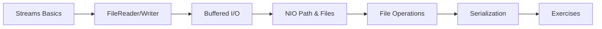

# 13 — File Handling

> **Experience level: 🟡 Basic+ (6 months – 1 year)**

Files store data between runs — configs, logs, user data, exports. This module teaches reading, writing, and managing files with the modern `java.nio.file` API and streams.

---

## 📂 Files in This Module

| File | What You'll Learn |
|------|-------------------|
| [File-Streams-Basics.md](File-Streams-Basics.md) | Byte vs character streams, reading/writing |
| [FileReader-Writer.md](FileReader-Writer.md) | Reading and writing text files |
| [BufferedReader-Writer.md](BufferedReader-Writer.md) | Efficient, line-based I/O |
| [File-Path-NIO.md](File-Path-NIO.md) | Path, Files, and the modern NIO API |
| [File-Operations.md](File-Operations.md) | Create, delete, copy, move, list |
| [Serialization.md](Serialization.md) | Saving whole objects to disk |
| [Exercises.md](Exercises.md) | Practice tasks for this module |

---

## 🎯 Learning Objectives

By the end of this module, you will be able to:

1. ✅ Read and write text files with modern APIs.
2. ✅ Use buffers for efficient line-based processing.
3. ✅ Create, copy, move, and delete files/folders.
4. ✅ Handle I/O exceptions properly (Module 10 skills).
5. ✅ Serialize and deserialize objects.

---

## 🧭 Module Map



---

## 📌 Quick Preview

```java
import java.nio.file.*;

public class Preview {
    public static void main(String[] args) throws Exception {
        Path p = Path.of("hello.txt");
        Files.writeString(p, "Hello, Files!");
        System.out.println(Files.readString(p));
    }
}
```

---

## Next Module

➡️ [14 — Multithreading](../14-Multithreading/README.md) — run code in parallel.