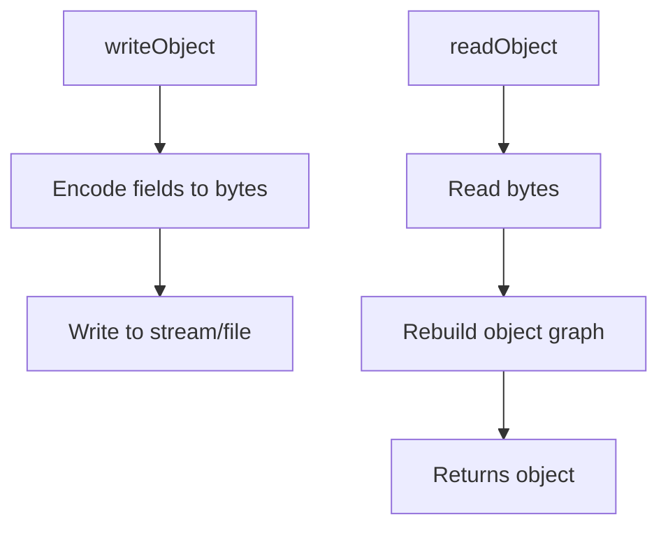

# Serialization

## 1. Introduction

**Serialization** converts an object into a byte stream so it can be saved to a file or sent over a network; **deserialization** reconstructs the object. Java does this with the `Serializable` interface and `ObjectOutputStream`/`ObjectInputStream`.

---

## 2. Why This Topic Is Important

- Save application state (settings, game saves, sessions).
- Send objects between systems (though JSON is often preferred today).
- Interviewers test Serializable, serialVersionUID, and transient.
- Session data in servlets (old-school) used serialization.

---

## 3. Real-World Analogy

Serialization is like **freeze-drying a meal** — you turn a full dish (object) into a compact powder (bytes), store it, then add water later to get the meal back (deserialization). Same ingredients, same structure, just stored differently.

---

## 4. Theory

### Making a Class Serializable
```java
class User implements Serializable {
    private static final long serialVersionUID = 1L;  // version ID
    String name;
    transient String password;   // NOT serialized
}
```
- `transient` fields are skipped (security/derived data).
- `serialVersionUID` tracks compatibility between versions.

### Streams
| Class | Role |
|-------|------|
| `ObjectOutputStream` | writeObject(obj) → bytes |
| `ObjectInputStream` | readObject() → object |

### Rules
| Rule | Detail |
|------|--------|
| Must implement `Serializable` | Marker interface, no methods |
| All fields must be serializable | Or marked transient |
| static fields | Not serialized |
| No-arg constructor needed? | Not for serialization (uses Object deserialization) |
| security | Deserialization can be a security risk |

---

## 5. Syntax

```java
try (ObjectOutputStream oos = new ObjectOutputStream(
        new FileOutputStream("user.ser"))) {
    oos.writeObject(user);
}
```

---

## 6. Flow Explanation



---

## 7. Memory Representation

The object graph (objects + references) is flattened into a byte sequence; transient fields are skipped.

---

## 8. Simple Example

```java
import java.io.*;
import java.util.Arrays;

class User implements Serializable {
    private static final long serialVersionUID = 1L;
    String name;
    transient String password;
    int age;

    User(String name, String password, int age) {
        this.name = name;
        this.password = password;
        this.age = age;
    }

    @Override
    public String toString() {
        return name + ", pass=" + password + ", age=" + age;
    }
}

public class SerializeDemo {
    public static void main(String[] args) throws Exception {
        User u = new User("Ajay", "secret123", 25);

        try (ObjectOutputStream oos = new ObjectOutputStream(
                new FileOutputStream("user.ser"))) {
            oos.writeObject(u);
        }

        try (ObjectInputStream ois = new ObjectInputStream(
                new FileInputStream("user.ser"))) {
            User loaded = (User) ois.readObject();
            System.out.println("Loaded: " + loaded);
        }
    }
}
```

---

## 9. Intermediate Example — Object Collections

```java
import java.io.*;
import java.util.List;
import java.util.Arrays;

class Product implements Serializable {
    private static final long serialVersionUID = 1L;
    String name;
    double price;

    Product(String name, double price) {
        this.name = name;
        this.price = price;
    }
}

public class ListSerialization {
    public static void main(String[] args) throws Exception {
        List<Product> products = Arrays.asList(
                new Product("Laptop", 800),
                new Product("Phone", 500));

        try (ObjectOutputStream oos = new ObjectOutputStream(
                new FileOutputStream("products.dat"))) {
            oos.writeObject(products);
        }

        try (ObjectInputStream ois = new ObjectInputStream(
                new FileInputStream("products.dat"))) {
            @SuppressWarnings("unchecked")
            List<Product> loaded = (List<Product>) ois.readObject();
            for (Product p : loaded) {
                System.out.println(p.name + " -> $" + p.price);
            }
        }
    }
}
```

---

## 10. Advanced Example — serialVersionUID & versioning

```java
import java.io.*;

// Version 1 saved, version 2 loads
class Settings implements Serializable {
    private static final long serialVersionUID = 100L;  // keep stable
    String theme = "light";
    int fontSize = 14;
    // adding a field later keeps compatibility if serialVersionUID is fixed
}

public class VersioningDemo {
    public static void main(String[] args) throws Exception {
        Settings s = new Settings();
        s.theme = "dark";

        try (ObjectOutputStream oos = new ObjectOutputStream(
                new FileOutputStream("settings.dat"))) {
            oos.writeObject(s);
        }

        try (ObjectInputStream ois = new ObjectInputStream(
                new FileInputStream("settings.dat"))) {
            Settings loaded = (Settings) ois.readObject();
            System.out.println("Theme: " + loaded.theme
                    + ", Font: " + loaded.fontSize);
        }
    }
}
```

---

## 11. Output

For the **Simple Example**:

```
Loaded: Ajay, pass=null, age=25
```
(`password` is null because it was `transient`!)

For the **Intermediate Example**:

```
Laptop -> $800.0
Phone -> $500.0
```

---

## 12. Common Mistakes

| Mistake | Correction |
|---------|------------|
| Forgetting `Serializable` | `NotSerializableException` at runtime |
| Serializing sensitive data | Mark fields `transient` |
| Ignoring serialVersionUID | InvalidClassException on mismatch |
| Loading without cast/version check | Cast carefully; handle ClassNotFoundException |
| Deserializing untrusted data | Security risk — validate input |

---

## 13. Best Practices

- Declare `serialVersionUID` explicitly.
- Mark passwords/secrets `transient`.
- Prefer **JSON** (Module 27 / Jackson/Gson) for modern data exchange.
- Validate before deserializing untrusted streams.
- Keep serializable classes simple.

---

## 14. Interview Questions

**Q1. What is serialization?**
*Converting an object to a byte stream to persist or transmit it.*

**Q2. What is transient?**
*A keyword marking fields excluded from serialization.*

**Q3. What is serialVersionUID?**
*A version identifier used to validate compatibility during deserialization.*

**Q4. Can static fields be serialized?**
*No.*

**Q5. Why prefer JSON over Java serialization?**
*Portable across languages, human-readable, safer than Java deserialization.*

---

## 15. Practice Exercises

1. Save and load a single object.
2. Save a List of objects.
3. Mark a sensitive field transient and verify it's null after load.
4. Change a class between save/load and observe serialVersionUID behavior.

---

## 16. Coding Challenges

1. **Easy:** Save/load a game high-score object.
2. **Medium:** A user-settings serializer with transient password.
3. **Hard:** A save-game system with multiple objects, versioning, and safe deserialization checks.

---

## 17. Summary

- Serializable → bytes ↔ object.
- transient skips fields; serialVersionUID manages versions.
- Use ObjectOutputStream/InputStream.
- Security: validate before deserializing.
- Modern apps often use JSON instead.

➡️ Continue to: [Exercises](Exercises.md)