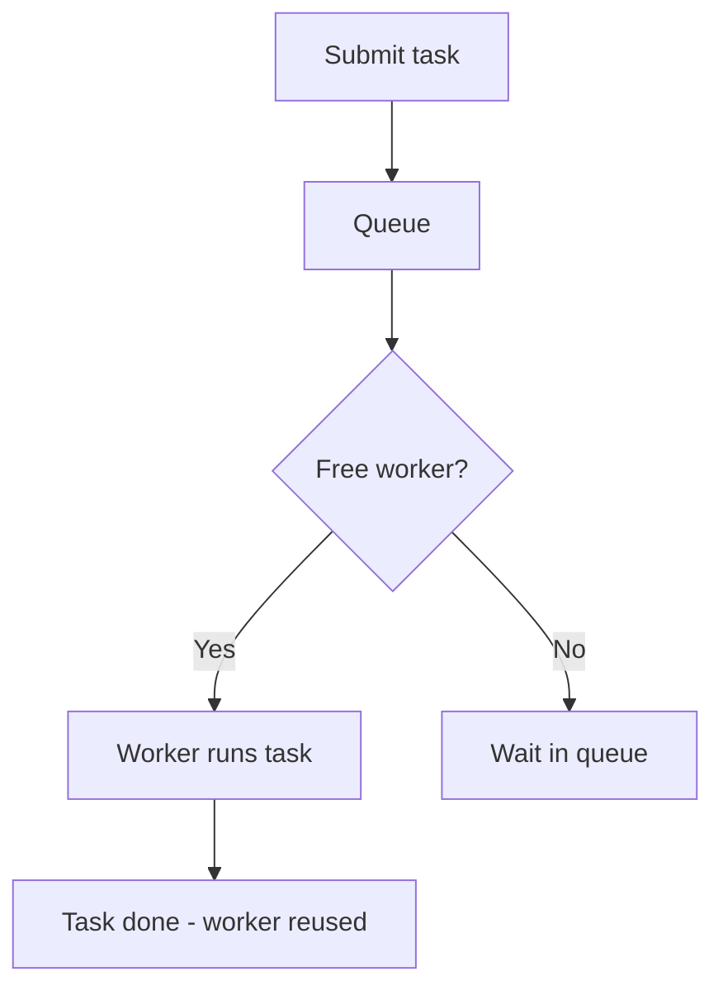

# ExecutorService

## 1. Introduction

**`ExecutorService`** is a thread pool abstraction: you submit tasks, and a managed set of worker threads executes them. It removes the pain of creating, starting, and joining raw threads.

---

## 2. Why This Topic Is Important

- Creating a thread per task is wasteful and slow — pools reuse threads.
- Every modern server app uses executor pools.
- Interviewers expect ExecutorService, Futures, and shutdown patterns.
- `ForkJoinPool`/parallel streams build on it.

---

## 3. Real-World Analogy

A thread pool is like a **call center with 5 agents**. When calls (tasks) come in, an available agent (pool thread) takes one. The agents aren't hired and fired per call (like raw threads) — they keep working call after call, efficiently.

---

## 4. Theory

### Creating Executors
| Factory | Pool | Use Case |
|---------|------|----------|
| `newFixedThreadPool(n)` | n fixed threads | Bounded parallel work |
| `newCachedThreadPool()` | grows/shrinks | Short, many tasks |
| `newSingleThreadExecutor()` | 1 thread | Sequential tasks |
| `newScheduledThreadPool(n)` | Scheduled | Delayed/periodic tasks |

### Submitting Tasks
```java
executor.execute(runnable);              // fire and forget
Future<?> f = executor.submit(runnable); // can track/cancel
Future<T> f = executor.submit(callable); // returns a result
```

### Future
| Method | Behavior |
|--------|----------|
| `get()` | Block until result (or exception) |
| `get(timeout, unit)` | Block with timeout |
| `isDone()` | Finished? |
| `cancel(true)` | Try to cancel |

### Shutdown
```java
executor.shutdown();        // stop accepting; finish queued tasks
executor.shutdownNow();     // attempt to stop immediately
executor.awaitTermination(5, TimeUnit.SECONDS);  // wait to finish
```

---

## 5. Syntax

```java
ExecutorService pool = Executors.newFixedThreadPool(3);
pool.submit(() -> System.out.println("Task"));
pool.shutdown();
```

---

## 6. Flow Explanation



---

## 7. Memory Representation

The pool holds a queue of tasks and an array of worker threads; tasks are heap objects waiting for workers.

---

## 8. Simple Example

```java
import java.util.concurrent.ExecutorService;
import java.util.concurrent.Executors;

public class PoolDemo {
    public static void main(String[] args) {
        ExecutorService pool = Executors.newFixedThreadPool(2);

        for (int i = 1; i <= 5; i++) {
            int taskId = i;
            pool.submit(() ->
                    System.out.println("Task " + taskId
                            + " on " + Thread.currentThread().getName()));
        }

        pool.shutdown();
    }
}
```

---

## 9. Intermediate Example — Callable & Future

```java
import java.util.concurrent.*;

public class FutureDemo {
    public static void main(String[] args) throws Exception {
        ExecutorService pool = Executors.newFixedThreadPool(2);

        Callable<Integer> task = () -> {
            Thread.sleep(500);
            return 42;
        };

        Future<Integer> future = pool.submit(task);
        System.out.println("Submitted. isDone? " + future.isDone());

        int result = future.get();               // blocks until ready
        System.out.println("Result: " + result);

        pool.shutdown();
    }
}
```

---

## 10. Advanced Example — Scheduling & Await Termination

```java
import java.util.concurrent.*;

public class SchedulingDemo {
    public static void main(String[] args) throws InterruptedException {
        ScheduledExecutorService scheduler = Executors.newScheduledThreadPool(1);

        scheduler.schedule(() ->
                System.out.println("One-shot after 1s"), 1, TimeUnit.SECONDS);

        scheduler.scheduleAtFixedRate(() ->
                System.out.println("Every 2s"), 2, 2, TimeUnit.SECONDS);

        Thread.sleep(5000);
        scheduler.shutdownNow();
        System.out.println("Scheduler stopped.");

        // Proper shutdown of a fixed pool
        ExecutorService pool = Executors.newFixedThreadPool(3);
        for (int i = 0; i < 3; i++) {
            int n = i;
            pool.submit(() -> System.out.println("Job " + n));
        }
        pool.shutdown();
        boolean done = pool.awaitTermination(5, TimeUnit.SECONDS);
        System.out.println("Pool terminated: " + done);
    }
}
```

---

## 11. Output

For the **Simple Example** (2 threads, order varies):

```
Task 1 on pool-1-thread-1
Task 2 on pool-1-thread-2
Task 3 on pool-1-thread-1
Task 4 on pool-1-thread-2
Task 5 on pool-1-thread-1
```

For the **Intermediate Example**:

```
Submitted. isDone? false
Result: 42
```

---

## 12. Common Mistakes

| Mistake | Correction |
|---------|------------|
| Never shutting down | Threads leak; the app won't exit |
| Creating a thread per task | Use a fixed pool |
| Forgetting get() throws exceptions | Wrap in try/catch |
| Blocking main on get() for parallel work | Collect futures, then get |
| Using fixed pool for infinite tasks | Queue grows unbounded |

---

## 13. Best Practices

- Always **shutdown** pools (finally block).
- Use fixed pools for bounded parallel work.
- Use Callable + Future for results.
- `awaitTermination` for graceful completion.
- Consider `CompletableFuture` (Module 16) for chaining.

---

## 14. Interview Questions

**Q1. What is ExecutorService?**
*A thread pool abstraction that manages worker threads and queues tasks.*

**Q2. Fixed pool vs cached pool?**
*Fixed: constant threads, bounded queue. Cached: unbounded, grows with load.*

**Q3. What is a Future?**
*A handle to a task's eventual result — get() blocks until ready.*

**Q4. Why pools instead of raw threads?**
*Reuse threads, bound resource usage, manage lifecycle.*

**Q5. How do you stop a pool gracefully?**
*shutdown() then awaitTermination(); shutdownNow() to interrupt.*

---

## 15. Practice Exercises

1. Run 5 tasks on a 2-thread pool.
2. Submit a Callable and print the result via Future.
3. Schedule a one-shot and a fixed-rate task.
4. Shut down a pool properly and confirm termination.

---

## 16. Coding Challenges

1. **Easy:** Parallel greetings with a fixed pool.
2. **Medium:** Compute squares of 1–10 in parallel and collect results via Futures.
3. **Hard:** A scheduled health-check monitor that logs every 2 seconds until stopped.

---

## 17. Summary

- ExecutorService = managed thread pools.
- submit Runnable/Callable; read results via Future.
- fixed/cached/scheduled pools for different needs.
- Always shutdown; awaitTermination to finish cleanly.
- Pools are the professional way to do concurrency.

➡️ Continue to: [Exercises](Exercises.md)