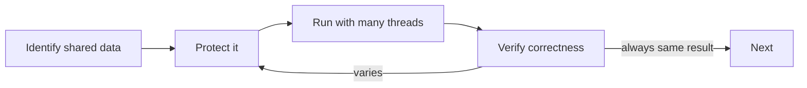

# Exercises — Multithreading

## 1. Introduction

Practice threads, synchronization, communication, and pools. These exercises turn theory into the concurrency instincts you'll use on real projects.

---

## 2. Why This Topic Is Important

- Concurrency bugs are the hardest to find — practice prevents them.
- Server performance depends on proper pooling.
- Interviews test threads, race conditions, and executors.
- Frameworks (Spring) execute async work under the hood.

---

## 3. Real-World Analogy

Practice is like **driving in traffic**: you learn rules (synchronization), signals (wait/notify), and how to share the road (pools). Without practice, multi-lane driving (concurrency) is chaos.

---

## 4. Theory — Toolbox Recap

- Create: Runnable + `new Thread(task).start()`.
- Coordinate: `synchronized`, `wait/notify`.
- Pool: `ExecutorService`, `submit`, `Future`, `shutdown`.

---

## 5. Syntax Reminder

```java
ExecutorService pool = Executors.newFixedThreadPool(2);
Future<Integer> f = pool.submit(() -> 42);
pool.shutdown();
```

---

## 6. Practice Flow



---

## 7. Memory Representation

Skip — focus on behavior.

---

## 8. Simple Exercises

**Ex 1 — Two Threads**
Two threads print "A" and "B" 10 times each. Observe interleaving.

**Ex 2 — Runnable Reuse**
One Runnable, three threads, named A/B/C.

**Ex 3 — Sleep Timer**
A thread counts 1–5 with 500ms sleeps; main joins and prints "Done".

---

## 9. Intermediate Exercises

**Ex 4 — Race Reproducer**
Two threads increment a shared counter 1000× each. Print the (often wrong) result.

**Ex 5 — Synchronized Fix**
Fix Ex 4 with a synchronized method. Print the correct 2000.

**Ex 6 — ReentrantLock**
Same counter using ReentrantLock with try/finally.

**Ex 7 — State Watcher**
Start a sleeping thread and print its states at each lifecycle stage.

---

## 10. Advanced Exercises

**Ex 8 — One-Slot Buffer**
Producer puts 1–5; consumer takes them; use wait/notify with a while loop.

**Ex 9 — BlockingQueue P/C**
Rewrite Ex 8 with ArrayBlockingQueue.

**Ex 10 — Fixed Pool + Futures**
Compute squares of 1–10 in a 3-thread pool; collect results via Futures; print in order.

**Ex 11 — Thread-Safe Bank**
A `BankAccount` with deposit/withdraw used by 10 threads; verify final balance equals the total deposited.

---

## 11. Expected Output Samples

**Ex 5 (Synchronized Fix):**
```
Count: 2000
```

**Ex 8 (One-Slot Buffer):**
```
Put: 1
Took: 1
Put: 2
Took: 2
...
```

**Ex 11 (Thread-Safe Bank):**
```
Final balance: 10000.0
```

---

## 12. Common Mistakes

| Mistake | Fix |
|---------|-----|
| Calling run() instead of start() | start() |
| Unsynchronized shared counters | synchronized / Lock |
| if instead of while in wait | while condition |
| Forgetting shutdown() | Always shutdown pools |
| join before start | start first |

---

## 13. Best Practices

- Always verify with the expected result.
- Test with many iterations (races hide).
- Name threads for readable output.
- Prefer ExecutorService over raw threads.
- Protect shared state minimally.

---

## 14. Interview Practice Questions

**Q1.** What is a race condition? Give an example.
**Q2.** start() vs run()?
**Q3.** synchronized vs volatile vs Lock?
**Q4.** What are thread states?
**Q5.** Why use ExecutorService over raw threads?

---

## 15. Self-Check

- [ ] I can create and start threads with Runnable.
- [ ] I can reproduce and fix a race condition.
- [ ] I use wait/notify correctly with while loops.
- [ ] I can build a producer/consumer.
- [ ] I use ExecutorService with proper shutdown.
- [ ] I can explain thread states and deadlock.

---

## 16. Next Steps

- Move to [Module 15 — Generics](../15-Generics/README.md).
- Module 16 (Java 8) covers CompletableFuture and parallel streams.

---

## 17. Summary

- Threads: Runnable + start().
- Correctness: synchronized/Lock on shared state.
- Communication: wait/notify with while loops.
- Scale: ExecutorService pools.
- Verify every exercise's expected result.

➡️ Module complete! Continue to [15 — Generics](../15-Generics/README.md).