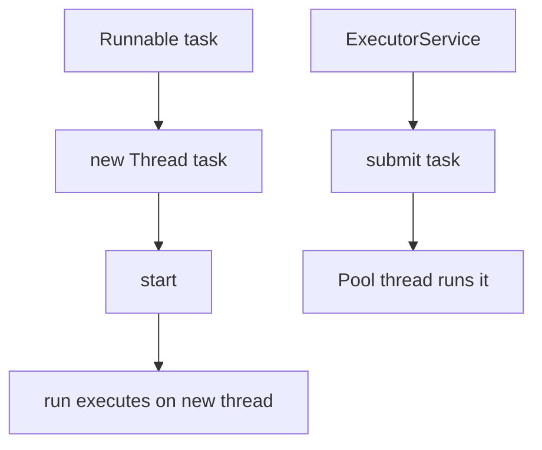

# Runnable vs Thread

## 1. Introduction

You can define threaded work by **extending `Thread`** or by **implementing `Runnable`**. Best practice strongly favors **Runnable** — and modern Java uses lambdas for even cleaner code.

---

## 2. Why This Topic Is Important

- The choice affects flexibility, reusability, and design.
- Interviewers ask "why Runnable over Thread?"
- ExecutorService (Module 14) accepts Runnable, not Thread subclasses.
- Lambdas make Runnable trivial.

---

## 3. Real-World Analogy

Extending Thread is like **hiring a chef who must also be the restaurant owner** — the person *is* the business. Implementing Runnable is like **hiring a chef to work in any kitchen** — the skill (task) is separate from the kitchen (thread). You can put that skill in any kitchen, even several at once.

---

## 4. Theory

### Approach 1 — Extend Thread
```java
class MyThread extends Thread {
    @Override
    public void run() { System.out.println("Work"); }
}
new MyThread().start();
```

### Approach 2 — Implement Runnable
```java
class MyTask implements Runnable {
    @Override
    public void run() { System.out.println("Work"); }
}
Thread t = new Thread(new MyTask());
t.start();
```

### Approach 3 — Lambda (Java 8+)
```java
Thread t = new Thread(() -> System.out.println("Work"));
t.start();
```

### Why Runnable Is Better
| Aspect | Extend Thread | Implement Runnable |
|--------|---------------|---------------------|
| Inheritance | Uses your single class inheritance | Class stays free to extend others |
| Reusability | One task, one thread | Same task reused in many threads/pools |
| Design | Ties task to thread | Separates task (work) from thread (runner) |
| ExecutorService | Not accepted | Accepted directly |
| Best practice | ❌ Avoid | ✅ Prefer |

---

## 5. Syntax

```java
Runnable task = () -> { /* work */ };
Thread t = new Thread(task);
t.start();
```

---

## 6. Flow Explanation



---

## 7. Memory Representation

Same thread memory model either way. The difference is purely class design and flexibility.

---

## 8. Simple Example

```java
public class RunnableDemo {
    public static void main(String[] args) {
        Runnable task = () ->
                System.out.println("Running on " + Thread.currentThread().getName());

        Thread t1 = new Thread(task, "thread-1");
        Thread t2 = new Thread(task, "thread-2");

        t1.start();
        t2.start();
    }
}
```

---

## 9. Intermediate Example — Same Task, Many Threads

```java
public class SharedTask {
    public static void main(String[] args) {
        Runnable counter = () -> {
            for (int i = 1; i <= 3; i++) {
                System.out.println(Thread.currentThread().getName() + ": " + i);
                try { Thread.sleep(100); } catch (InterruptedException e) { }
            }
        };

        Thread a = new Thread(counter, "A");
        Thread b = new Thread(counter, "B");
        Thread c = new Thread(counter, "C");

        a.start();
        b.start();
        c.start();
    }
}
```

---

## 10. Advanced Example — Combining with Inheritance

```java
// A class that needs to extend something else can still be a Runnable
class BaseWorker {
    protected String workerId;

    BaseWorker(String id) { workerId = id; }

    protected void log(String msg) {
        System.out.println("[" + workerId + "] " + msg);
    }
}

// Runnable keeps inheritance free
class Downloader extends BaseWorker implements Runnable {
    Downloader(String id) { super(id); }

    @Override
    public void run() {
        log("Download started");
        try { Thread.sleep(500); } catch (InterruptedException e) { }
        log("Download finished");
    }
}

public class InheritanceDemo {
    public static void main(String[] args) {
        Thread t = new Thread(new Downloader("dl-1"));
        t.start();
    }
}
```

---

## 11. Output

For the **Simple Example** (order may vary):

```
Running on thread-1
Running on thread-2
```

For the **Intermediate Example** (interleaved):

```
A: 1
B: 1
C: 1
A: 2
B: 2
C: 2
A: 3
B: 3
C: 3
```

---

## 12. Common Mistakes

| Mistake | Correction |
|---------|------------|
| Extending Thread for everything | Implement Runnable instead |
| Throwing from run() | Can't — handle exceptions inside |
| Sharing mutable state between runnables | Synchronize (next topic) |
| Using run() instead of start() | No concurrency |
| Forgetting the lambda parentheses | `() -> ...` |

---

## 13. Best Practices

- Implement `Runnable`, don't extend `Thread`.
- Use lambdas for simple tasks.
- Pass the same Runnable to many threads for reuse.
- Name threads for debugging.
- Let ExecutorService manage lifecycle (later topic).

---

## 14. Interview Questions

**Q1. Why Runnable over extending Thread?**
*Keeps class inheritance free, improves reusability, works with executor pools.*

**Q2. Can you start the same Runnable twice?**
*Yes — create two Threads with it; each runs once.*

**Q3. What's the lambda form?**
*`new Thread(() -> { ... })`.*

**Q4. What methods does Runnable require?**
*Only `run()`. Thread adds lifecycle methods.*

**Q5. Is there a performance difference?**
*No — the design benefit, not performance, is why Runnable wins.*

---

## 15. Practice Exercises

1. Implement Runnable with an anonymous class.
2. Rewrite it with a lambda.
3. Reuse one Runnable across 3 threads.
4. Show that extending Thread blocks extending another class.

---

## 16. Coding Challenges

1. **Easy:** A Runnable printing numbers 1–5.
2. **Medium:** A reusable `Task` used by 5 threads with names.
3. **Hard:** A class extending a base while implementing Runnable (like the Downloader example).

---

## 17. Summary

- Runnable = work; Thread = runner. Keep them separate.
- Prefer Runnable; use lambdas.
- Reuse tasks; keep inheritance free.
- ExecutorService accepts Runnables.
- Design over ceremony.

➡️ Continue to: [Thread Lifecycle](Thread-Lifecycle.md)