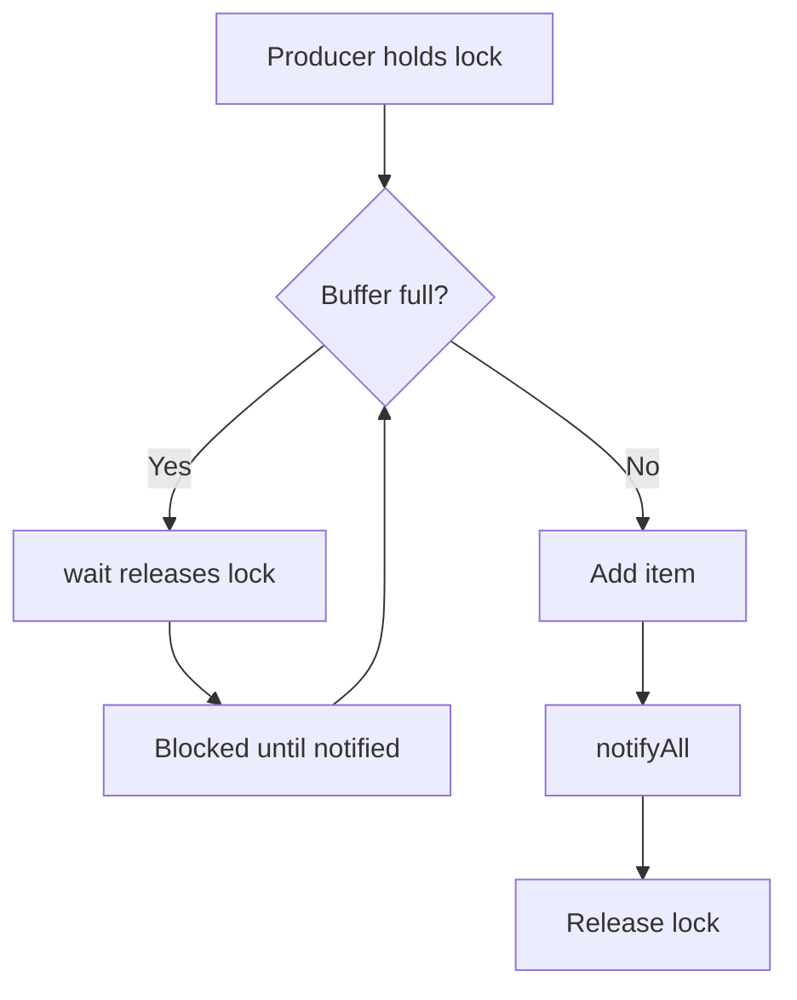

# Thread Communication

## 1. Introduction

Threads often need to **coordinate**: a producer waits until the queue has space; a consumer waits until there's work. Java provides `wait()`, `notify()`, and `notifyAll()` — the classic monitor pattern.

---

## 2. Why This Topic Is Important

- Producer/consumer is a classic interview and design pattern.
- Raw wait/notify teaches the foundations of queues.
- Modern code often uses `BlockingQueue` instead — but you must know why.
- Misuse causes deadlocks and lost wakeups.

---

## 3. Real-World Analogy

Think of a **restaurant kitchen with a pass window**. A cook (producer) waits when the window is full (wait) and is signaled when space frees (notify). A waiter (consumer) waits when no dish is ready and is signaled when food arrives. Both communicate through signals on the shared window.

---

## 4. Theory

### The Rules of wait/notify
| Rule | Detail |
|------|--------|
| Must hold the monitor | Inside a `synchronized` block on the same object |
| `wait()` | Releases the lock and blocks until notified |
| `notify()` | Wakes ONE waiting thread |
| `notifyAll()` | Wakes ALL waiting threads |
| Check condition in a loop | Spurious wakeups — re-check while |

### The Producer/Consumer Pattern
```java
synchronized (lock) {
    while (buffer full) { lock.wait(); }   // wait while condition
    // add item
    lock.notifyAll();                      // wake consumers
}
```

### Lost Wakeup Trap
```java
// WRONG: check-then-wait is a race without synchronization
if (isEmpty()) wait();    // another thread may notify between check and wait

// RIGHT: synchronized + while loop
synchronized (monitor) {
    while (isEmpty()) monitor.wait();
}
```

---

## 5. Syntax

```java
synchronized (monitor) {
    while (!condition) monitor.wait();   // wait
    // ...
    monitor.notifyAll();                 // signal
}
```

---

## 6. Flow Explanation



---

## 7. Memory Representation

Waiting threads park in the object's wait set; notified threads move to the entry set to reacquire the lock.

---

## 8. Simple Example

```java
public class WaitNotify {
    private boolean ready = false;

    synchronized void produce() {
        ready = true;
        System.out.println("Producer: ready = true");
        notifyAll();                          // wake consumers
    }

    synchronized void consume() throws InterruptedException {
        while (!ready) {                      // loop against spurious wakeup
            System.out.println("Consumer: waiting...");
            wait();
        }
        System.out.println("Consumer: got the signal!");
    }

    public static void main(String[] args) throws InterruptedException {
        WaitNotify wn = new WaitNotify();

        Thread consumer = new Thread(() -> {
            try { wn.consume(); } catch (InterruptedException e) { }
        });

        consumer.start();
        Thread.sleep(300);
        new Thread(wn::produce).start();
        consumer.join();
    }
}
```

---

## 9. Intermediate Example — One-Slot Buffer

```java
public class OneSlot {
    private int value = 0;
    private boolean hasValue = false;

    synchronized void put(int v) throws InterruptedException {
        while (hasValue) wait();           // wait until slot empty
        value = v;
        hasValue = true;
        System.out.println("Put: " + v);
        notifyAll();
    }

    synchronized int take() throws InterruptedException {
        while (!hasValue) wait();          // wait until value present
        int v = value;
        hasValue = false;
        System.out.println("Took: " + v);
        notifyAll();
        return v;
    }

    public static void main(String[] args) throws InterruptedException {
        OneSlot slot = new OneSlot();

        Thread producer = new Thread(() -> {
            try {
                for (int i = 1; i <= 3; i++) slot.put(i);
            } catch (InterruptedException e) { }
        });

        Thread consumer = new Thread(() -> {
            try {
                for (int i = 1; i <= 3; i++) slot.take();
            } catch (InterruptedException e) { }
        });

        producer.start();
        consumer.start();
        producer.join();
        consumer.join();
    }
}
```

---

## 10. Advanced Example — Producer/Consumer with BlockingQueue

```java
import java.util.concurrent.ArrayBlockingQueue;
import java.util.concurrent.BlockingQueue;

public class BlockingQueueDemo {
    public static void main(String[] args) throws InterruptedException {
        BlockingQueue<Integer> queue = new ArrayBlockingQueue<>(2);

        Thread producer = new Thread(() -> {
            for (int i = 1; i <= 5; i++) {
                try {
                    queue.put(i);            // blocks when full
                    System.out.println("Produced " + i);
                } catch (InterruptedException e) { }
            }
        }, "producer");

        Thread consumer = new Thread(() -> {
            for (int i = 1; i <= 5; i++) {
                try {
                    int v = queue.take();    // blocks when empty
                    System.out.println("  Consumed " + v);
                } catch (InterruptedException e) { }
            }
        }, "consumer");

        producer.start();
        consumer.start();
        producer.join();
        consumer.join();
        System.out.println("Done.");
    }
}
```

---

## 11. Output

For the **Intermediate Example** (alternating):

```
Put: 1
Took: 1
Put: 2
Took: 2
Put: 3
Took: 3
```

For the **Advanced Example**:

```
Produced 1
Produced 2
  Consumed 1
  Consumed 2
Produced 3
Produced 4
Produced 5
  Consumed 3
  Consumed 4
  Consumed 5
Done.
```

---

## 12. Common Mistakes

| Mistake | Correction |
|---------|------------|
| Calling wait() outside synchronized | IllegalMonitorStateException |
| Using `if` instead of `while` | Spurious wakeups break logic |
| notify() instead of notifyAll() | May wake the wrong thread |
| No condition loop | Wait returns even when condition false |
| Hand-rolling queues | Prefer BlockingQueue |

---

## 13. Best Practices

- Always wait/notify inside synchronized blocks.
- Check conditions with `while`, not `if`.
- Use `notifyAll()` unless you know exactly one waiter matters.
- Prefer `BlockingQueue` for producer/consumer.
- Name the condition clearly (`hasValue`, `ready`).

---

## 14. Interview Questions

**Q1. What does wait() do?**
*Releases the monitor and blocks until notified; must hold the lock.*

**Q2. notify vs notifyAll?**
*notify wakes one; notifyAll wakes all waiters on the monitor.*

**Q3. Why check conditions in a loop?**
*Spurious wakeups and lost wakeups require re-checking the condition.*

**Q4. What is a lost wakeup?**
*Waiting after the condition became true without synchronization — the notify was missed.*

**Q5. When would you prefer BlockingQueue?**
*It handles all the waiting/notifying safely and simply.*

---

## 15. Practice Exercises

1. A producer signals a waiting consumer.
2. Build the one-slot buffer.
3. Build a multi-slot producer/consumer.
4. Rewrite it with BlockingQueue and compare.

---

## 16. Coding Challenges

1. **Easy:** Signal-based start: one thread waits until another says go.
2. **Medium:** The one-slot producer/consumer.
3. **Hard:** A bounded task queue with multiple producers/consumers using wait/notify — then compare with BlockingQueue.

---

## 17. Summary

- wait/notify coordinate threads on a monitor.
- while-loops prevent spurious-wakeup bugs.
- notifyAll for safety; BlockingQueue for simplicity.
- Producer/consumer is the classic use case.
- Synchronization (prev topic) + communication = full coordination.

➡️ Continue to: [Executor Service](ExecutorService.md)