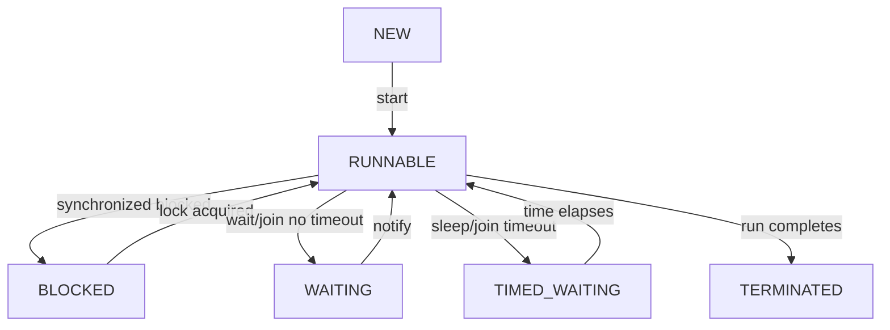

# Thread Lifecycle

## 1. Introduction

A thread moves through well-defined **states** during its life: NEW → RUNNABLE → BLOCKED/WAITING/TIMED_WAITING → TERMINATED. Understanding states explains scheduling and debugging.

---

## 2. Why This Topic Is Important

- Interviewers love lifecycle questions.
- `Thread.getState()` helps debug stuck threads.
- Blocked vs waiting states are common interview traps.
- Thread dumps (jstack) show states in production.

---

## 3. Real-World Analogy

Think of a **restaurant order**:
- NEW: ticket printed, chef hasn't looked.
- RUNNABLE: chef actively cooking or ready to cook.
- BLOCKED: chef can't start until they grab the shared pan (lock held by another).
- WAITING: chef waiting for the waiter to bring an ingredient (no time limit).
- TIMED_WAITING: chef waiting for a timer.
- TERMINATED: dish done, chef leaves.

---

## 4. Theory

### The Six States
| State | Meaning | Entered By |
|-------|---------|------------|
| NEW | Created, not started | `new Thread(...)` |
| RUNNABLE | Ready to run or running | `start()` |
| BLOCKED | Waiting for a monitor lock | `synchronized` blocked |
| WAITING | Waiting indefinitely | `wait()`, `join()` (no timeout) |
| TIMED_WAITING | Waiting with a timeout | `sleep()`, `join(ms)`, `wait(ms)` |
| TERMINATED | Finished | `run()` returns/throws |

### Transitions


### Getting the State
```java
Thread t = ...;
System.out.println(t.getState());
```

---

## 5. Syntax

```java
Thread.State state = thread.getState();
// NEW, RUNNABLE, BLOCKED, WAITING, TIMED_WAITING, TERMINATED
```

---

## 6. Flow Explanation

The thread scheduler moves a RUNNABLE thread between ready and running constantly; you can't see that split, but the other states are observable via getState().

---

## 7. Memory Representation

The JVM tracks thread state internally (a native thread + metadata). States don't consume heap; they're scheduling bookkeeping.

---

## 8. Simple Example

```java
public class LifecycleDemo {
    public static void main(String[] args) throws InterruptedException {
        Thread t = new Thread(() -> {
            try { Thread.sleep(1000); } catch (InterruptedException e) { }
        });

        System.out.println("After creation : " + t.getState());   // NEW

        t.start();
        System.out.println("After start    : " + t.getState());   // RUNNABLE

        Thread.sleep(200);
        System.out.println("While sleeping : " + t.getState());   // TIMED_WAITING

        t.join();
        System.out.println("After finish   : " + t.getState());   // TERMINATED
    }
}
```

---

## 9. Intermediate Example — BLOCKED State

```java
public class BlockedDemo {
    private static final Object LOCK = new Object();

    public static void main(String[] args) throws InterruptedException {
        Thread holder = new Thread(() -> {
            synchronized (LOCK) {
                try { Thread.sleep(2000); } catch (InterruptedException e) { }
            }
        }, "holder");

        Thread waiter = new Thread(() -> {
            synchronized (LOCK) {          // waits for holder to release
                System.out.println("waiter got the lock");
            }
        }, "waiter");

        holder.start();
        Thread.sleep(100);
        waiter.start();
        Thread.sleep(100);

        System.out.println("waiter state  : " + waiter.getState());   // BLOCKED
        holder.join();
        waiter.join();
        System.out.println("holder state  : " + holder.getState());   // TERMINATED
    }
}
```

---

## 10. Advanced Example — WAITING State via join

```java
public class WaitingDemo {
    public static void main(String[] args) throws InterruptedException {
        Thread longTask = new Thread(() -> {
            try { Thread.sleep(500); } catch (InterruptedException e) { }
        }, "longTask");

        Thread observer = new Thread(() -> {
            try {
                longTask.join();              // waits indefinitely
            } catch (InterruptedException e) { }
            System.out.println("observer: longTask finished");
        }, "observer");

        longTask.start();
        observer.start();
        Thread.sleep(100);

        System.out.println("observer state : " + observer.getState());  // WAITING
        observer.join();
    }
}
```

---

## 11. Output

For the **Simple Example**:

```
After creation : NEW
After start    : RUNNABLE
While sleeping : TIMED_WAITING
After finish   : TERMINATED
```

For the **Intermediate Example**:

```
waiter state  : BLOCKED
waiter got the lock
holder state  : TERMINATED
```

---

## 12. Common Mistakes

| Mistake | Correction |
|---------|------------|
| Confusing BLOCKED and WAITING | BLOCKED = waiting for a lock; WAITING = wait/join |
| Checking state too early | Sleep or coordinate before sampling |
| Assuming RUNNABLE means running | It means "ready or running" |
| Deadlock from wait/notify misuse | Covered in Thread-Communication |
| Not joining before checking TERMINATED | Race — the thread may not be done yet |

---

## 13. Best Practices

- Use `getState()` for debugging, not logic.
- Avoid busy-waiting on states — use join/wait.
- Name threads so dumps are readable.
- Use jstack/JConsole for production state analysis.
- Treat RUNNABLE as "in the scheduler's hands".

---

## 14. Interview Questions

**Q1. List thread states.**
*NEW, RUNNABLE, BLOCKED, WAITING, TIMED_WAITING, TERMINATED.*

**Q2. Difference between BLOCKED and WAITING?**
*BLOCKED: can't proceed because another thread holds a lock. WAITING: waiting to be notified (wait/join without timeout).*

**Q3. When is a thread TIMED_WAITING?**
*During sleep(), or wait/join with a timeout.*

**Q4. What state is a thread right after start()?**
*RUNNABLE.*

**Q5. How do you observe a thread's state?**
*`thread.getState()`.*

---

## 15. Practice Exercises

1. Print states as a thread goes NEW → RUNNABLE → TIMED_WAITING → TERMINATED.
2. Create a BLOCKED thread with two synchronized blocks.
3. Create a WAITING thread via join.
4. Use getState() to confirm a thread ended.

---

## 16. Coding Challenges

1. **Easy:** A state printer for a sleeping thread.
2. **Medium:** Demonstrate all six states in one program.
3. **Hard:** A debug utility that periodically prints every thread's state.

---

## 17. Summary

- States: NEW → RUNNABLE → (BLOCKED/WAITING/TIMED_WAITING) → TERMINATED.
- BLOCKED waits for a lock; WAITING waits for notification.
- getState() observes; join/wait coordinate.
- Named threads + state dumps = easier debugging.

➡️ Continue to: [Thread Synchronization](Thread-Synchronization.md)