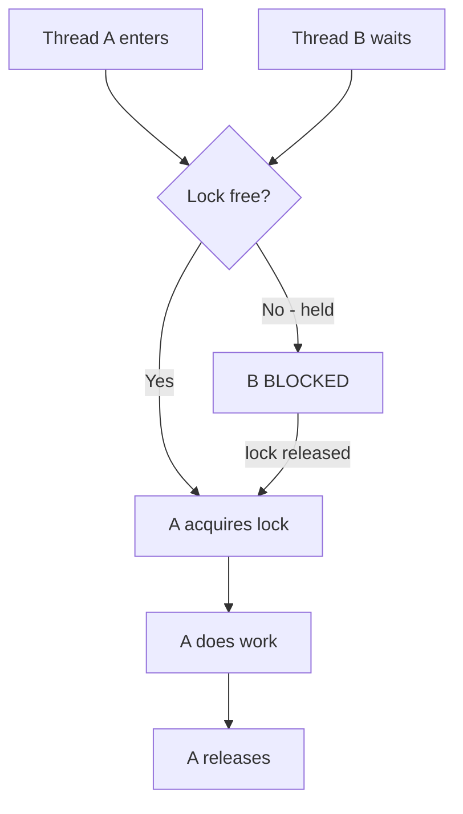

# Thread Synchronization

## 1. Introduction

When threads **share mutable data**, they can corrupt it — a **race condition**. **Synchronization** coordinates threads so only one accesses a critical section at a time, using the `synchronized` keyword (monitor locks).

---

## 2. Why This Topic Is Important

- Race conditions cause intermittent, hard-to-fix bugs.
- Bank balances, counters, and caches all need protection.
- Interviewers always test race conditions and `synchronized`.
- `volatile`, `synchronized`, and `Lock` are daily tools in server code.

---

## 3. Real-World Analogy

Think of a **single bathroom** (critical section). If everyone walks in at once (race), chaos. A lock (monitor) ensures only one person uses it at a time; the others wait outside (BLOCKED) until it's free. Synchronization = the bathroom lock.

---

## 4. Theory

### The Race Condition
```java
// Two threads incrementing a shared counter: value can be lost
counter = counter + 1;   // read-modify-write is NOT atomic
```

### Solutions

**1. synchronized method**
```java
synchronized void increment() { counter++; }
```

**2. synchronized block (lock on an object)**
```java
synchronized (this) { counter++; }
```

**3. volatile (visibility only, not atomicity)**
```java
volatile boolean running = true;   // visible across threads
```

**4. ReentrantLock (java.util.concurrent)**
```java
Lock lock = new ReentrantLock();
lock.lock();
try { counter++; } finally { lock.unlock(); }
```

### synchronized Rules
| Rule | Detail |
|------|--------|
| Monitor per object | Each object has one lock |
| Reentrant | Same thread can re-enter its own lock |
| Auto-release | On method/block exit (even exceptions) |
| static synchronized | Locks the Class object |

---

## 5. Syntax

```java
synchronized void method() { ... }        // whole method
synchronized (obj) { ... }                // block
```

---

## 6. Flow Explanation



---

## 7. Memory Representation

The monitor lives with the object in the heap. Atomicity + visibility are guaranteed inside the synchronized region.

---

## 8. Simple Example — The Bug

```java
public class RaceCondition {
    private static int counter = 0;

    public static void main(String[] args) throws InterruptedException {
        Runnable task = () -> {
            for (int i = 0; i < 1000; i++) counter++;
        };

        Thread t1 = new Thread(task);
        Thread t2 = new Thread(task);
        t1.start();
        t2.start();
        t1.join();
        t2.join();

        System.out.println("Expected 2000, got: " + counter);
    }
}
```
Run it a few times — you'll likely see a number below 2000.

---

## 9. Intermediate Example — The Fix with synchronized

```java
public class FixedCounter {
    private int counter = 0;

    synchronized void increment() {
        counter++;
    }

    synchronized int get() {
        return counter;
    }

    public static void main(String[] args) throws InterruptedException {
        FixedCounter fc = new FixedCounter();

        Runnable task = () -> {
            for (int i = 0; i < 1000; i++) fc.increment();
        };

        Thread t1 = new Thread(task);
        Thread t2 = new Thread(task);
        t1.start();
        t2.start();
        t1.join();
        t2.join();

        System.out.println("Count (synchronized): " + fc.get());
    }
}
```

---

## 10. Advanced Example — Synchronized Block & ReentrantLock

```java
import java.util.concurrent.locks.Lock;
import java.util.concurrent.locks.ReentrantLock;

public class LockDemo {
    private static int balance = 0;
    private static final Lock lock = new ReentrantLock();

    static void deposit(int amt) {
        lock.lock();
        try {
            balance += amt;          // critical section
        } finally {
            lock.unlock();
        }
    }

    public static void main(String[] args) throws InterruptedException {
        Runnable task = () -> {
            for (int i = 0; i < 500; i++) deposit(1);
        };

        Thread t1 = new Thread(task);
        Thread t2 = new Thread(task);
        t1.start();
        t2.start();
        t1.join();
        t2.join();

        System.out.println("Balance: " + balance);
    }
}
```

---

## 11. Output

For the **Simple Example** (varies — that's the point):

```
Expected 2000, got: 1893
```

For the **Intermediate Example** (always correct):

```
Count (synchronized): 2000
```

For the **Advanced Example** (always correct):

```
Balance: 1000
```

---

## 12. Common Mistakes

| Mistake | Correction |
|---------|------------|
| Thinking volatile fixes counting | Volatile = visibility only, NOT atomicity |
| Locking on a mutable field | Lock on a stable object (or this) |
| Forgetting unlock in finally | Use try/finally with ReentrantLock |
| Over-synchronizing everything | Hurts performance; synchronize the minimal section |
| Deadlock with multiple locks | Acquire locks in a consistent order |

---

## 13. Best Practices

- Synchronize the **smallest critical section** possible.
- Prefer `synchronized` for simplicity; `ReentrantLock` for advanced needs.
- Always `unlock()` in `finally`.
- Use `volatile` only for simple flags.
- Prefer thread-safe collections (`ConcurrentHashMap`) when possible.

---

## 14. Interview Questions

**Q1. What is a race condition?**
*Multiple threads modifying shared data without coordination, causing lost/corrupted updates.*

**Q2. What does synchronized guarantee?**
*Mutual exclusion AND memory visibility inside the block.*

**Q3. volatile vs synchronized?**
*volatile guarantees visibility, not atomicity; synchronized gives both.*

**Q4. What is a deadlock?**
*Threads holding locks and waiting on each other forever.*

**Q5. When use ReentrantLock?**
*When you need tryLock, timed locks, or fair locks.*

---

## 15. Practice Exercises

1. Reproduce a counter race (get below expected).
2. Fix it with a synchronized method.
3. Fix it with a synchronized block.
4. Use ReentrantLock with try/finally.

---

## 16. Coding Challenges

1. **Easy:** A thread-safe counter.
2. **Medium:** A thread-safe bank account (deposit/withdraw balance) used by many threads.
3. **Hard:** A producer/consumer (next topic) or a thread-safe queue implemented with locking.

---

## 17. Summary

- Race conditions = unsynchronized shared mutation.
- synchronized = mutual exclusion + visibility.
- volatile = visibility only (flags).
- ReentrantLock for advanced control.
- Synchronize the minimal critical section.

➡️ Continue to: [Thread Communication](Thread-Communication.md)