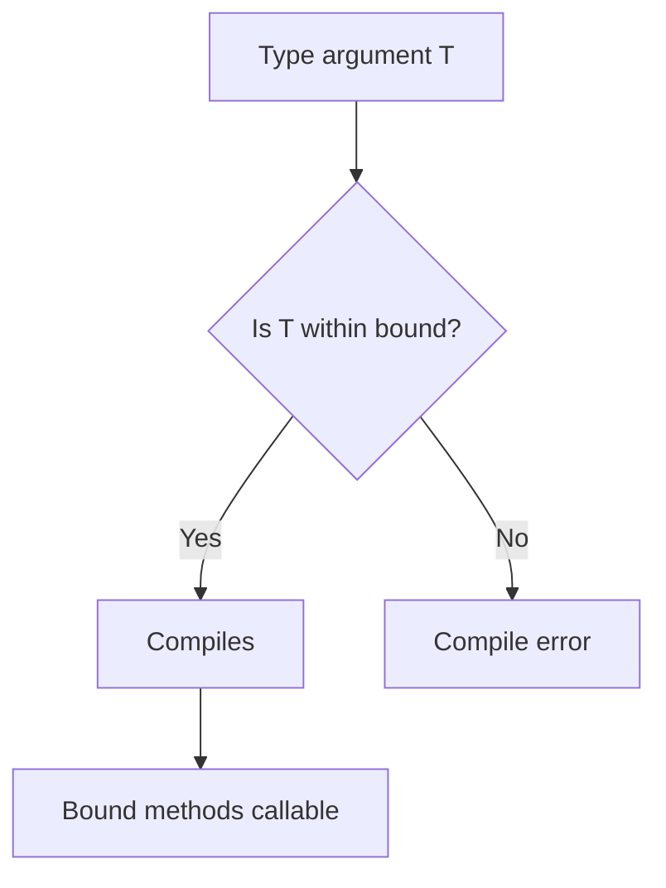

# Bounded Type Parameters

## 1. Introduction

**Bounded type parameters** restrict what types a generic can accept using `extends` — e.g., `<T extends Number>` means T must be a Number or a subclass. This enables calling type-specific methods.

---

## 2. Why This Topic Is Important

- Without bounds, you can only call Object methods on T.
- `Comparable`, `Number`, and custom interfaces are common bounds.
- Interviews test bounded parameters and multiple bounds.
- Sorting and algorithms need `Comparable<T>` bounds.

---

## 3. Real-World Analogy

Think of a **restaurant hiring a "chef"** (bounded generic). Instead of hiring any person (unbounded T), you require someone who can cook (implements a Cooking interface). The bound guarantees the skill so you can rely on it.

---

## 4. Theory

### Single Bound
```java
// T must be a Number or subclass -> can call intValue(), doubleValue()
<T extends Number> double toDouble(T value) {
    return value.doubleValue();
}
```

### Class + Interface Bounds
```java
// T extends a class AND interfaces (class must come first)
<T extends Employee & Comparable<T>> void sort(List<T> list) {
    Collections.sort(list);
}
```

### Why Bounds Matter
| Without bound | With bound |
|---------------|------------|
| Can only call Object methods | Can call bound methods (`doubleValue`) |
| Can't compare | Can use Comparable |

### Bounded Generic Class
```java
class Calculator<T extends Number> {
    double sum(T a, T b) {
        return a.doubleValue() + b.doubleValue();
    }
}
```

---

## 5. Syntax

```java
<T extends Number> returnType method(T arg) { ... }
class MyClass<T extends Comparable<T>> { ... }
<T extends A & B> ...    // class A first, then interfaces
```

---

## 6. Flow Explanation



---

## 7. Memory Representation

Bounds are erased at runtime to the leftmost bound (e.g., `<T extends Number>` erases to `Number`).

---

## 8. Simple Example

```java
public class BoundDemo {
    static <T extends Number> double square(T value) {
        return value.doubleValue() * value.doubleValue();
    }

    public static void main(String[] args) {
        System.out.println("Square 5 (int): " + square(5));
        System.out.println("Square 2.5 (double): " + square(2.5));
        System.out.println("Square 3L (long): " + square(3L));

        // square("hello");  -> compile error: String isn't a Number
    }
}
```

---

## 9. Intermediate Example — Comparable Bound

```java
import java.util.Arrays;
import java.util.List;
import java.util.Collections;

public class ComparableBound {
    // T must implement Comparable<T>
    static <T extends Comparable<T>> T max(List<T> list) {
        T max = list.get(0);
        for (T item : list) {
            if (item.compareTo(max) > 0) {
                max = item;
            }
        }
        return max;
    }

    public static void main(String[] args) {
        System.out.println("Max int: " + max(List.of(4, 9, 2, 7)));
        System.out.println("Max str: " + max(List.of("b", "z", "a")));
    }
}
```

---

## 10. Advanced Example — Class with Bounds & Multiple Bounds

```java
import java.util.Collections;
import java.util.List;
import java.util.ArrayList;

class Employee implements Comparable<Employee> {
    String name;
    int salary;

    Employee(String name, int salary) {
        this.name = name;
        this.salary = salary;
    }

    @Override
    public int compareTo(Employee o) {
        return Integer.compare(this.salary, o.salary);
    }

    @Override
    public String toString() { return name + "(" + salary + ")"; }
}

public class MultiBound {
    // T extends Employee AND Comparable<Employee>
    static <T extends Employee & Comparable<Employee>> void sortAndShow(List<T> list) {
        Collections.sort(list);
        System.out.println("Sorted: " + list);
    }

    public static void main(String[] args) {
        List<Employee> team = new ArrayList<>();
        team.add(new Employee("Ajay", 90000));
        team.add(new Employee("Priya", 70000));
        team.add(new Employee("Ravi", 80000));

        sortAndShow(team);
    }
}
```

---

## 11. Output

For the **Simple Example**:

```
Square 5 (int): 25.0
Square 2.5 (double): 6.25
Square 3L (long): 9.0
```

For the **Intermediate Example**:

```
Max int: 9
Max str: z
```

For the **Advanced Example**:

```
Sorted: [Priya(70000), Ravi(80000), Ajay(90000)]
```

---

## 12. Common Mistakes

| Mistake | Correction |
|---------|------------|
| Using `implements` instead of `extends` | Bounds always use `extends` |
| Class after interface in multiple bounds | Class must come first |
| Expecting String to fit `<T extends Number>` | Bound rejects non-Number |
| Unbounded T when calling bound methods | Add the bound |
| Ignoring erasure to leftmost bound | Know what T becomes at runtime |

---

## 13. Best Practices

- Bound to **interfaces** (`Comparable`, `Runnable`) for flexibility.
- Bound to classes only when you need fields/methods.
- Keep bounds minimal — one interface usually suffices.
- Use `<? extends T>` (wildcards) for producer/consumer cases.
- Combine with wildcards for maximum flexibility.

---

## 14. Interview Questions

**Q1. What is a bounded type parameter?**
*A type parameter restricted to a subtype of a class/interface using `extends`.*

**Q2. Can you have multiple bounds?**
*Yes — one class first, then interfaces: `<T extends A & B>`.*

**Q3. Why does it use extends for interfaces?**
*Historical decision; `implements` isn't used in bounds.*

**Q4. What does the bound become after erasure?**
*The leftmost bound.*

**Q5. When would you bound to Comparable?**
*For generic sorting/max/min algorithms.*

---

## 15. Practice Exercises

1. Write a method bound to `Number` computing absolute value.
2. Write `max` bound to `Comparable`.
3. Create a class `<T extends Employee>` with an overridden bound method.
4. Add two bounds (class + interface) and compile.

---

## 16. Coding Challenges

1. **Easy:** A generic `average<T extends Number>` method.
2. **Medium:** A generic `max/min` utility with Comparable bounds.
3. **Hard:** A generic `Sorter<T extends Comparable<T>>` that sorts and shows employees, then strings.

---

## 17. Summary

- Bounds restrict T: `<T extends Number>`.
- Class bound first, then interfaces.
- Enable type-specific method calls.
- Erase to the leftmost bound.
- Combine with wildcards for power.

➡️ Continue to: [Wildcards](Wildcards.md)