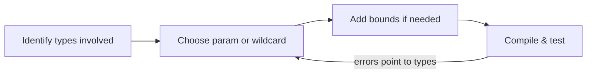

# Exercises — Generics

## 1. Introduction

Practice writing generic, type-safe code: generic classes, bounded parameters, wildcards, and understanding erasure.

---

## 2. Why This Topic Is Important

- Collections and frameworks are built on generics.
- Type-safe code = fewer runtime crashes.
- Interviews test bounds, wildcards, and PECS.
- Your own reusable utilities should be generic.

---

## 3. Real-World Analogy

Practice is like **learning to label and sort a warehouse** — once you master the system (types, bounds, wildcards), every shelf (codebase) is easy to organize safely.

---

## 4. Theory — Recap

- `T`, `E`, `K`, `V` = type parameters.
- `<T extends X>` = bounded.
- `? extends T` = produce (read). `? super T` = consume (write).
- PECS. Erasure removes types at runtime.

---

## 5. Syntax Reminder

```java
class Box<T> { T get() { ... } }
<T extends Comparable<T>> T max(List<T> list) { ... }
void show(List<? extends Animal> list) { ... }
```

---

## 6. Practice Flow



---

## 7. Memory Representation

Skip — compile-time topic.

---

## 8. Simple Exercises

**Ex 1 — Generic Box**
`Box<T>` with get/set; use with String and Integer.

**Ex 2 — Generic Pair**
`Pair<K, V>`; use for (name, age) and (country, capital).

**Ex 3 — Generic Method**
`printAll(List<T>)` printing every element.

---

## 9. Intermediate Exercises

**Ex 4 — Number Bound**
`average(List<? extends Number>)` returning a double.

**Ex 5 — Comparable Max**
`max(List<T extends Comparable<T>>)` returning the largest.

**Ex 6 — Wildcard Show**
`show(List<?>)` printing Object elements.

**Ex 7 — PECS Fill**
`fill(List<? super Integer>)` adding 1–5.

---

## 10. Advanced Exercises

**Ex 8 — Generic Registry**
`Registry<K, V>` with put/get/remove and typed retrieval.

**Ex 9 — PECS Copy**
`copy(List<? extends T> src, List<? super T> dest)`.

**Ex 10 — Class Token**
A `JsonParser<T>` that takes `Class<T>` and parses a string to T (String, Integer, Boolean).

**Ex 11 — Erasure Detective**
Write code showing raw types causing ClassCastException, with comments explaining erasure.

---

## 11. Expected Output Samples

**Ex 4 (average):**
```
Average: 3.5
```

**Ex 9 (PECS copy):**
```
Copied: [Dog, Dog]
```

---

## 12. Common Mistakes

| Mistake | Fix |
|---------|-----|
| Raw types everywhere | Use generics + diamond |
| Writing into `? extends` | Use `? super` |
| `new T()` | Class token / factory |
| Reading `? super` as T | Only Object guaranteed |
| Unchecked warnings ignored | Investigate heap pollution |

---

## 13. Best Practices

- Type-safe always; no raw types.
- Diamond `<>` for inference.
- PECS for wildcards.
- Bounds only when needed.
- Understand erasure implications.

---

## 14. Interview Practice Questions

**Q1.** Why generics over Object?
**Q2.** What is a bounded type parameter?
**Q3.** Explain PECS with an example.
**Q4.** What is type erasure?
**Q5.** Why can't you create `new T()`?

---

## 15. Self-Check

- [ ] I can write generic classes and methods.
- [ ] I use bounded parameters correctly.
- [ ] I apply PECS with wildcards.
- [ ] I can explain type erasure.
- [ ] I avoid raw types and heap pollution.
- [ ] I use Class tokens when runtime type is needed.

---

## 16. Next Steps

- Move to [Module 16 — Java 8 Features](../16-Java-8-Features/README.md).
- Streams and lambdas rely on generic types heavily.

---

## 17. Summary

- Generics = compile-time type safety.
- Bounds restrict; wildcards flex.
- PECS guides read/write.
- Erasure explains runtime behavior.
- Type-safe everywhere — no raw types.

➡️ Module complete! Continue to [16 — Java 8 Features](../16-Java-8-Features/README.md).