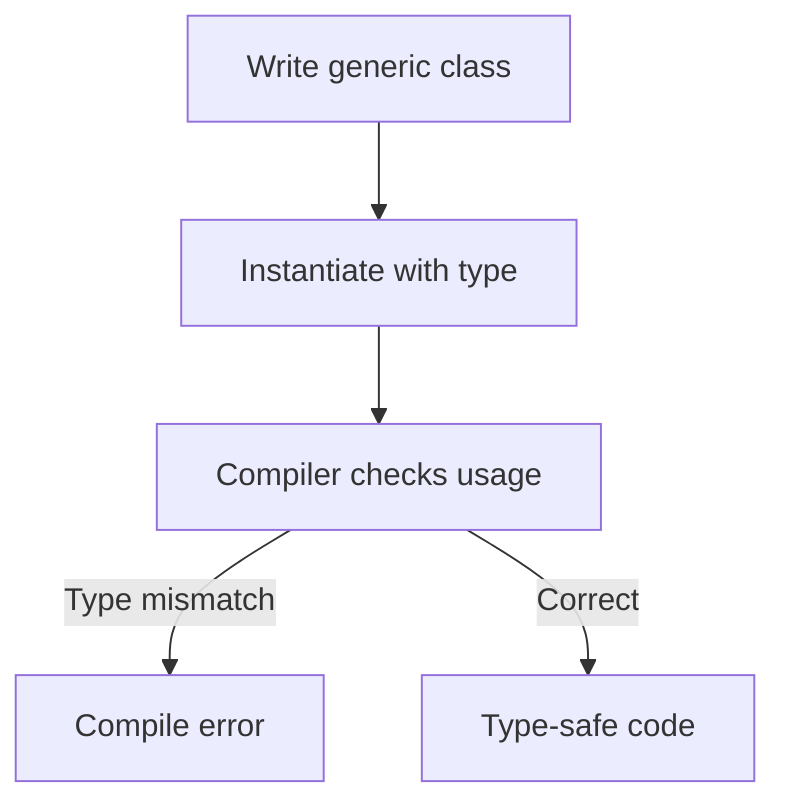

# Generics Basics

## 1. Introduction

**Generics** add type parameters (`<T>`) to classes, interfaces, and methods. They let you write one piece of code that works with many types **safely** — errors surface at compile time, not runtime.

---

## 2. Why This Topic Is Important

- Collections (`List<T>`, `Map<K,V>`) are generic — you use them daily.
- Generics eliminate unsafe casts and ClassCastException.
- Interviewers test generic classes, methods, and conventions.
- Every framework API is full of generics.

---

## 3. Real-World Analogy

Think of a **universal box with a label**. One box design (generic class) works for anything, but you label it: "Books" or "Shoes" (type parameter). The label tells everyone what's inside, and you can't stuff the wrong item past the labeled door (compile-time check).

---

## 4. Theory

### Generic Class
```java
class Box<T> {
    private T value;
    Box(T value) { this.value = value; }
    T get() { return value; }
}

Box<String> stringBox = new Box<>("hello");
Box<Integer> intBox = new Box<>(42);
```

### Type Parameter Conventions
| Letter | Meaning |
|--------|---------|
| `T` | Type |
| `E` | Element (collections) |
| `K` | Key |
| `V` | Value |
| `N` | Number |

### Generic Method
```java
static <T> T identity(T value) {
    return value;
}
String s = identity("x");
```

### Why Generics?
| Without generics | With generics |
|------------------|---------------|
| `List list` holds Objects | `List<String>` holds strings |
| Cast needed: `(String) list.get(0)` | No cast |
| Errors at runtime | Errors at compile time |
| Unsafe | Type-safe |

---

## 5. Syntax

```java
class MyClass<T> {
    private T field;
    T method(T arg) { return arg; }
}

<T> T genericMethod(T arg) { return arg; }
```

---

## 6. Flow Explanation



---

## 7. Memory Representation

Generics are a compile-time concept; at runtime the type is erased (Type Erasure topic). No extra memory.

---

## 8. Simple Example

```java
class Box<T> {
    private T value;

    Box(T value) { this.value = value; }

    T get() { return value; }

    void set(T value) { this.value = value; }
}

public class GenericBoxDemo {
    public static void main(String[] args) {
        Box<String> strBox = new Box<>("Java");
        System.out.println("String box: " + strBox.get());

        Box<Integer> intBox = new Box<>(100);
        System.out.println("Integer box: " + intBox.get());

        // strBox.set(42);  -> compile error (type safe!)
    }
}
```

---

## 9. Intermediate Example — Generic Pair

```java
class Pair<K, V> {
    private final K key;
    private final V value;

    Pair(K key, V value) {
        this.key = key;
        this.value = value;
    }

    K getKey() { return key; }
    V getValue() { return value; }

    @Override
    public String toString() {
        return key + "=" + value;
    }
}

public class PairDemo {
    public static void main(String[] args) {
        Pair<String, Integer> age = new Pair<>("Ajay", 25);
        Pair<String, String> city = new Pair<>("India", "Chennai");

        System.out.println(age);
        System.out.println(city);

        String name = age.getKey();     // no cast
        Integer years = age.getValue();
        System.out.println(name + " is " + years);
    }
}
```

---

## 10. Advanced Example — Generic Method & Type Inference

```java
import java.util.ArrayList;
import java.util.List;

public class GenericMethodDemo {
    // generic method: reverse any list
    static <T> List<T> reverse(List<T> list) {
        List<T> result = new ArrayList<>();
        for (int i = list.size() - 1; i >= 0; i--) {
            result.add(list.get(i));
        }
        return result;
    }

    public static void main(String[] args) {
        List<String> names = List.of("Ajay", "Priya", "Ravi");
        System.out.println("Reversed: " + reverse(names));

        List<Integer> nums = List.of(1, 2, 3, 4);
        System.out.println("Reversed: " + reverse(nums));   // type inferred
    }
}
```

---

## 11. Output

For the **Intermediate Example**:

```
Ajay=25
India=Chennai
Ajay is 25
```

For the **Advanced Example**:

```
Reversed: [Ravi, Priya, Ajay]
Reversed: [4, 3, 2, 1]
```

---

## 12. Common Mistakes

| Mistake | Correction |
|---------|------------|
| Raw types: `List list` | Use `List<String>` |
| Casting generic results | Generics eliminate the need |
| Creating `new T()` | Not allowed (erasure) — use a factory/Class<T> |
| Static fields of type T | Static fields can't use class type params |
| Unbounded wildcard misuse | Next topic covers wildcards |

---

## 13. Best Practices

- Use the diamond `<>` for instantiation.
- Use descriptive letters (T, E, K, V) by convention.
- Prefer generic methods over Object parameters.
- Never use raw types — they disable safety.
- Keep generic constraints (bounds) minimal.

---

## 14. Interview Questions

**Q1. What are generics?**
*Type parameters letting code work with any type, with compile-time type safety.*

**Q2. Why use generics over Object?**
*No casts, compile-time errors instead of runtime ClassCastException.*

**Q3. What is the diamond operator?**
*`<>` — lets the compiler infer type arguments: `new ArrayList<>()`.*

**Q4. Can you instantiate a generic type?**
*No — `new T()` is illegal due to erasure.*

**Q5. What are common conventions?**
*T (type), E (element), K/V (key/value), N (number).*

---

## 15. Practice Exercises

1. Build a generic `Box<T>` with get/set.
2. Build a `Pair<K, V>` and use it.
3. Write a generic method that returns the larger of two Comparable values.
4. Convert a raw-type List program to generics.

---

## 16. Coding Challenges

1. **Easy:** A generic `Storage<T>` with add/get/size.
2. **Medium:** A generic `Utils` class with a `reverse` and `toList` method.
3. **Hard:** A generic repository-style class `Registry<K, V>` storing entities with typed retrieval.

---

## 17. Summary

- Generics = type parameters with compile-time safety.
- Generic classes, interfaces, methods all supported.
- Diamond `<>` for inference.
- No runtime instances of T (erasure).
- No raw types — safety first.

➡️ Continue to: [Bounded Type Parameters](Bounded-Type-Parameters.md)