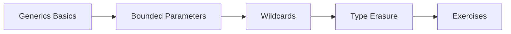

# 15 — Generics

> **Experience level: 🟠 Intermediate (1 – 2 years)**

**Generics** let you write classes and methods that work with **any type**, while catching type mistakes at **compile time**. `List<String>`, `Map<K, V>`, and custom generic classes are all generics.

---

## 📂 Files in This Module

| File | What You'll Learn |
|------|-------------------|
| [Generics-Basics.md](Generics-Basics.md) | Type parameters, generic classes and methods |
| [Bounded-Type-Parameters.md](Bounded-Type-Parameters.md) | Restricting types with extends |
| [Wildcards.md](Wildcards.md) | ?, ? extends, ? super |
| [Type-Erasure.md](Type-Erasure.md) | How generics work under the hood |
| [Exercises.md](Exercises.md) | Practice tasks for this module |

---

## 🎯 Learning Objectives

By the end of this module, you will be able to:

1. ✅ Write generic classes and methods.
2. ✅ Use bounded type parameters.
3. ✅ Apply wildcards (? extends / ? super) correctly.
4. ✅ Explain type erasure and its implications.
5. ✅ Build type-safe, reusable utilities.

---

## 🧭 Module Map



---

## 📌 Quick Preview

```java
class Box<T> {
    private T value;
    Box(T value) { this.value = value; }
    T get() { return value; }
}

Box<String> box = new Box<>("hello");
String s = box.get();      // no cast needed
```

---

## Next Module

➡️ [16 — Java 8 Features](../16-Java-8-Features/README.md) — lambdas, streams, and modern Java.