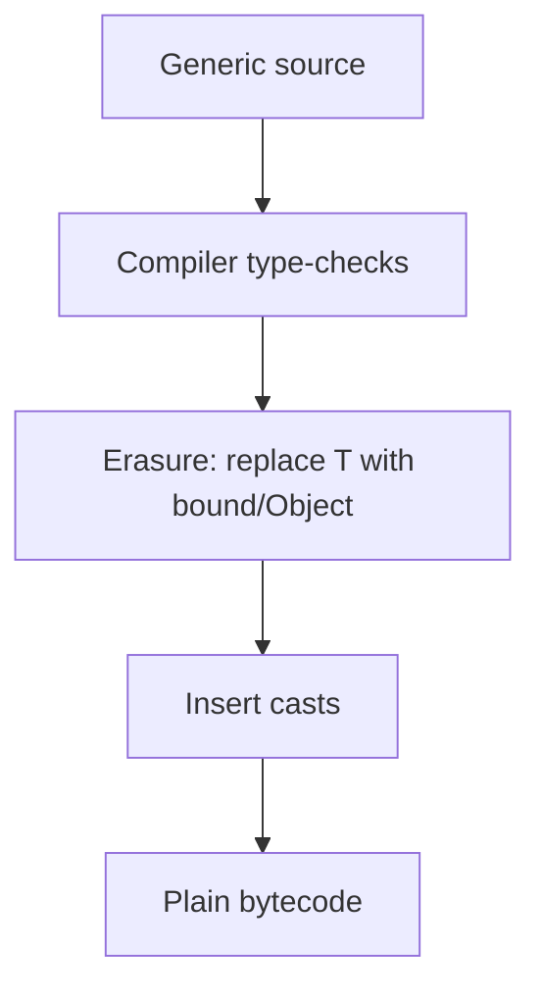

# Type Erasure

## 1. Introduction

**Type erasure** is how the JVM implements generics: the compiler **removes** generic type information at compile time, replacing type parameters with their bounds (or Object). At runtime, a `List<String>` is just a `List`.

---

## 2. Why This Topic Is Important

- Explains why `new T()` is illegal and casts appear in bytecode.
- Interviewers ask "what is type erasure?"
- Explains heap pollution and unchecked warnings.
- Bridges generics and legacy raw-type code.

---

## 3. Real-World Analogy

Think of **labels on moving boxes**. Before the move, you label boxes "Kitchen," "Books" (generics) — the movers know where things go. But once on the truck, all boxes look identical (erased to plain boxes). The labels existed only during packing (compilation), not during the trip (runtime).

---

## 4. Theory

### What Erasure Does
| Generic code | After erasure (runtime) |
|--------------|--------------------------|
| `List<String>` | `List` (raw) |
| `Box<T>` | `Box` (fields/methods use Object) |
| `<T extends Number>` | T replaced with `Number` |
| `<T extends A & B>` | T replaced with `A` (leftmost) |
| `T t` | `(Object) t` or bound type |

### The Inserted Casts
```java
List<String> list = new ArrayList<>();
String s = list.get(0);
```
Compiles to:
```java
List list = new ArrayList();
String s = (String) list.get(0);   // cast inserted by compiler
```

### Consequences
| Consequence | Detail |
|-------------|--------|
| No `new T()` | No runtime type info |
| No `instanceof T` | Illegal — T erased |
| No generic arrays `T[]` | Can't create at runtime |
| Heap pollution | Unchecked casts may corrupt |
| Raw type interop | `List` and `List<String>` coexist |

---

## 5. Syntax (what you can't do)

```java
// ALL illegal because of erasure:
T value = new T();              // no
if (obj instanceof T) { }       // no
T[] arr = new T[10];            // no
```

---

## 6. Flow Explanation



---

## 7. Memory Representation

At runtime, all type parameters are gone. The JVM sees raw Object-typed fields and cast instructions.

---

## 8. Simple Example — What the compiler sees

```java
import java.util.List;
import java.util.ArrayList;

public class ErasureDemo {
    public static void main(String[] args) {
        List<String> names = new ArrayList<>();     // erased to List
        names.add("Java");
        names.add("Spring");

        String first = names.get(0);                // cast inserted
        System.out.println(first);
    }
}
```
Bytecode-equivalent after erasure:
```java
List names = new ArrayList();
names.add("Java");
String first = (String) names.get(0);
```

---

## 9. Intermediate Example — Raw Type Danger

```java
import java.util.List;
import java.util.ArrayList;

public class RawTypeDemo {
    public static void main(String[] args) {
        List<String> strings = new ArrayList<>();
        strings.add("safe");

        List raw = strings;                      // raw view (unchecked)
        raw.add(42);                             // heap pollution!

        // Danger:
        try {
            String s = strings.get(1);           // cast fails!
            System.out.println(s);
        } catch (ClassCastException e) {
            System.out.println("Caught: " + e.getMessage());
        }
    }
}
```

---

## 10. Advanced Example — Bridging Erasure with a Class<T>

```java
public class ClassTokenDemo<T> {
    private final Class<T> type;

    ClassTokenDemo(Class<T> type) {
        this.type = type;       // the class token survives erasure
    }

    T cast(Object o) {
        return type.cast(o);    // runtime type check via reflection
    }

    public static void main(String[] args) {
        ClassTokenDemo<String> d = new ClassTokenDemo<>(String.class);
        String s = d.cast("hello");
        System.out.println("Cast ok: " + s);

        try {
            d.cast(42);                         // fails at runtime
        } catch (ClassCastException e) {
            System.out.println("Refused int: " + e.getMessage());
        }
    }
}
```

---

## 11. Output

For the **Intermediate Example**:

```
Caught: class java.lang.Integer cannot be cast to class java.lang.String
```

For the **Advanced Example**:

```
Cast ok: hello
Refused int: class java.lang.Integer cannot be cast to class java.lang.String
```

---

## 12. Common Mistakes

| Mistake | Correction |
|---------|------------|
| `new T()` | Illegal — pass a Class<T> or factory |
| `instanceof T` | Illegal — erased |
| Generic arrays `T[]` | Use `List<T>` instead |
| Ignoring unchecked warnings | They signal possible heap pollution |
| Mixing raw types | Causes runtime ClassCastException |

---

## 13. Best Practices

- Accept that runtime doesn't know T — design accordingly.
- Pass `Class<T>` tokens when runtime type info is needed.
- Prefer `List<T>` over `T[]`.
- Avoid raw types entirely.
- Pay attention to `@SuppressWarnings("unchecked")` sites.

---

## 14. Interview Questions

**Q1. What is type erasure?**
*The compiler removing generic type information at runtime, replacing T with Object/bounds and inserting casts.*

**Q2. Why can't you do `new T()`?**
*Because T is erased at runtime — no type info to instantiate.*

**Q3. What is heap pollution?**
*When a raw type lets a wrong-type object into a generic collection, causing ClassCastException later.*

**Q4. How do you get runtime type info?**
*Pass `Class<T>` as a parameter (class token).*

**Q5. Does erasure have performance cost?**
*Minimal — just inserted casts.*

---

## 15. Practice Exercises

1. Explain (comment) what the compiler does to a generic method.
2. Create heap pollution with a raw type and observe the failure.
3. Use a Class<T> token to implement a type-safe cast.
4. List the four things erasure forbids.

---

## 16. Coding Challenges

1. **Easy:** A `Stringify<T>` that converts T to String (works via toString).
2. **Medium:** A generic `cache` that needs runtime class tokens for typed get.
3. **Hard:** A generic utility that, given `Class<T>`, parses strings into T instances via reflection (String/Integer/Boolean).

---

## 17. Summary

- Erasure removes generics at runtime.
- T → Object/bounds; casts inserted by the compiler.
- No `new T()`, `instanceof T`, or `T[]`.
- Raw types cause heap pollution.
- Class tokens bring runtime type info back.

➡️ Continue to: [Exercises](Exercises.md)